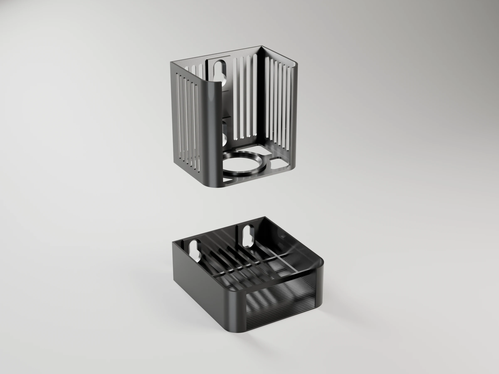
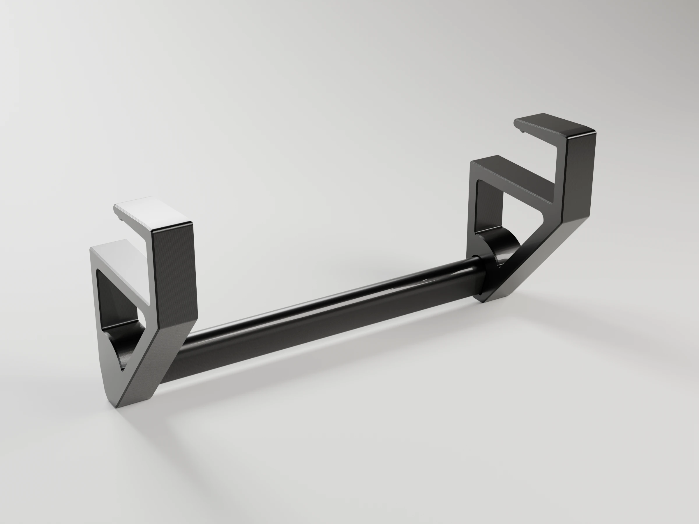
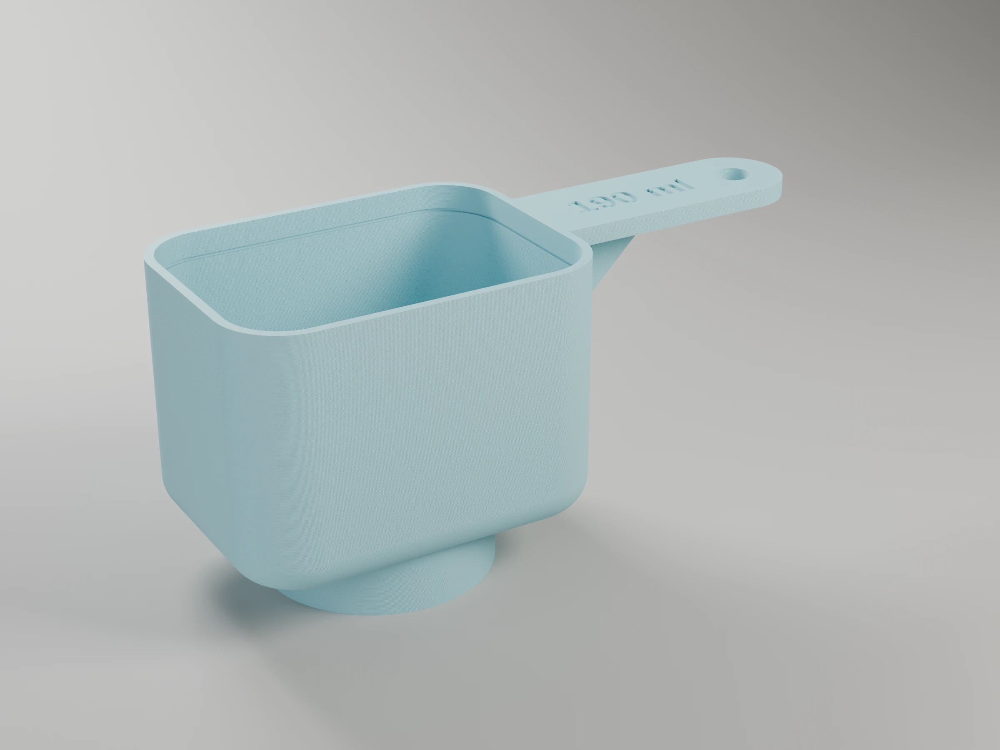

# 3d-models

| | Project |
|---|---|
|  | [soap-caddy](projects/soap-caddy/) — wall-mounted holder on suction cups for an upside-down dish soap bottle over a sponge cradle that drains into the sink (OpenSCAD) |
|  | [desk-hanger-rail](projects/desk-hanger-rail/) — clip-on rail under the desk edge for coat hangers, two C brackets and a bar (OpenSCAD) |
|  | [lattice-bowl](projects/lattice-bowl/) — parametric lattice bowl (OpenSCAD) |
|  | [detergent-scoop](projects/detergent-scoop/) — measuring scoop with an exact, parametric capacity that sits on the bottle cap (OpenSCAD) |
|  | [remote-stand](projects/remote-stand/) — two-row stepped stand for TV remotes, ribbed (v1) or channelled (v2) (OpenSCAD) |
|  | [cosmere-tracker](projects/cosmere-tracker/) — two-sided Health / Focus / Investiture wheels for the Cosmere RPG, multi-colour inlays (OpenSCAD) |

The models live in [`projects/`](projects/), one folder each. Everything they share lives in
[`tools/`](tools/): `bambu3mf.py` builds each project's ready-to-print Bambu Studio 3MF
(`make project`, `make report`), `render_studio.py` renders it in Blender (`make render`), and
[`tools/scad/`](tools/scad/) is the OpenSCAD library of functional components (mounts, joints,
holes, the house style), each one researched, documented in [CLAUDE.md](CLAUDE.md) and printable
as a sample. See [tools/README.md](tools/README.md).
