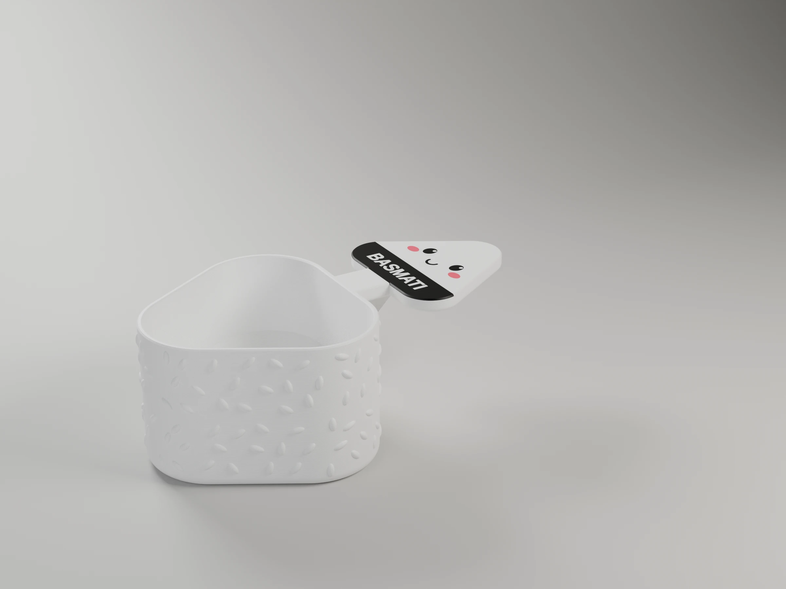

# 3d-models

| | Project |
|---|---|
|  | [dog-gate](projects/dog-gate/) — a plywood board across a stair tread on two printed brackets, nothing fixed to the stair: a simple version that stands it in bolted shoes over 275 mm feet, and a reinforced one hooked under an open stair's tray tread, with battens, that holds a leaning dog; tipping by statics and MuJoCo, the board and bracket by FEA; P1S and X2D (OpenSCAD) |
|  | [onigiri-rice-scoop](projects/onigiri-rice-scoop/) — a kawaii onigiri scoop that holds 100 g of rice levelled off, one per rice (basmati, brown), face and nori as multi-colour inlays, PLA Pure for food contact (OpenSCAD) |
|  | [sink-organizers](projects/sink-organizers/) — a soap caddy and a cutlery drainer for either side of the tap, on one pattern: a wall plate on suction cups and a body slid onto it on dovetails, with lift-out boxes and bins over drip trays that drain into the sink (OpenSCAD) |
|  | [desk-hanger-rail](projects/desk-hanger-rail/) — clip-on rail under the desk edge for coat hangers, two C brackets and a bar (OpenSCAD) |
|  | [lattice-bowl](projects/lattice-bowl/) — parametric lattice bowl (OpenSCAD) |
|  | [detergent-scoop](projects/detergent-scoop/) — measuring scoop with an exact, parametric capacity that sits on the bottle cap (OpenSCAD) |
|  | [remote-stand](projects/remote-stand/) — two-row stepped stand for TV remotes, ribbed (v1) or channelled (v2) (OpenSCAD) |
|  | [cosmere-tracker](projects/cosmere-tracker/) — two-sided Health / Focus / Investiture wheels for the Cosmere RPG, multi-colour inlays (OpenSCAD) |

The models live in [`projects/`](projects/), one folder each. Everything they share lives in
[`tools/`](tools/): `bambu3mf.py` builds each project's ready-to-print Bambu Studio 3MF
(`make project`, `make report`), `render_studio.py` renders it in Blender (`make render`), and
[`tools/scad/`](tools/scad/) is the OpenSCAD library of functional components (mounts, joints,
holes, the house style), each one researched, documented in [CLAUDE.md](CLAUDE.md) and printable
as a sample. [`tools/fea/`](tools/fea/) is the load analysis (gmsh + CalculiX) for parts that
carry a load, and the design-study workflow that tunes them; [`tools/stability/`](tools/stability/)
is the tipping analysis (statics and MuJoCo) for pieces that stand free; [`tools/materials/`](tools/materials/)
holds the filaments' data sheets. See [tools/README.md](tools/README.md).

## License

The models (`projects/` and the OpenSCAD library in `tools/scad/`) are
[CC BY-NC-SA 4.0](https://creativecommons.org/licenses/by-nc-sa/4.0/): use, print, remix and share them, crediting this
repository and sharing remixes under the same licence, but **not commercially**: selling them,
their prints or their files needs the author's permission. The code (the Python and build tooling)
is [MIT](LICENSE). Details in [LICENSE](LICENSE).
