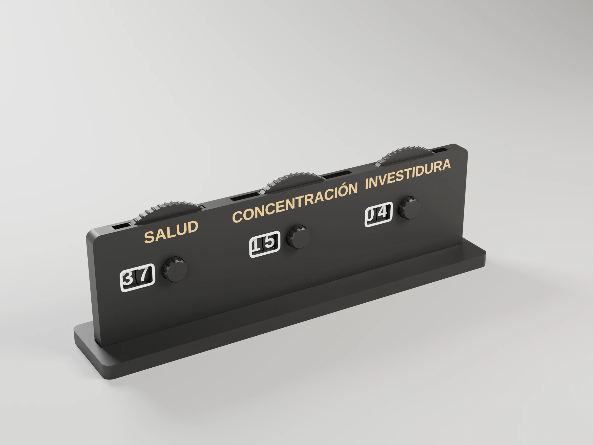

# Cosmere tracker

Health, Focus and Investiture tracker for the Cosmere RPG. Each stat counts
00–99 and **reads the same from both sides of the table**: the player sees it
from the front, everyone else from the back.



Each wheel is an outer ring (tens) around an inner disc (units), with digits
on both faces. The front window sits at 9 o'clock and the back one at
3 o'clock, so both sides read tens on the left and units on the right. Turn
the ring by its ridged edge on top and the disc by the knob on the front.

```sh
make project                                # -> cosmere-tracker-p1s.3mf (Bambu Studio, ready to print)
make report                                 # rebuild it, slice it, print time and filament
make                                        # -> frame.3mf front.3mf wheels.3mf stand.3mf
make DEFS='-D show_investiture=false'       # only Health and Focus
make DEFS='-D digit_h=6'                    # smaller (and narrower) tracker
make stl                                    # single-colour STLs instead
make preview                                # -> cosmere-tracker-front.png / -back.png (OpenSCAD)
make render                                 # -> renders/*.webp, studio views with Blender
```

The default is about 200 × 59 × 8 mm (plus the knobs) with 7 mm digits;
`digit_h` scales the wheels and the whole housing. The console prints the
size.

## Printing (multi-colour, e.g. Bambu P1S + AMS)

`make project` builds `cosmere-tracker-p1s.3mf`, a Bambu Studio project with
every part on one plate (3 rings, 3 discs, front, frame and stand) and each
colour already assigned to a filament: P1S 0.4 nozzle, *0.20mm Standard*
with the Arachne wall generator and no elephant foot compensation (so the
thin strokes of the first-layer labels survive), Textured PEI plate, Bambu PLA Basic in slots 1 (body), 2 (labels) and 3
(digits and rims). Colours only change in the first three layers and in the
top three of the wheels, so one plate costs about ten filament changes:
roughly 3 h 30 min and 112 g. Map the three slots to your AMS when sending
it. It needs Bambu Studio installed (its CLI fills in the full presets).

To build your own plate instead:

Digits, labels and window rims are 0.6 mm flush inlays (3 layers at 0.2 mm),
exported as separate coloured objects. In Bambu Studio open each 3MF, answer
**Yes** to loading it as a single object with multiple parts, and give each
part its filament. The default uses three: body `#1b1b1b`, digits and rims
`#f2f2f2`, labels `#e0b040` — change `label_colors` for one colour per stat.

| file         | what                                   | orientation            |
|--------------|----------------------------------------|------------------------|
| `frame.3mf`  | back plate + walls + alignment pegs    | back face on the bed   |
| `front.3mf`  | front plate                            | front face on the bed  |
| `wheels.3mf` | 3 rings (tens) + 3 discs with knob     | as laid out            |
| `stand.3mf`  | base with a slot                       | as laid out            |

No supports needed. The colour changes only happen in the first and last
layers of each part, so purge waste is small.

## Renders

`make render` builds the project and renders studio views of the assembled tracker (OpenSCAD's `assembly`
part, each colour in its filament) and of the print plate with Blender
(`../tools/render_studio.py`), in the project's filaments and with layer lines
at its layer height. 2400 x 1800 WebP, ready for MakerWorld's model images;
add `RENDER_FLAGS="--samples 32 --scale 0.25"` for a quick draft.
The parts print flat, so on the assembly the layer lines run across the
thickness (`--layer-axis y`).

| | Hero | Front | Side | Top | Back |
|---|---|---|---|---|---|
| Assembly |  |  |  |  |  |

| Plate, hero | Plate, top |
|---|---|
|  |  |

OpenSCAD previews (`make preview`): [front](cosmere-tracker-front.png) · [back](cosmere-tracker-back.png).

## Assembly

1. Drop each disc into its ring, knob up, and both into a round pocket of the
   frame.
2. Press the front plate on, with the knobs through the holes. The pegs are a
   snug fit; add a drop of glue if they are loose.
3. Stand it in the base.

Tune `gap_z`, `wheel_gap`, `hub_play` and `ring_play` if the wheels bind or
spin too freely on your printer.
