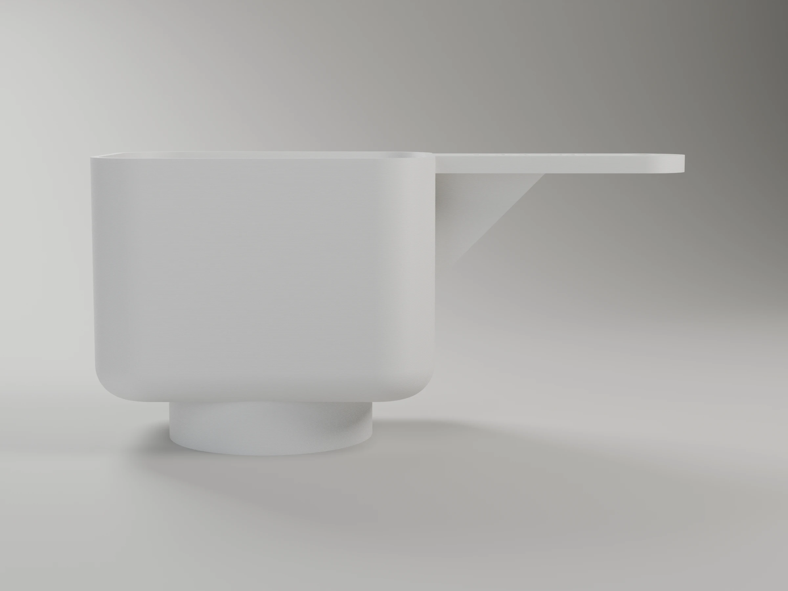
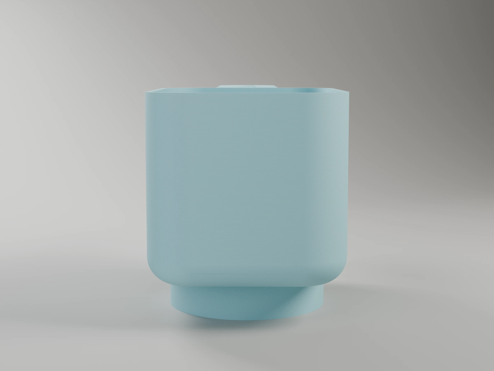
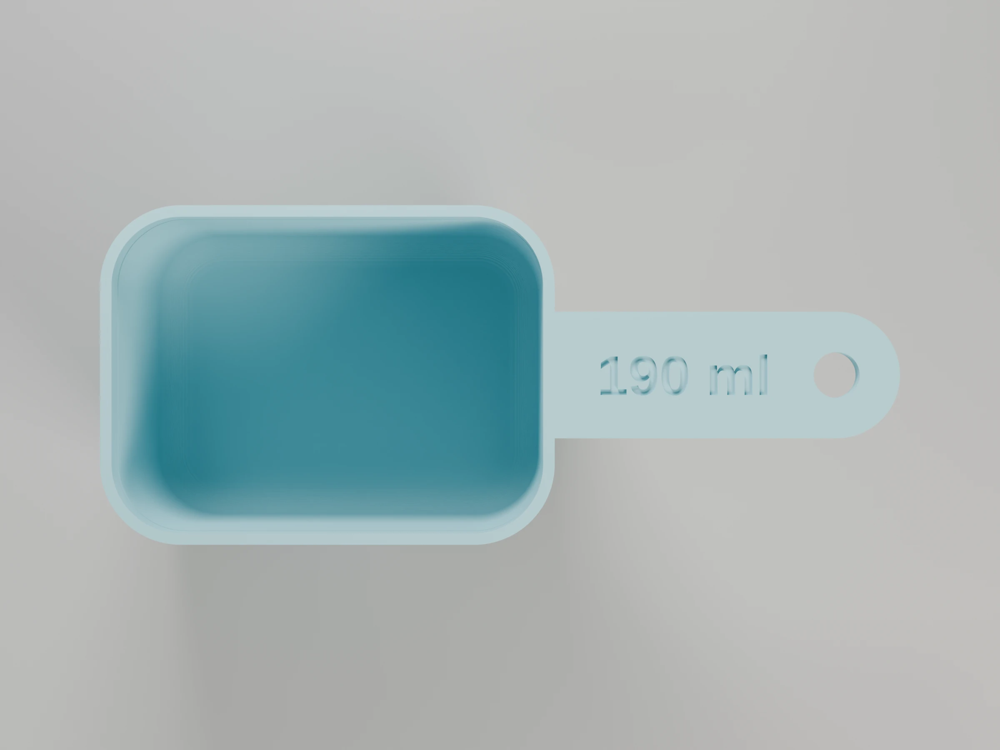
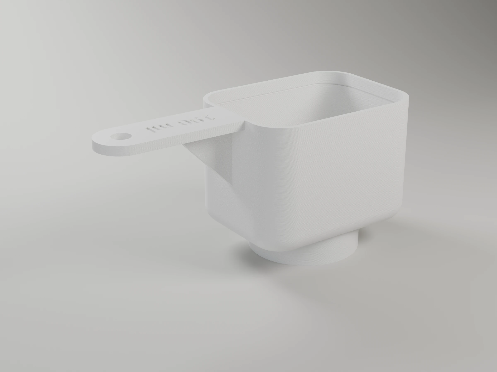

# Detergent scoop

Rounded-rectangle measuring scoop that holds exactly `capacity_ml` (190 ml by
default) up to an engraved fill line. The cup depth is solved from the
capacity and the footprint, bottom fillet included, so the measure stays exact
whatever you change. A collar under the floor fits over the bottle cap, so the
scoop can be stored sitting on top of the bottle.


```sh
make project                                   # -> detergent-scoop-p1s.3mf (Bambu Studio, ready to print)
make report                                    # rebuild it, slice it, print time and filament
make                                           # -> detergent-scoop.stl
make DEFS='-D cap_d=38'                        # fit it to your bottle cap
make DEFS='-D capacity_ml=150 -D inner_l=65'
make check                                     # prints the real cavity volume
make OPENSCAD_FLAGS=--backend=Manifold         # OpenSCAD >= 2025, much faster
make preview                                   # -> detergent-scoop.png (OpenSCAD, quick look; not committed)
make render                                    # -> renders/*.webp, studio views with Blender
```

Measure the widest point of your bottle cap and set `cap_d`; `cap_clearance`
and the small `grip_ribs` inside the collar set how snug it sits. If the
collar is wider than the cup, the cup width grows to fit it (the depth is then
recalculated). The console prints the fill-line height and total size.

## Parameters

All lengths in mm. Override any of them with `make DEFS='-D name=value'` (also
`make project`, `make report` and `make render`).

| Parameter | Default | What it does |
|---|---|---|
| **Capacity** | | |
| `capacity_ml` | 190 | Volume up to the fill line; the cup depth is solved from it. Also the text on the handle |
| `headroom` | 6 | Wall above the fill line, so it doesn't spill |
| **Cup** | | |
| `inner_l` | 75 | Inside length, along the handle |
| `inner_w` | 55 | Inside width (grows if the collar needs it) |
| `corner_r` | 12 | Inside corner radius, seen from above (≤ half the smaller side) |
| `bottom_fillet` | 6 | Inside radius between floor and walls (≤ `corner_r` and ≤ fill height) |
| `wall` | 2 | Wall thickness |
| `floor_t` | 2 | Floor thickness |
| **Fill line** | | |
| `fill_mark` | true | Groove around the inside just above the fill level |
| `mark_h` | 0.8 | Groove height |
| `mark_depth` | 0.6 | Groove depth into the wall |
| **Handle** | | |
| `handle_l` | 60 | Length from the cup wall to the tip |
| `handle_w` | 22 | Handle width |
| `handle_t` | 4 | Handle thickness |
| `hang_hole_d` | 8 | Hanging hole near the tip (0 = none) |
| `label` | true | Engrave the capacity on the handle |
| `label_size` | 7 | Letter height of the label |
| `label_depth` | 0.6 | Engraving depth |
| **Bottle mount** | | |
| `mount` | true | Collar under the floor that fits over the bottle cap |
| `cap_d` | 45 | Bottle cap diameter at its widest point (measure yours) |
| `cap_clearance` | 0.4 | Added to the cap diameter |
| `collar_h` | 12 | How far the cap goes into the collar |
| `collar_wall` | 2 | Collar wall thickness |
| `grip_ribs` | 6 | Small vertical ribs inside the collar for a snug fit (0 = none) |
| `rib_bump` | 0.5 | How far each rib sticks in |
| **Render** | | |
| `part` | `scoop` | `scoop` or `cavity` (the volume up to the fill line, used by `make check`) |

## Variations

The measure stays exact whatever footprint you choose, so the same model works
as any kind of measuring scoop. Without a bottle to sit on, set `mount=false`
and hang it from the hole. Checked with the console (`make check` prints the
real volume).

| Use | Parameters | Result |
|---|---|---|
| Liquid detergent (default) | — | 190 ml, sits on a Ø45 mm cap, 68 mm tall |
| Your detergent / softener bottle | `-D cap_d=38 -D capacity_ml=150 -D inner_l=65` | Measure the cap and the dose on the label |
| **Rice cup** (1 *gō*, 180 ml) | `-D capacity_ml=180 -D mount=false -D inner_l=70 -D inner_w=60` | The Japanese rice-cooker cup, 53 mm tall |
| Coffee scoop (~10 g ground coffee) | `-D capacity_ml=30 -D mount=false -D inner_l=45 -D inner_w=32 -D corner_r=10 -D bottom_fillet=6 -D headroom=4 -D handle_l=70 -D handle_w=14 -D label_size=5 -D hang_hole_d=5` | 30 ml (2 tablespoons), long slim handle |
| Protein / formula powder | `-D capacity_ml=75 -D mount=false -D inner_l=55 -D inner_w=45 -D corner_r=12 -D bottom_fillet=8 -D headroom=5` | 75 ml; check the dose in ml on your tub |
| Pet food / bird seed | `-D capacity_ml=250 -D mount=false -D inner_l=90 -D inner_w=70 -D corner_r=15 -D bottom_fillet=8` | 250 ml (about one cup of kibble), 50 mm tall |

For food, see the food-contact notes in the root `CLAUDE.md` (§8): PLA or PETG,
occasional use, and the layer lines are hard to clean.

## Printing (Bambu P1S)

`make project` builds `detergent-scoop-p1s.3mf`, a Bambu Studio project with
the scoop already upside down (rim and handle on the bed, collar on top) on a
Textured PEI plate: P1S 0.4 nozzle, *0.20mm Standard* with gyroid infill,
Bambu PLA Matte Ice Blue in slot 1. No supports needed. About 1 h and 51 g with the
default parameters (`make report` prints the figures for your parameters). It
needs Bambu Studio installed.

The floor of the cup prints as a bridge over the cavity. For a detergent that
is harsh on PLA, switch the filament to PETG HF in Bambu Studio.

## Renders

`make render` builds the project and renders studio views of the scoop, turned cup up, with Blender
(`../tools/render_studio.py`), in the project's filaments and with layer lines
at its layer height. 2400 x 1800 WebP, ready for MakerWorld's model images;
add `RENDER_FLAGS="--samples 32 --scale 0.25"` for a quick draft.

| | Hero | Front | Side | Top | Back |
|---|---|---|---|---|---|
|  |  |  |  |  |  |

