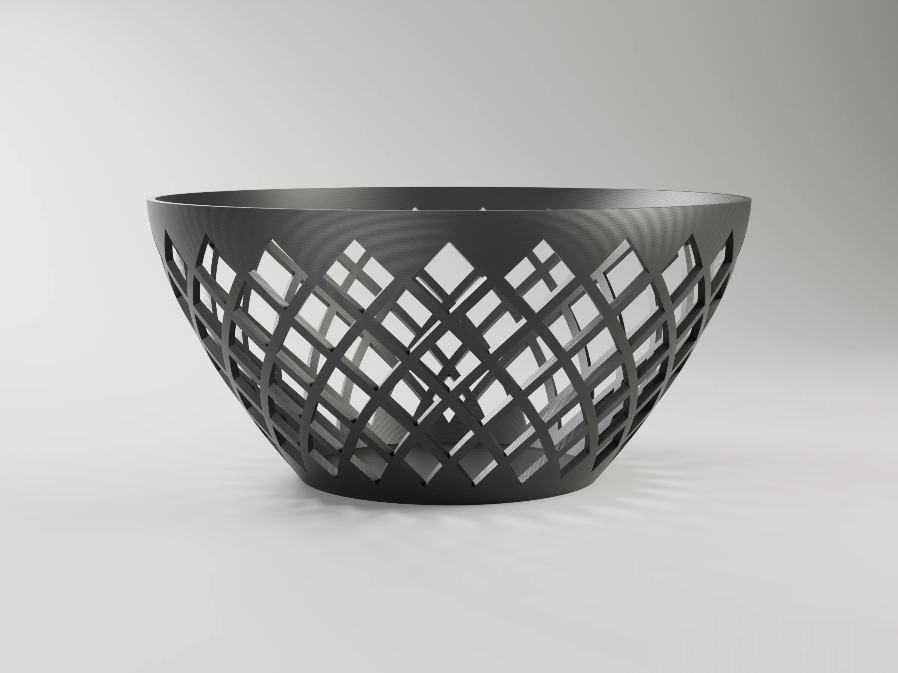
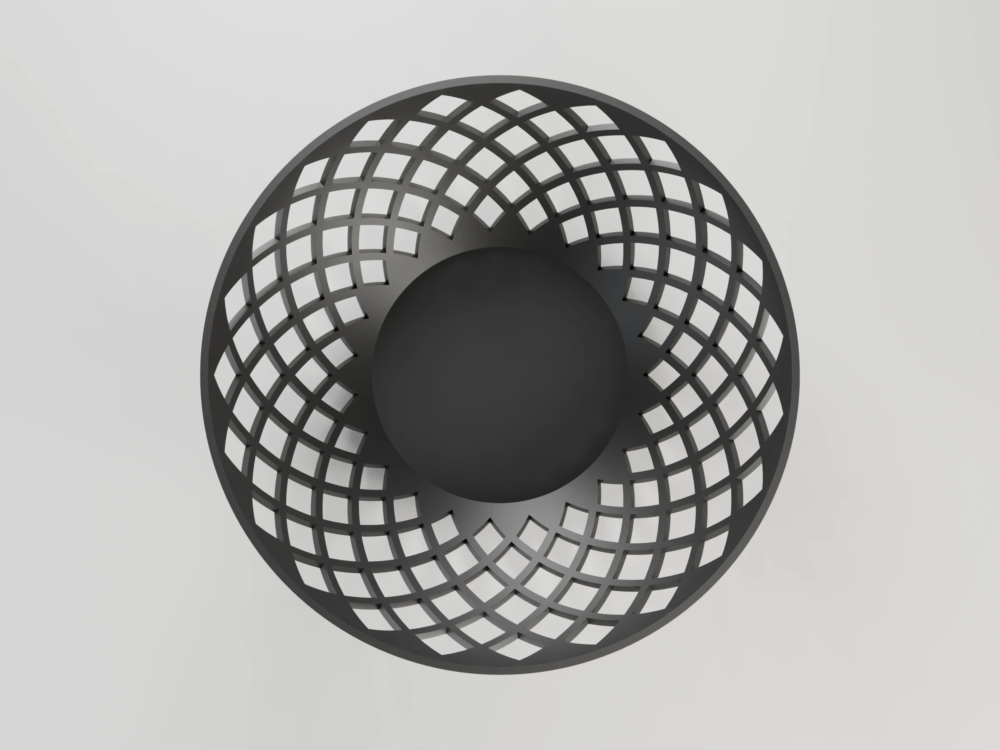
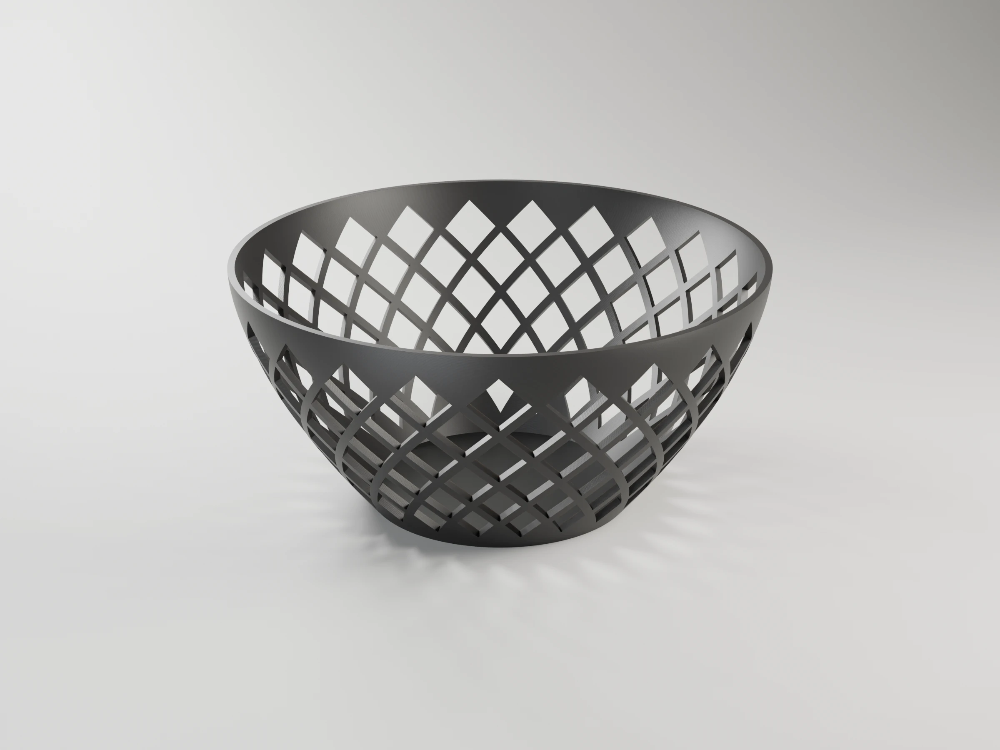

# Lattice bowl

Parametric decorative bowl with a diagonal lattice of diamond openings that
follow the wall curvature. Printable without supports.


```sh
make project                                   # -> lattice-bowl-p1s.3mf (Bambu Studio, ready to print)
make report                                    # rebuild it, slice it, print time and filament
make                                           # -> lattice_bowl.stl
make DEFS='-D top_diameter=200 -D rod_width=2.5'
make OPENSCAD_FLAGS=--backend=Manifold         # OpenSCAD >= 2025, much faster
make preview                                   # -> lattice_bowl.png (OpenSCAD)
make render                                    # -> renders/*.webp, studio views with Blender
# or directly:
openscad -o lattice_bowl.stl lattice_bowl.scad
```

All parameters are at the top of `lattice_bowl.scad` (also editable from the
OpenSCAD Customizer). The console prints the number of rows/columns, the
maximum wall tilt, and the minimum overhang angle, with a warning if any of
them is out of the safe range for support-free printing.

## Printing (Bambu P1S)

`make project` builds `lattice-bowl-p1s.3mf`, a Bambu Studio project with the
bowl standing on its base on a Textured PEI plate: P1S 0.4 nozzle,
*0.16mm Optimal* with Precise wall, Bambu PLA Basic in slot 1. The thinner
layers show less stepping on the flared wall and hold the diamond edges
better. About 4 h 30 min and 72 g with the default parameters (`make report`
prints the figures for your parameters). It needs Bambu Studio installed.

## Renders

`make render` builds the project and renders studio views of the bowl with Blender
(`../tools/render_studio.py`), in the project's filaments and with layer lines
at its layer height. 2400 x 1800 WebP, ready for MakerWorld's model images;
add `RENDER_FLAGS="--samples 32 --scale 0.25"` for a quick draft.

| | Hero | Front | Side | Top | Back |
|---|---|---|---|---|---|
|  |  |  |  |  |  |

OpenSCAD preview (`make preview`): [lattice_bowl.png](lattice_bowl.png).
