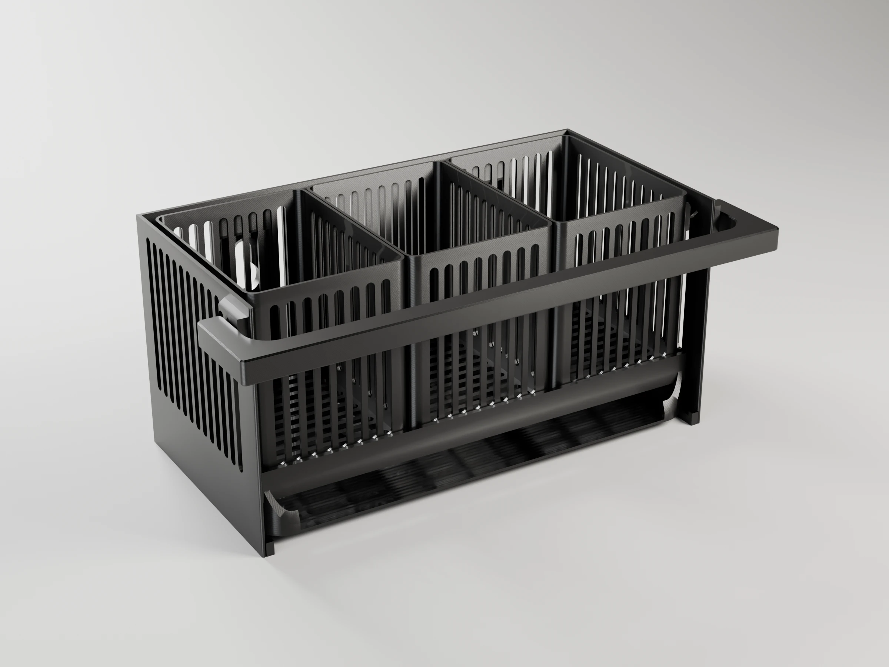
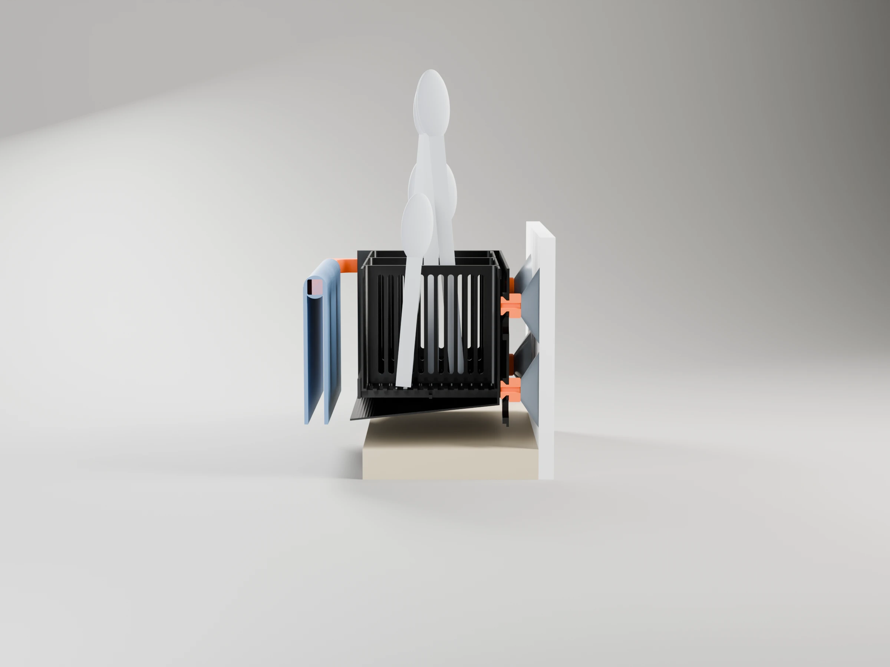
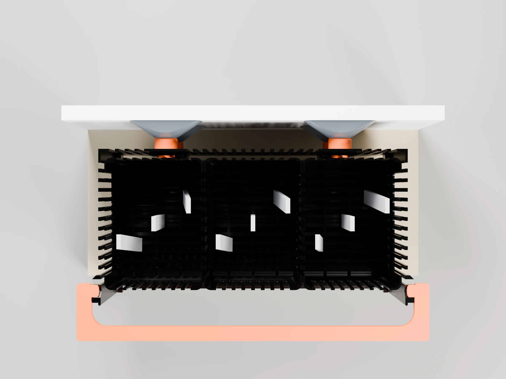
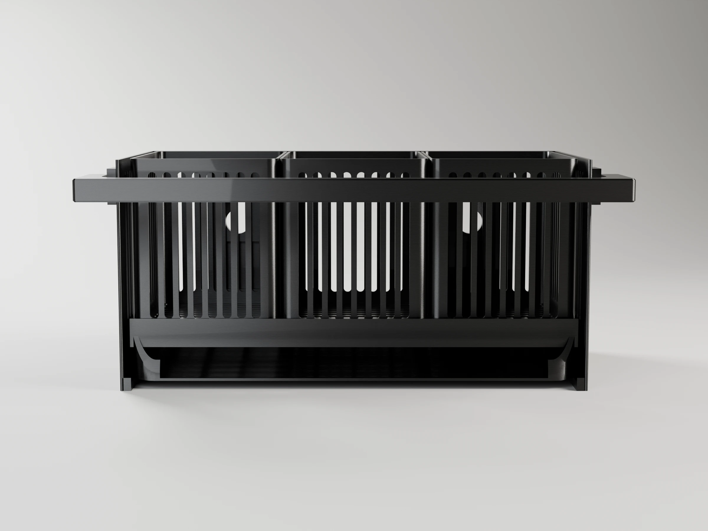
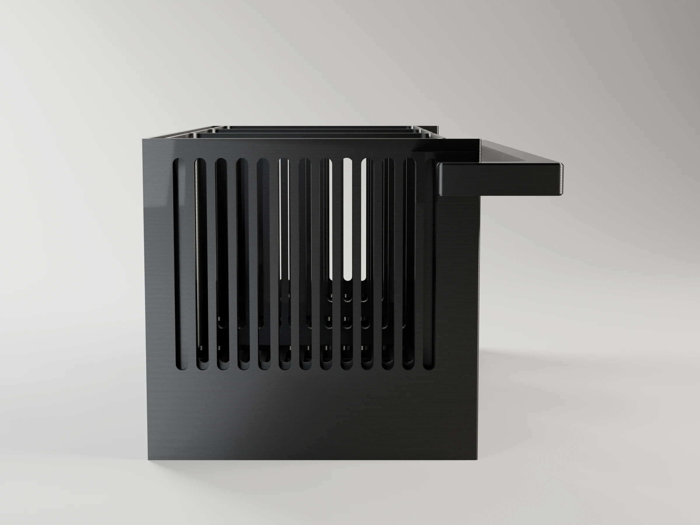
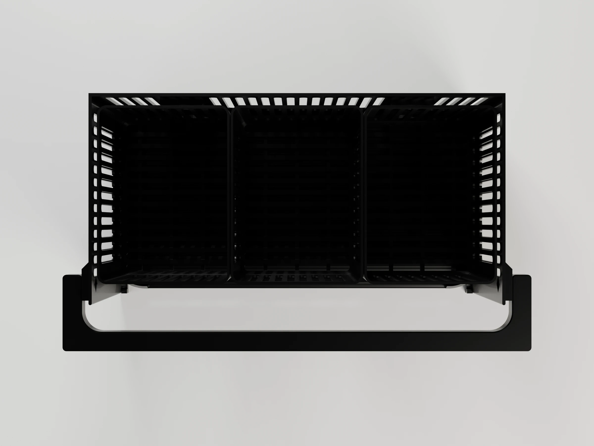
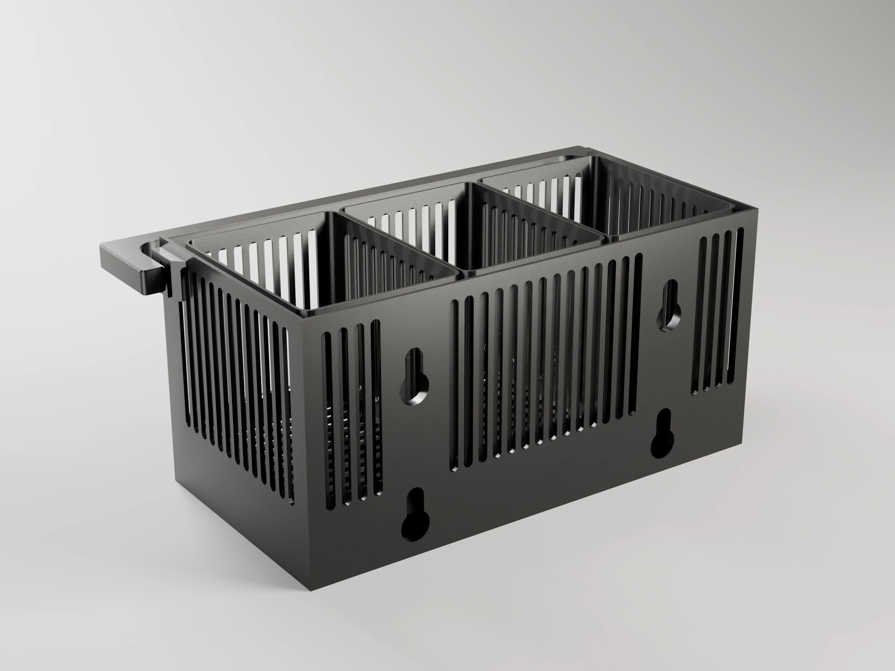
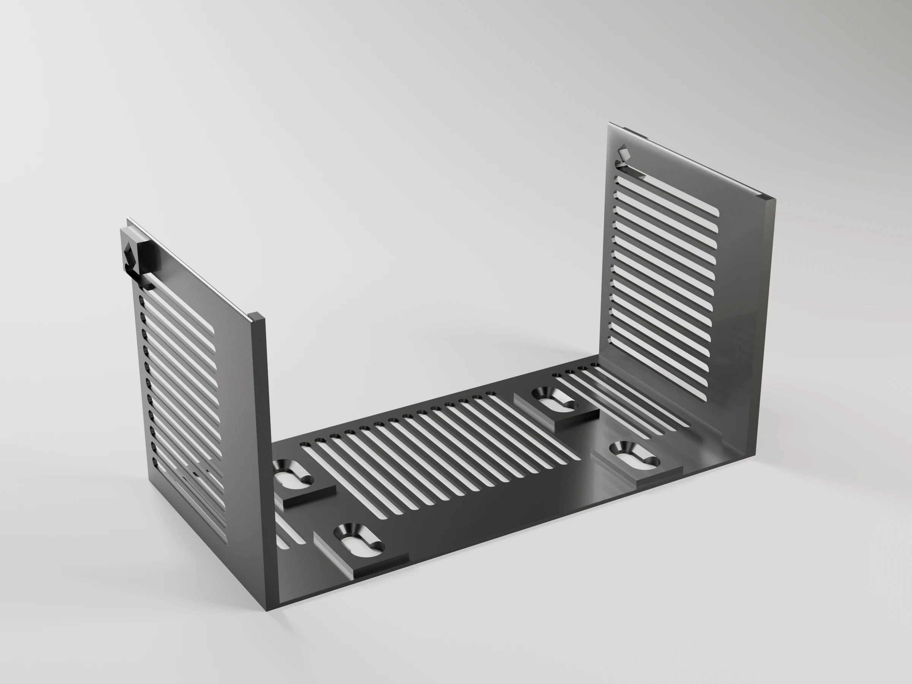
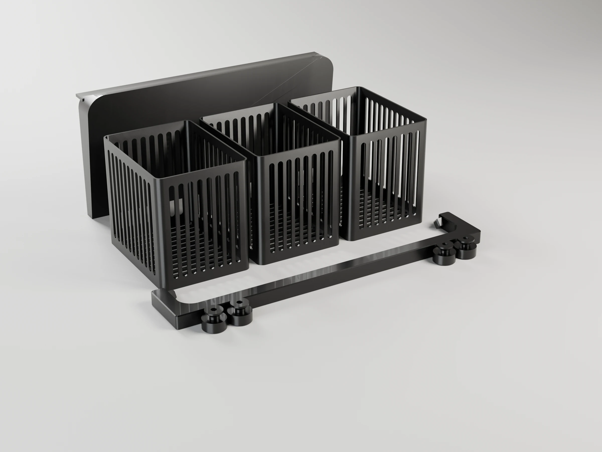

# Cutlery drainer

A wall-mounted drainer for the cutlery, on the other side of the tap from the
[soap caddy](../soap-caddy/), in the same design: a straight back on the
wall, rounded front corners, close rounded slots, hung on suction cups. Three
bins hold the cutlery; they drain onto a tray that slopes forward and spills
into the sink; a handle across the front holds the dish towel.

Every piece that stays wet comes out on its own, to wash it or to reprint it
when the knives have scored it:

- **Frame**: the back plate and two side walls. It stays on the wall.
- **Tray**: the floor that drains into the sink, with the slats the bins
  stand on. It rests on ledges in the frame and slides out to the front.
- **Bins**: three open boxes with slotted floors. They lift out.
- **Towel handle**: a U in front of everything, snapped onto both side walls.



```sh
make project                                   # -> cutlery-drainer-p1s.3mf (Bambu Studio, ready to print)
make report                                    # rebuild it, slice it, print time and filament per plate
make                                           # -> one STL per part
make project DEFS='-D bins=2 -D bin_h=70'      # two bins, lower
make render                                    # -> renders/*.webp, studio views with Blender
make help                                      # every target
```

## How it hangs and drains



Four suction cups (Ø 50 mm, M4 × 10 stud: a second DIYexpert pack, the first
one is on the soap caddy) in two rows of two, `cup_span` (120 mm) apart and
`cup_pitch` (55 mm) one above the other. The frame hangs on them through
keyholes over printed buttons (orange above), as the soap caddy does. The
cutlery and the wet towel hang well in front of the wall; the two rows take
that turning moment, the top pair in tension and the bottom pair pressing on
the wall. Lift the frame 12 mm (`drop`) to take it off.

- **Bins**: 67 × 90 mm each, 80 mm tall (`bin_h`). Your current drainer is
  130 mm tall; this one is low enough to pick a teaspoon out, and longer
  knives stand out of it. Every wall and the floor are slotted, so the
  cutlery airs and drips through.
- **Tray**: the bins stand on slats; the water drips through onto a floor
  that slopes 6° forward and spills over the front edge, 124 mm from the
  wall, 9 mm past the edge of the sink (`sink_dist`; `front_lip` moves it). A tie across the
  front of the slats keeps the bins in place. The back and side rims keep
  the water off the frame.
- **Taking it apart**: lift the bins out; lift the front of the tray 2 mm
  over the bumps at the ends of the ledges (`ledge_stop`) and slide it out
  to the front, under the handle. Everything goes in the other way round.

## The towel handle



The handle is a U in front of the whole frame: the bar runs 14 mm
(`towel_gap`) clear of the front, so the towel hangs over the sink and drips
into it, and the arms run back outside the side walls. Fold the towel over the
bar.

It must not move when you pull the towel off, so it is a **sprung handle**
(`sprung_handle` from [tools/scad](../../tools/scad/), CLAUDE.md §4.7): spread
the arms a little and let them close, and a 6 mm diamond pin at the end of
each arm snaps 5 mm into a socket in a boss on each side wall. The pins only
come out if you spread the arms again, so pulling the towel up or forward
cannot unseat it, and being square they cannot turn. Seated, the arms carry
no preload (their free spacing is the frame's width plus 0.4 mm), so the
PETG does not creep. Putting it on strains the bar 0.8 %, under the 1 %
allowed for a part taken on and off; the console prints it. Try the fit on
plate 3 first: `pin_play` (0.15 mm per side) loosens or tightens it.

The handle prints flat: the towel's weight bends it in the bed plane, along
the lines, and the pins lie in the bed plane too.

## Installing

1. Clean the tile with isopropyl alcohol; on tile that is not quite smooth, a
   very thin film of petroleum jelly on each cup rim seals much better.
2. Screw a button onto each cup by turning the cup: the M4 stud taps its own
   thread into the 3.4 mm hole.
3. Hang the frame on its buttons on the table, press the whole frame against
   the wall pushing over each cup, then lift it off and back on to check it
   slides.
4. Spread the handle's arms and snap its pins into the side walls, slide the
   tray in and drop the bins in.

Measure `cup_h` (wall to the hub face of a pressed cup) once the cups are on
the wall: it sets how far the tray reaches.

## Parts

| Part | Size (mm) | Notes |
|---|---|---|
| `frame` | 218 × 107 × 104 | Back plate, side walls with ledges, the handle's bosses; printed lying on its back |
| `tray` | 206 × 98 × 28 | Sloping floor, slats, rims; printed lying on its back |
| `bin` | 67 × 90 × 80 | Three; printed standing on their floors |
| `handle` | 239 × 39 × 10 | The U with its two diamond pins; printed flat |
| `button` | Ø 16 × 11 | One per cup (4); printed on its flange |
| `test_pin` | 45 × 51 × 16 | Fit test: a block with a socket on each side and a small handle |

## Strength and orientation

Each loaded part checked against its load, derating PETG to 40 % across the
layers (CLAUDE.md §2.3). Loads: 1 kg of wet cutlery, bins and tray (≈10 N,
≈77 mm from the wall) and a wet towel (≈3 N, 148 mm from the wall).

| Part | Load | Printed | Across the layers? | Margin |
|---|---|---|---|---|
| Cups | ≈1 N·m of turning moment over two rows 55 mm apart: ≈9 N pull on each top cup, ≈3 N of shear on each | — | — | a Ø 50 mm cup on tile holds a few times that; four cups, not two |
| `handle` | the towel on a 230 mm bar held at both ends: ≈0.1 N·m at mid-span | flat: the U in XY | no | > 50×; under 1 mm of sag |
| `handle` pins | ≈1.5 N of shear each, plus the strain of putting it on (0.8 %) | pins flat, sockets on their side | no | 6 mm diamond pins; the strain is under the 1 % limit |
| `frame` side walls | the tray and bins on the ledges, cantilevered from the back plate | on its back: bending along Z | yes | > 100× (the walls are 105 mm deep beams) |
| `frame` keyholes | the whole drainer on four buttons | on its back: the slot lips in XY | no | as on the soap caddy |
| `bin` floors | cutlery standing on slotted floors over 18 mm slat spacing | standing | no | — |

## Parameters

All lengths in mm. Override any of them with `make DEFS='-D name=value'` (also
`make project`, `make report` and `make render`). The console prints the
sizes, the cup heights and how far the tray reaches; asserts stop the build if
it does not reach past the sink or the cups do not fit.

| Parameter | Default | What it does |
|---|---|---|
| **Size** | | |
| `frame_w` | 210 | Width along the wall |
| `bins`, `bin_d`, `bin_h` | 3, 90, 80 | Number of bins, their depth and height |
| **Kitchen** | | |
| `sink_dist` | 115 | Wall to the inner edge of the sink bowl: the tray must reach past it |
| `counter_gap` | 15 | Counter to the bottom of the frame (preview and checks) |
| **Suction cups and keyholes** | | As in the soap caddy: `cup_d`, `cup_h`, `stud_len`, `stud_hole`, `shank_d`, `head_d`, `keyhole_play`, `shank_play`, `drop`, `pad_t`, `pad_w` |
| `cup_span`, `cup_pitch` | 120, 55 | Distance between the cups of a row, and between the rows |
| **Frame** | | |
| `back_t`, `side_t` | 1.68, 1.68 | Back plate and side walls |
| `ledge_w`, `ledge_h`, `ledge_stop` | 3.36, 4, 2 | Ledges under the tray; the bump at their front ends |
| `front_lip` | 8 | Tray floor in front of the bins, where the water spills |
| `towel_gap` | 14 | Room for the towel between the front of the frame and the handle |
| **Tray** | | |
| `tray_play`, `tray_t`, `tray_wall` | 0.4, 1.26, 1.68 | Clearance in the frame, floor, rims |
| `tray_slope` | 6 | Floor slope towards the sink, degrees |
| `slat_w`, `slat_h`, `slat_pitch`, `slat_clear` | 2.1, 5, 18, 3 | Slats under the bins |
| `stop_h` | 8 | Tie across the front of the bins |
| **Bins** | | |
| `bin_wall`, `bin_floor`, `bin_r`, `bin_play` | 1.26, 1.6, 5, 0.5 | Walls, floor, corner radius, clearance |
| **Towel handle** | | |
| `handle_s`, `handle_drop` | 10, 12 | Section; pin axes below the top of the frame |
| `pin_s`, `pin_len`, `pin_play` | 6, 5, 0.15 | Diamond pins and their clearance in the sockets |
| `boss_t`, `boss_w`, `handle_play` | 4.2, 16, 0.4 | Bosses round the sockets; clearance between the arms and the bosses |
| **Style** | | `corner_r` (tray front corners), `slot_w`, `slot_rib`, `slot_margin`, as in the soap caddy |

## Printing (Bambu P1S)

`make project` builds `cutlery-drainer-p1s.3mf` on a Textured PEI plate: P1S
0.4 nozzle, *0.20mm Standard* with gyroid infill, the seam at the back, scarf
seam and precise outer walls. Black Bambu PETG Basic in slot 1. No supports:
the frame and the tray lie on their backs, so their walls, ledges, slats and
sloping floor all print upright; the bins stand on their floors; the handle
lies flat. With the default parameters:

| Plate | Contents | Time | Filament |
|---|---|---|---|
| 1 · Frame | frame | 3 h 05 min | 63 g |
| 2 · Tray, bins and handle | tray, 3 bins, handle, 4 buttons | 7 h 42 min | 144 g |
| 3 · Handle fit test | block and small handle | 28 min | 8 g |

The keyhole fit test is the soap caddy's (same keyholes and buttons). PETG
bonds hard to the textured plate: use a glue stick as a release layer, and let
the plate cool before removing the parts.

## Renders

`make render` builds the project and renders the drainer, the two sections
on the wall (`-D section="keyhole"` through a keyhole, `"handle"` level
with the handle's pins, with cutlery and towel; mates in orange) and the print plates
with Blender (`../../tools/render_studio.py`). 2400 × 1800 WebP; add
`RENDER_FLAGS="--samples 32 --scale 0.25"` for a quick draft.

| Hero | Front | Side | Top | Back |
|---|---|---|---|---|
|  |  |  |  |  |

Plates:  
