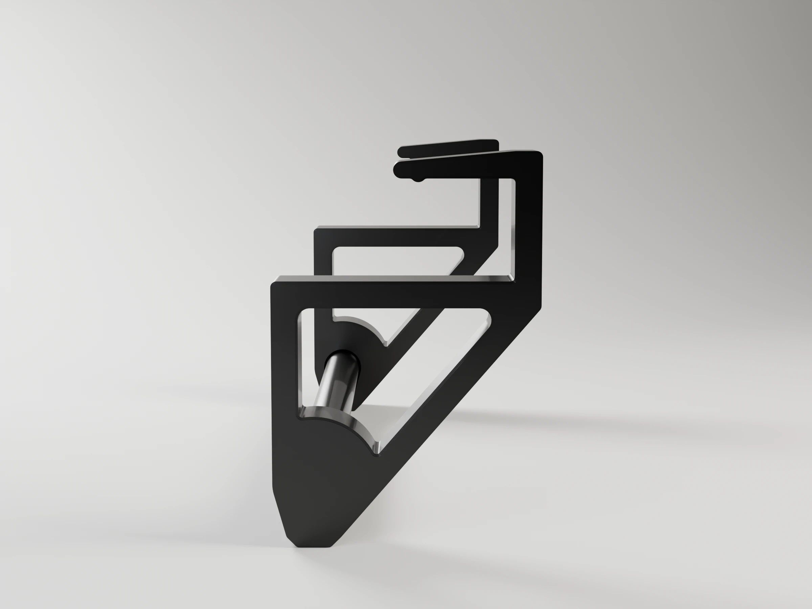
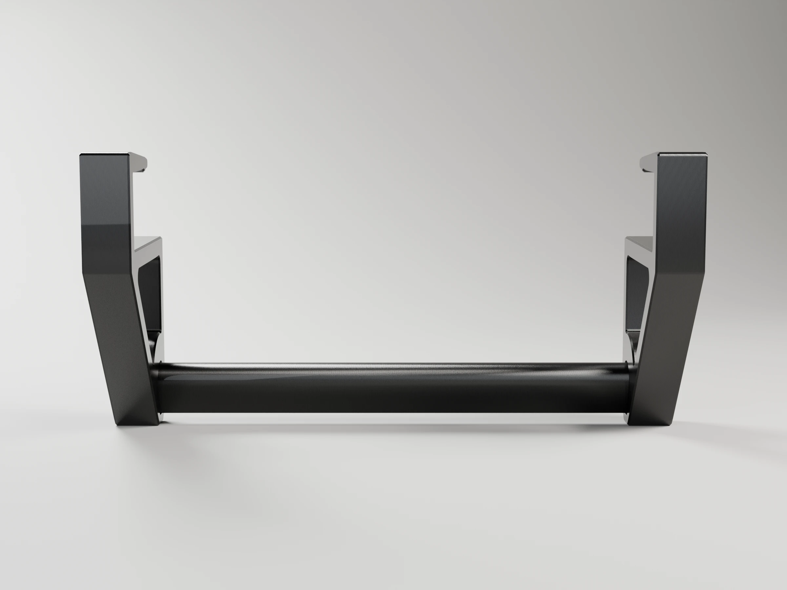
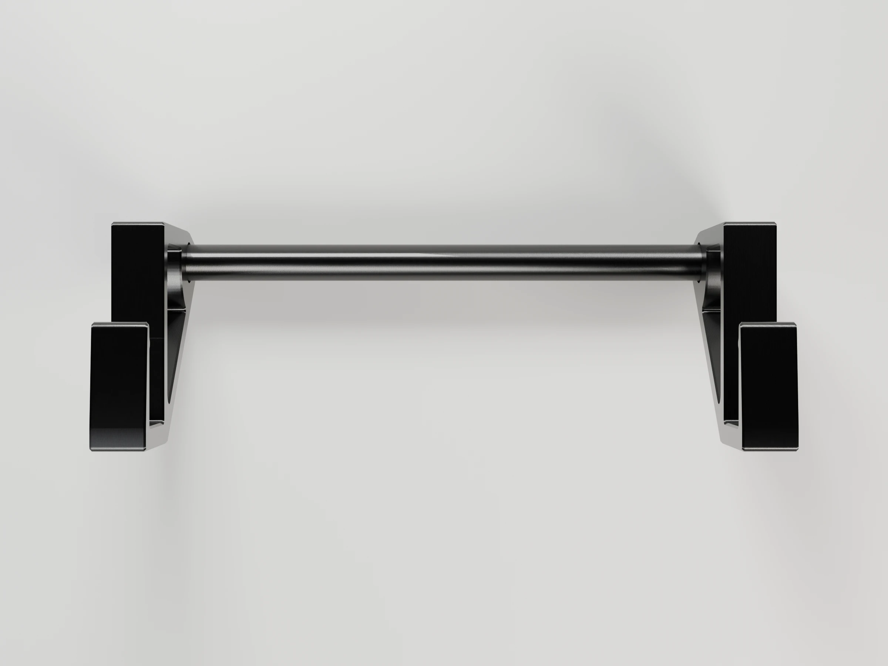
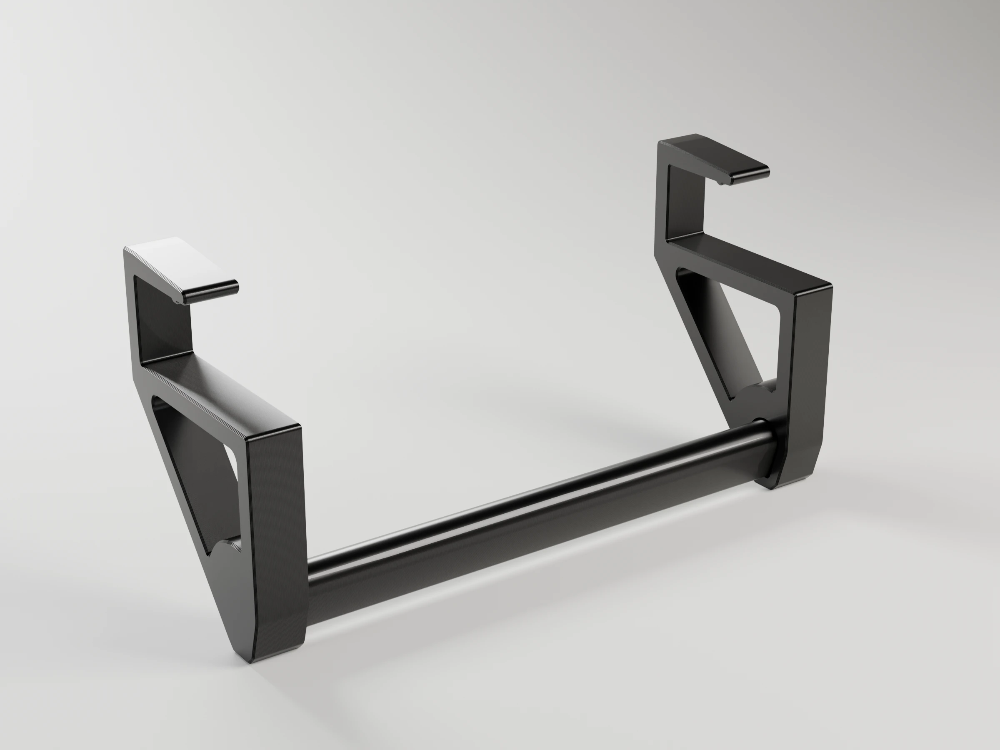
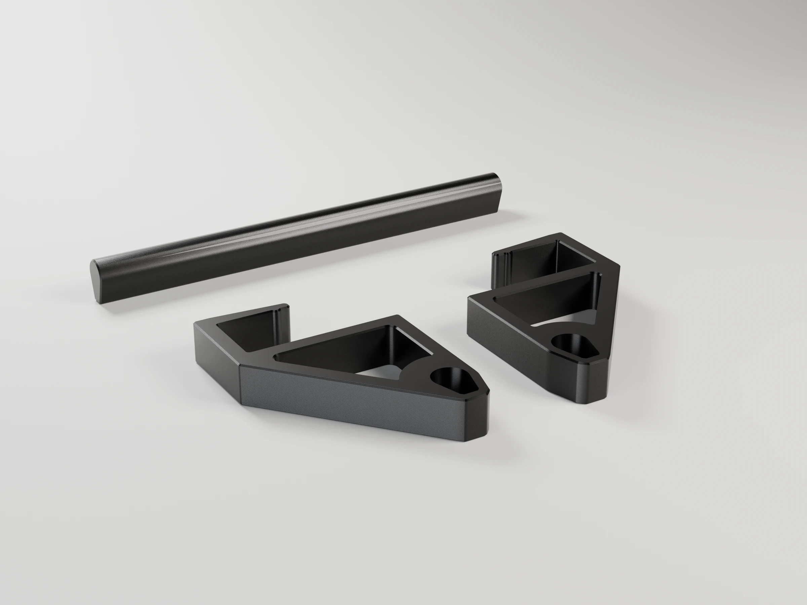
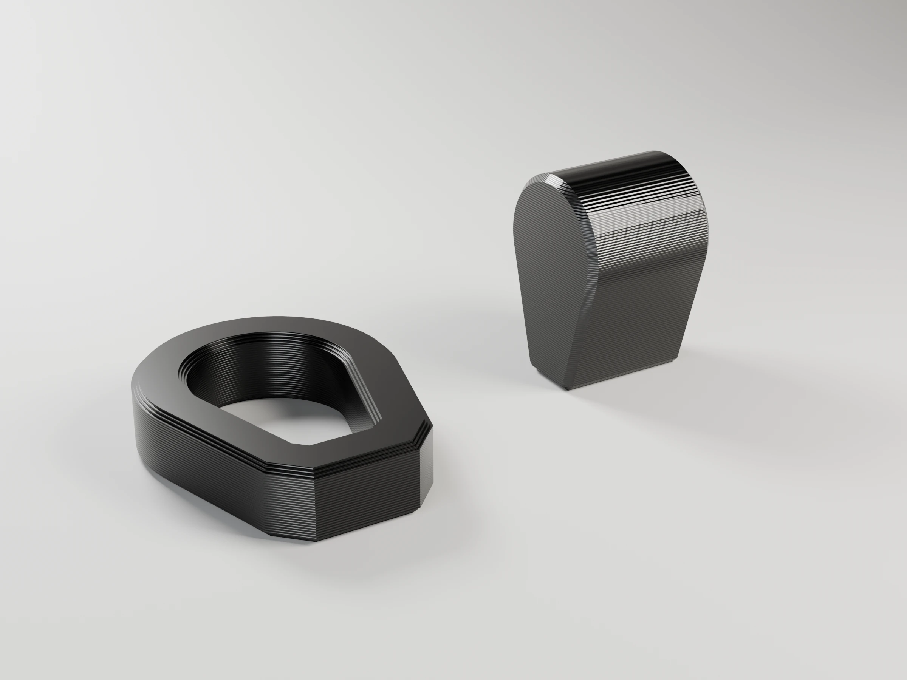
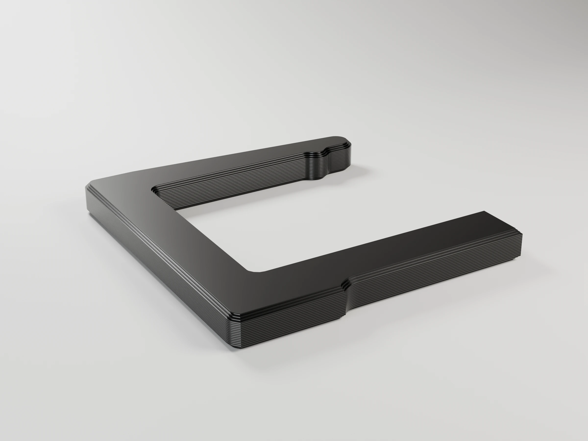

# Desk hanger rail

A short rail for coat hangers that clips onto the front edge of a desk, for
guests' clothes. Two C brackets wrap the desk edge, and a bar runs between
them under the desk, 50 mm in from the edge and 45 mm below the top, enough
for a hanger hook to go on and off. No screws, no tools.


```sh
make project                                   # -> desk-hanger-rail-p1s.3mf (Bambu Studio, ready to print)
make report                                    # rebuild it, slice it, print time and filament per plate
make                                           # -> one STL per part (rail and fit test)
make stl PARTS="test_socket test_bar test_clip"  # fit test only
make project DEFS='-D desk_t=18'               # another desk thickness
make render                                    # -> renders/*.webp, studio views with Blender
make help                                      # every target
```

## How it holds



The weight on the bar levers each bracket around the desk edge: the tip of the
top lip presses down on the desk top and the underside arm presses up
against the desk near the edge. The more you hang, the harder it grips. A
small nub under the lip tip squeezes the desk by `grip_squeeze` (0.6 mm), so
the rail also stays put when it is empty.

- The lip tapers from 6.7 mm at the web, where the bending moment peaks, to
  4.2 mm at the tip, so it barely stands out on the desk top.
- Under the desk, the arm, the leg down to the bar and the diagonal back to the
  web form a triangle: the load runs along the members instead of bending one
  corner. Each member is 6.72 mm wide (16 lines).
- The bar sits in a blind socket with 4.2 mm of wall all round and 6 mm behind
  it. Its cross-section is a round top (where the hooks sit) on a keel, so it
  cannot turn in the socket and it prints lying down without supports. It
  is a snug fit (`bar_play` 0.05 mm per side; 0.15 rattled on the first
  print): the bar cannot come out anyway, because it is trapped between the
  two brackets.
- Everything prints **solid** (100 % infill): no sparse infill in the lip root
  or around the socket.

With 1 kg per bracket the lip root works at about 10 MPa, a fifth of the
yield strength of PETG. A few T-shirts are well within that; for heavy coats,
raise `lip_root_t` and `bracket_w`.

## Parts

| Part | Size (mm) | Notes |
|---|---|---|
| `bracket_left`, `bracket_right` | 67 × 97 × 16 | Mirror images; printed on their outer face, socket up |
| `bar` | 187 × 12 × 18 | Printed on its flat keel |
| `test_socket` | 21 × 27 × 6 | Fit test: a ring with the socket profile at `bar_play`, open at both ends |
| `test_bar` | 12 × 12 × 18 | Fit test: a short bar for the ring |
| `test_clip` | 38 × 40 × 4 | Fit test: a slice of the C to try the grip on the desk |

## Parameters

All lengths in mm. Override any of them with `make DEFS='-D name=value'` (also
`make project`, `make report` and `make render`). The console prints the
bracket and bar sizes.

| Parameter | Default | What it does |
|---|---|---|
| **Desk** | | |
| `desk_t` | 25 | Desk top thickness |
| `edge_r` | 1 | Rounding of the desk edge; the inner corners of the C get the same fillet |
| **Rail** | | |
| `width` | 200 | Overall width along the desk edge. The bar fits the P1S bed up to `width` ≈ 260 |
| `bar_inset` | 50 | Bar axis, measured in from the desk front edge |
| `hook_clearance` | 45 | Gap between the desk underside and the top of the bar |
| `bar_d` | 12 | Diameter of the round top the hangers sit on |
| `bar_h` | 18 | Total bar height (round top + keel); taller is stiffer |
| **Bracket** | | |
| `bracket_w` | 16 | Bracket thickness along the desk edge |
| `lip_len` | 30 | How far the top lip reaches onto the desk |
| `lip_t` | 4.2 | Lip thickness at the tip |
| `lip_root_t` | 6.72 | Lip thickness at the web |
| `web_t` | 6.72 | Front web thickness |
| `arm_t` | 6.72 | Width of the underside arm and the truss members |
| `socket_wall` | 4.2 | Wall around the bar socket |
| `socket_depth` | 10 | How deep the bar goes into each bracket |
| `truss_window` | true | Open the triangle under the desk (false: solid plate) |
| **Fit** | | |
| `grip_play` | 0.3 | Clearance between the C and the desk |
| `grip_squeeze` | 0.6 | How far the lip nub presses into the desk top |
| `bar_play` | 0.05 | Clearance of the bar in its socket, per side (0.05: snug; 0.15 left the bar loose in PETG) |
| `end_gap` | 0.5 | Gap between each bar end and the socket bottom |
| **Fit test** | | |
| `test_h` | 6 | Height of `test_socket`; `test_bar` is twice as long |
| `test_clip_w` | 4 | Thickness of `test_clip` |

Tune the fit with the fit tests (below) before printing the rail.

## Variations

| Use | Parameters |
|---|---|
| Thinner desk (18 mm board) | `-D desk_t=18` |
| Widest rail that fits the bed | `-D width=260` |
| Longer hanger hooks | `-D hook_clearance=60` |
| Heavier coats | `-D bracket_w=22 -D lip_root_t=8.4 -D bar_h=22` |
| Shelf or wall-cabinet bottom | `-D desk_t=16 -D bar_inset=40` |

## Fit tests

Two small plates of the project test the anchoring before printing the rail,
with the same filament and settings:

- **Plate 2 · Socket fit test** (19 min, 4 g): `test_socket` + `test_bar`.
  Push the short bar into the ring. It should go in by hand, hold without
  rattling and come out again. Too tight or too loose: change `bar_play` and
  print the test again (`make project DEFS='-D bar_play=0.10'`). Holes in PETG
  print close to their size; in PLA they come out about 0.1 mm smaller, so
  add ~0.05 mm.
- **Plate 3 · Clip fit test** (6 min, 3 g): `test_clip`. Push it onto the
  desk edge. It should need a firm push and not slide along the edge. Too
  hard: lower `grip_squeeze` (0 = no squeeze); loose: raise it.

## Printing (Bambu P1S)

`make project` builds `desk-hanger-rail-p1s.3mf`, on a Textured PEI plate:
P1S 0.4 nozzle, *0.20mm Strength* (6 walls) with 100 % rectilinear infill and
the seam at the back, Bambu PETG Basic (255 °C, bed 70 °C) in slot 1. No
supports. With the default parameters:

| Plate | Contents | Time | Filament |
|---|---|---|---|
| 1 · Desk hanger rail | two brackets + bar | 3 h 06 min | 112 g |
| 2 · Socket fit test | socket ring, short bar | 19 min | 4 g |
| 3 · Clip fit test | clip slice | 6 min | 3 g |

PETG bonds hard to the textured plate: use a glue stick as a release layer,
and let the plate cool before removing the parts.

## Assembly

1. Press the bar into the socket of each bracket (a drop of glue is optional).
2. Hold the rail with the bar under the desk and push the C onto the front
   edge until the web touches it.

## Renders

`make render` builds the project and renders the assembled rail, the print
plate and the fit tests with Blender (`../../tools/render_studio.py`), in the filament colour and
with layer lines at the project's layer height. 2400 x 1800 WebP; add
`RENDER_FLAGS="--samples 32 --scale 0.25"` for a quick draft.

| Hero | Front | Side | Top | Back |
|---|---|---|---|---|
|  |  |  |  |  |

Print plate:  · Socket fit test:  · Clip fit test: 

