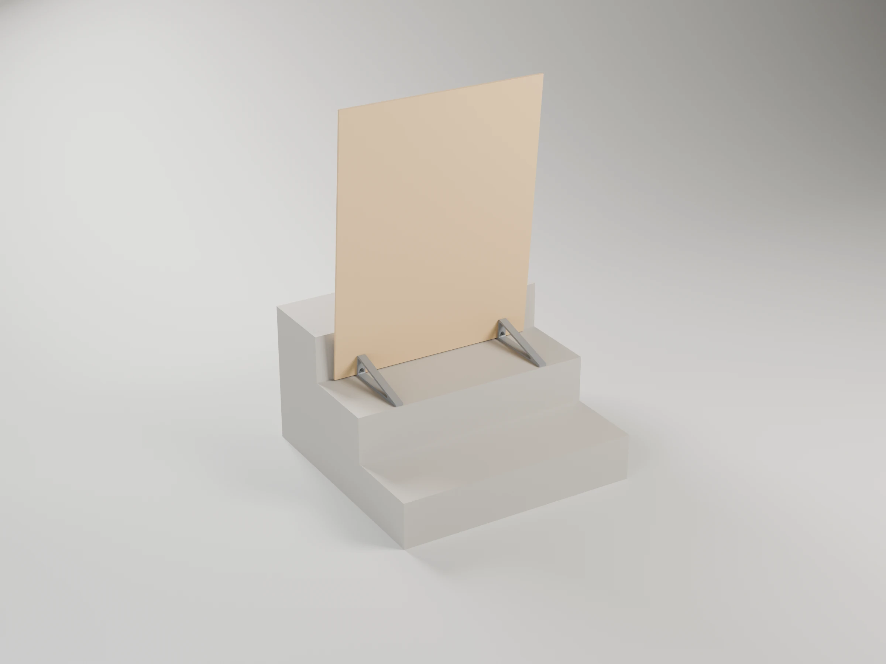
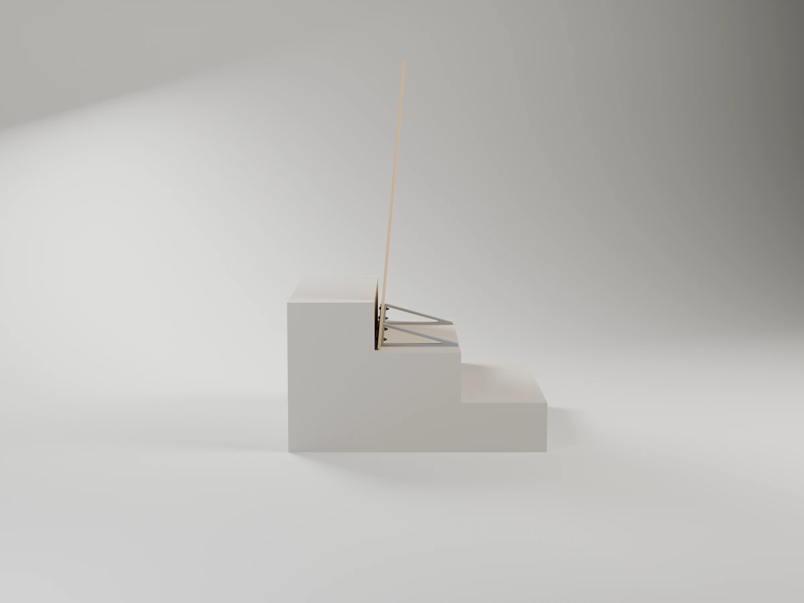
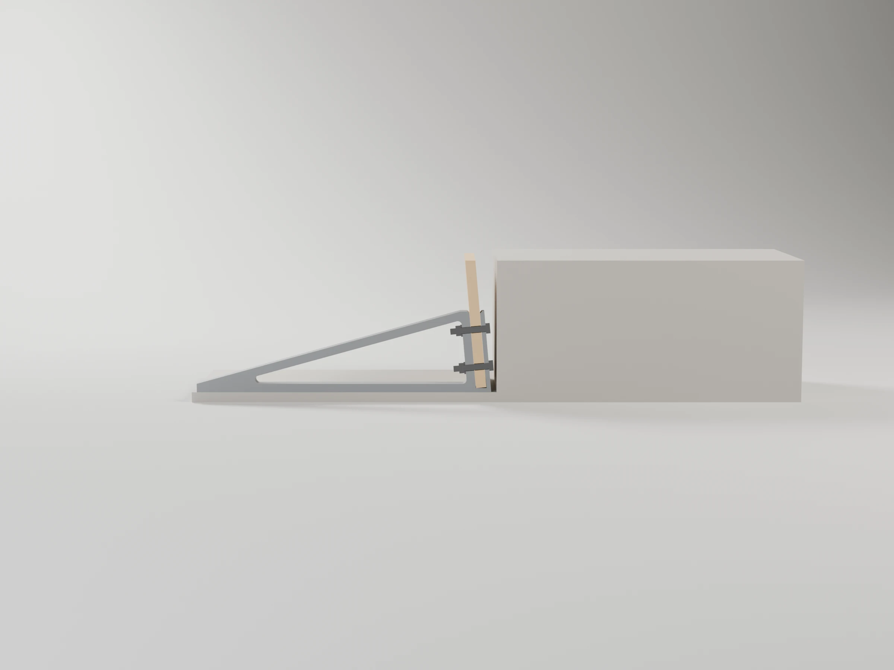
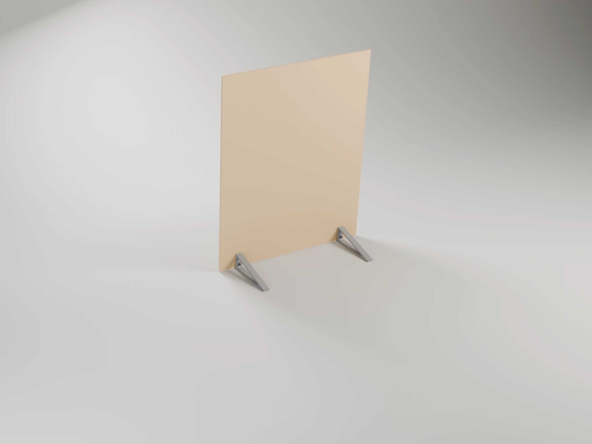
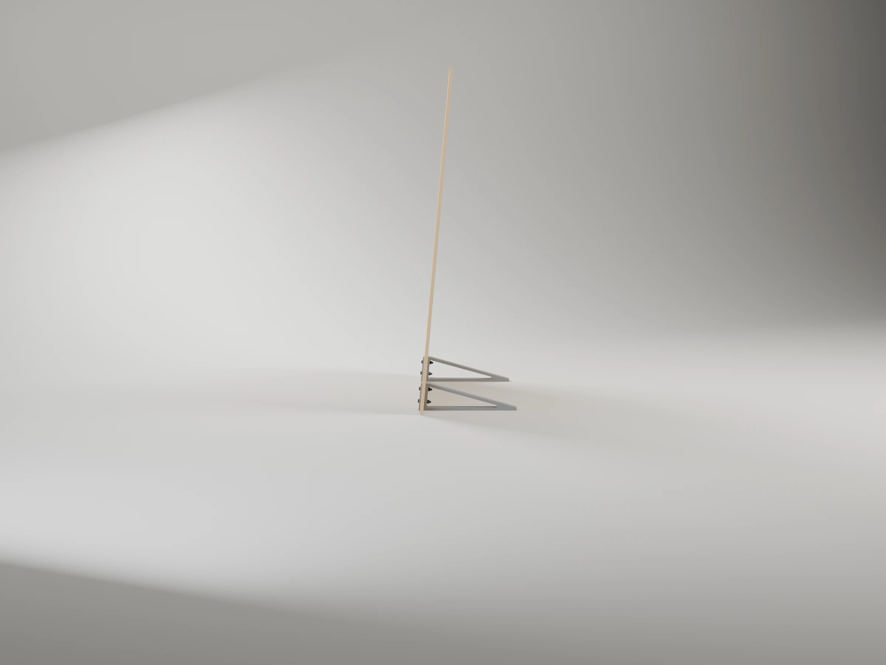

# Dog gate (stair)

A 780 × 1000 × 10 mm plywood board standing across a stair tread, against the next step, held upright by two printed brackets ("escuadras") on its downhill face. Each bracket holds
the board's foot in a shoe (a U, bolted through) and leans it 5° over its 275 mm foot, so its
weight sits over the feet and it also stands on its own on any flat floor.

"Riser" below is the plane under the next step's front edge: a closed riser, or the gap of an open
stair (treads as planks with nothing between them, the stair this was made for). The board leans
back onto that edge either way, so the figures hold for both.
Nothing is fixed to the stair. It keeps a dog that does not push at it from going up or down.



| | |
|---|---|
|  |  |
|  |  |

The bracket is the library's [`board_bracket`](../../tools/scad/boards.scad) (CLAUDE.md §4.7,
"Board bracket").

## Commands

```sh
make project   # dog-gate-p1s.3mf: two plates, one bracket each
make report    # slice it: time and grams per plate
make stl       # dog-gate-bracket.stl, one bracket in print orientation
make render    # renders/ (Blender)
make stability # how hard it is to tip, by statics (stability/stability.py)
make sim       # the same, simulated with MuJoCo (stability/sim.py)
make help
```

Your stair and board: `make project DEFS="-D tread=280 -D board_t=9.5"`. The feet follow from the
tread: `tread − nosing − head_gap − lip − shoe − clearance` (275 mm on a 300 mm tread, the
most that also fits the bed). If the next step's nosing overhangs its riser, set `nosing`: the
board then stands under the nosing. `lean` trades the two ways it can tip (see "Stability").

## Parts

| Part | Qty | Material | Notes |
|---|---|---|---|
| Bracket | 2 | ABS (printed) | 275 mm foot, 80 mm leg leaning 5° over it, a shoe round the board's foot, 30 mm wide |
| Plywood board | 1 | 780 × 1000 × 10 | four Ø7 holes, 100 mm in from each side, 21 and 58 mm up from its bottom edge |
| M6 × 35 hex bolt (DIN 933 / ISO 4017), zinc-plated or A2 | 4 | steel | head on the lip, towards the riser: no washer under it (head 4 + washer 1.6 > the 5.2 mm gap) |
| Nut, one of the two options below | 4 | steel | inside the bracket's hollow |
| M6 washer, DIN 9021 (wide) or DIN 125 | 4 | steel | under the nut: spreads the squeeze on the plastic |
| Anti-slip rubber pads | 4 | adhesive | under the feet |

The two ways to fasten it:

| | Nut | For | Tighten |
|---|---|---|---|
| **A. Fixed** | M6 self-locking nut, DIN 985 (nylon ring) | the gate stays assembled: the nylon ring keeps the nut from working loose with knocks and handling | with a spanner until the lip and the leg grip the board, ≈2–3 N·m; harder crushes the ABS |
| **B. By hand** | M6 wing nut, DIN 315 | taking the board out of the brackets without tools | by hand, firm; leave the upper nut's wings horizontal (across the bracket): upright they hit the brace. No locking ring, so check them now and then |

Bolt length: lip 4.2 + board in its slot 10.6 + leg 8.4 + washer 1.6 + nut (8 for DIN 985, ≈5 for
a wing nut) ≈ 33 mm: M6 × 35. With a board thicker than 10 mm, M6 × 40.

## Printing

`dog-gate-p1s.3mf`, two identical plates, one bracket each, on its side (the triangle and the
shoe on the bed) so the leg, the foot, the brace and the lip bend within the layers. At 275 mm
it only fits the bed turned 54°, and only with an 80 mm leg.

| Plate | Time | Filament |
|---|---|---|
| Bracket 1 | 3 h 45 min | 115 g |
| Bracket 2 | 3 h 45 min | 115 g |
| Total | 7 h 31 min | 230 g |

- AMS slot 1: Bambu ABS (`Bambu ABS @BBL P1S 0.4 nozzle`): it takes the summer heat on the
  stair (heat deflection ≈85 °C, PLA softens at ≈55 °C). The stair gets the sun part of the
  day, and ABS yellows and turns brittle in UV over the years; ASA prints the same and takes UV,
  if you ever reprint them.
- Process 0.20mm Strength (6 walls) with gyroid infill. Door closed (CLAUDE.md §8).

## Assembly

1. Drill the board: four Ø7 holes, 100 mm in from each side edge, 21 and 58 mm up from the
   bottom edge (the board stands on the shoe's 4.2 mm floor). Easiest: put the board in the
   shoes and drill through the brackets' holes.
2. Stick the anti-slip pads under the feet.
3. Board into both shoes, bolts in from the lip's side (no washer under the head), washer and
   nut (self-locking or wing, see Parts) inside each bracket's hollow. Tighten until the lip and
   the leg grip the board without play.
4. Stand it on the tread, the bolt heads towards the next riser (5 mm off it), the feet downhill.

## Strength

| Part | Load | Orientation | Margin |
|---|---|---|---|
| Bracket | the board's weight and the moment that tips it (≈5 N·m per bracket at most) | on its side: the load stays within the layers | tens |
| Bolts in the plywood | the same, in bearing | — | tens |

## Stability

Nothing holds the board to the stair, so what keeps it up is its weight, and what limits the gate
is tipping, not a part breaking. Two analyses, in [`stability/`](stability/):

- **Statics** (`make stability`): rigid bodies, from the model's own geometry and the brackets'
  sliced mass. For each way it can tip: the steady push that tips it (`W · b / H`, b from the
  centre of mass to the edge it tips over), the angle it can lean before it falls on its own,
  the energy to lift its centre of mass over that edge, and the shortest tap that does it.
- **Simulation** (`make sim`, MuJoCo): the gate as one rigid body on the stair (three steps
  above) or on a flat floor, with friction μ 0.4 (bare ABS on stone) or 0.7 (rubber pads). A push
  at the middle of the top edge growing 2 N/s, and 50 ms taps there, the smallest that makes it
  fall. It needs the `physics` environment: `micromamba create -n physics -c conda-forge
  python=3.12 mujoco numpy imageio imageio-ffmpeg`.

With a 3.5 kg board (light plywood, the worst case), pushed at the top edge:

| | Statics | Simulation (μ 0.4) |
|---|---|---|
| Steady push, forwards (downhill): tips | 8.5 N | lifts 9.3 N, falls 10.4 N |
| Steady push, backwards on the stair: levers over the riser's top edge onto the steps above | 2.8 N | 3.1 N |
| Steady push, backwards on a flat floor | 2.1 N | 3.1 N |
| Tap that throws it **forwards, down the stair** | 2.3 N·s | 2.6 N·s (81 N peak) |
| Tap forwards that makes it fall at all | — | 1.15 N·s on the stair, 0.84 flat: it rocks forward, lands back on its foot and goes over **backwards** |

- **Down the stair, the dangerous way, it holds best**: a steady 10 N or a tap of 2.6 N·s.
  The weak side is backwards (3 N); on the stair a fall that way lays it on the steps above,
  harmless but open. A sharp tap forwards tips it backwards on the rebound.
- **Rubber pads under the feet**: a steady push lower than 58 cm (μ 0.4) or 33 cm (μ 0.7)
  slides it rather than tips it, and the toes are 5 mm from the nosing. On the stair the pads
  also steady it against taps: the smallest tap that makes it fall at all goes from 1.15 to
  1.84 N·s (the rebound pushes the shoe back against the riser, and the grip holds it there).
- **The lean trades the two ways** (simulation, on the stair):

| `lean` | Steady push, forwards | Steady push, backwards | Tap: falls down the stair | Tap: falls at all |
|---|---|---|---|---|
| 0° | 11.9 N | 2.5 N | 3.1 N·s | 1.0 N·s |
| **5°** (default) | **10.4 N** | **3.1 N** | **2.6 N·s** | **1.15 N·s** |
| 8° | 9.5 N | 4.0 N | 2.3 N·s | 1.3 N·s |
| 12° | 8.3 N | 5.2 N | 1.9 N·s | 1.6 N·s |

- **Against the alternatives** (statics; simulation agrees within ≈15 %): brackets on both faces
  in the middle of the tread (140 mm each way) tip at 5.3 N either way, discs Ø230 with a U at
  4.5 N: steadier backwards, but half as steady down the stair. 5 kg of ballast on the feet
  doubles every figure (17 N forwards, 5 N·s). A 30 % perforated board scales them with its
  weight (6.0 N). More brackets change nothing.
- On a closed stair nothing that only rests on it can be stopped from sliding downhill: treads
  push up and risers face downhill, so only friction holds it that way. On an open stair the
  planks can be gripped from below: the next version hooks the toes under the tread.

So this version is for a dog that does not push at the board. A board-level study of what it
takes to hold a push (a railing clamp and the wall, with a batten along the top edge) is in
[fea/board_fea.py](fea/board_fea.py) and `concept.scad`, for a later version.
