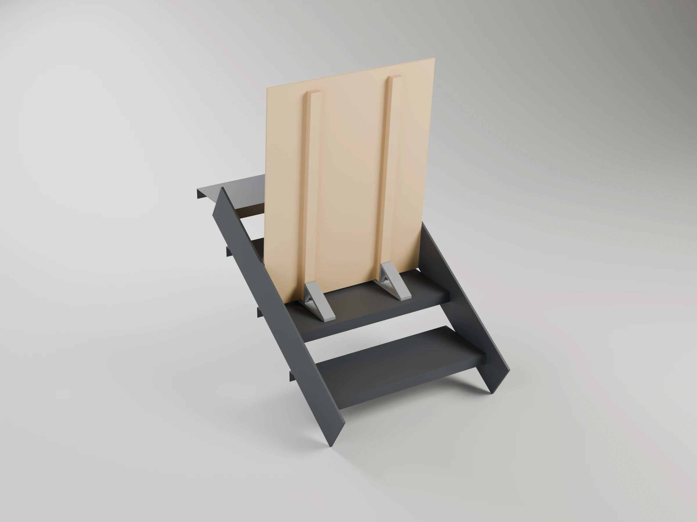
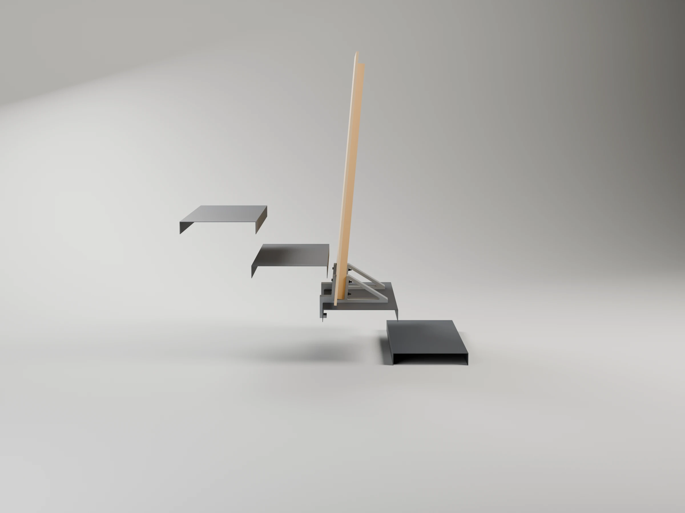
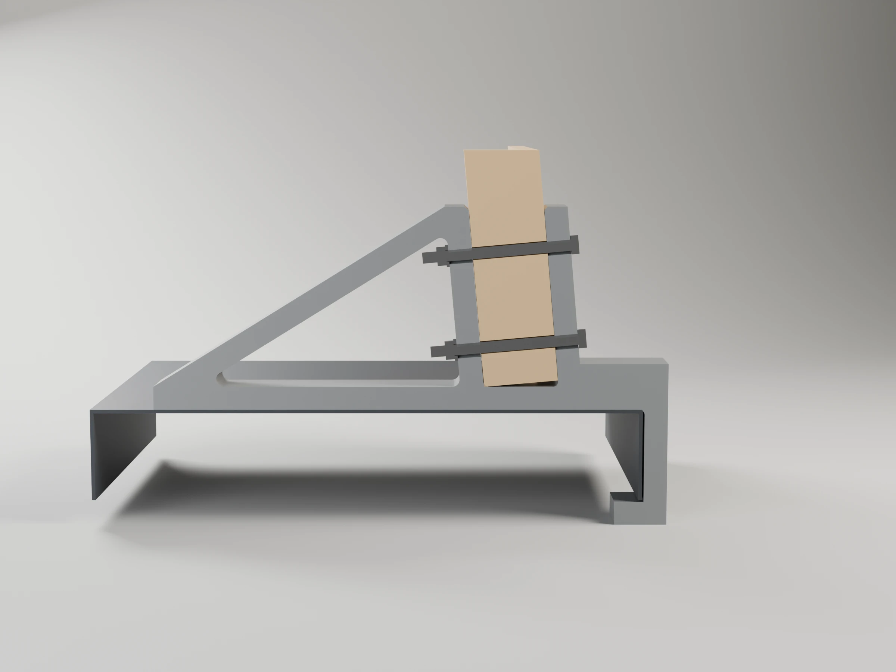
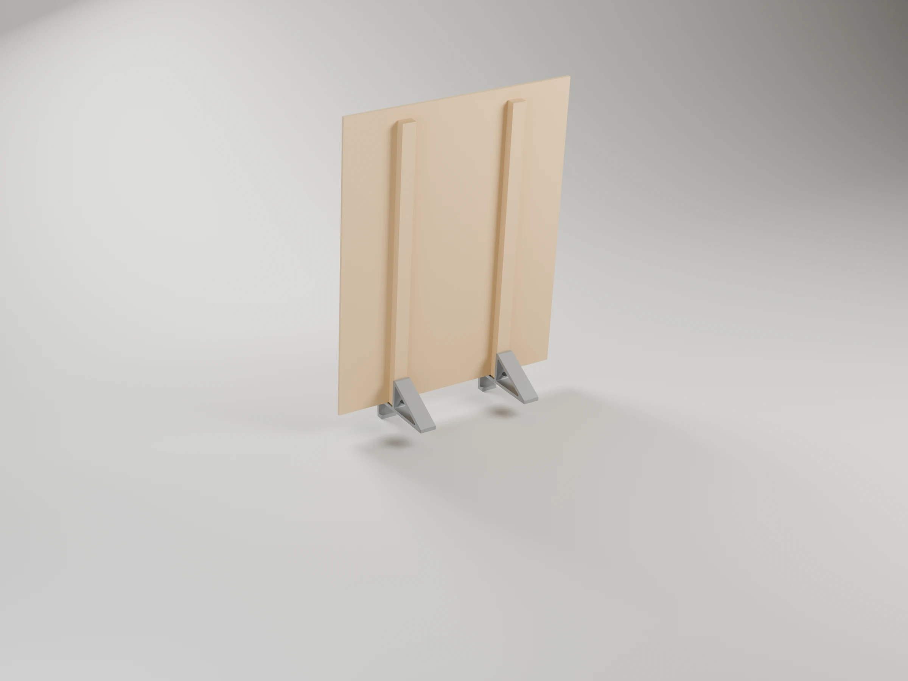
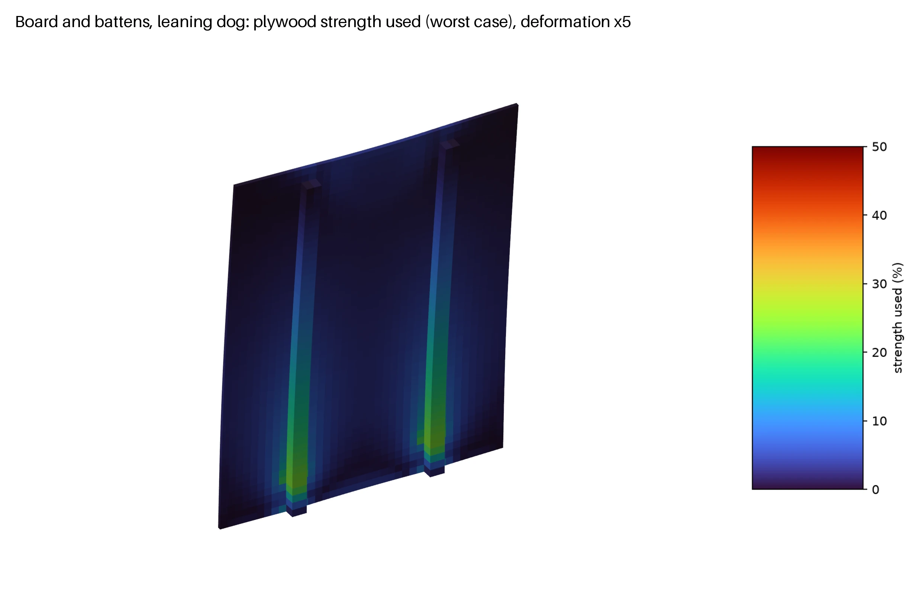
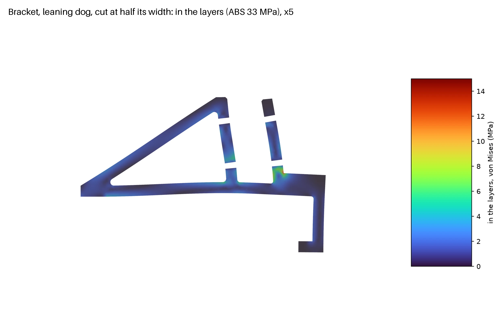
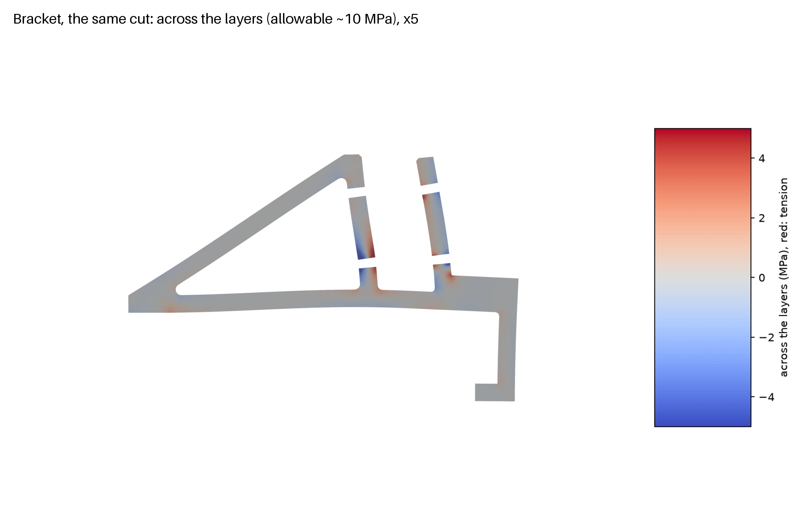

# Dog gate (stair)

A 10 mm plywood board standing across a stair tread, held up by two printed brackets on its
downhill face, nothing fixed to the stair. Two versions:

| | Simple | Reinforced |
|---|---|---|
| |  |  |
| Holds | a dog that does not push at it: it tips with ~10 N at the top | **a leaning dog** (206 N at the top) |
| How | the board in the brackets' shoes, leaning 5° over 275 mm feet | the same, plus a hook under the tread's back flange and two battens up the board |
| Stair | any tread (closed or open) | open stair of pressed steel tray treads |
| Wood | the board (780 × 1000) | the board and six strips from the same 1.2 × 1.2 m sheet |
| Print (P1S, ABS) | 2 × 3 h 45 min, 230 g | 2 × 9 h 38 min, 570 g, + hook tests 2 h 24 min |
| Model | [`dog-gate.scad`](dog-gate.scad) | [`dog-gate-hook.scad`](dog-gate-hook.scad) |

Both brackets are the library's [`board_bracket`](../../tools/scad/boards.scad) (CLAUDE.md §4.7,
"Board bracket"): the reinforced one with its `heel` hook.

## Commands

```sh
make project   # dog-gate-p1s.3mf and dog-gate-x2d.3mf: both versions and the hook tests
make report    # slice them: time and grams per plate
make stl       # dog-gate-bracket.stl and dog-gate-hook-bracket.stl, in print orientation
make render    # renders/ (Blender)
make stability # simple: how hard it is to tip, by statics (stability/stability.py)
make sim       # simple: the same, simulated with MuJoCo (stability/sim.py), clips into stability/videos/
make sim-hook  # reinforced: the leaning dog and a hard blow, simulated (stability/sim_hook.py)
make fea       # reinforced: the board and the bracket under the leaning dog (fea/)
make help
```

Your stair and board: `make project DEFS="-D tread=280 -D board_t=9.5"`; for the reinforced
version also the tread's flange depth, `-D edge_h=45` (print the hook tests first).

## Printing

One project per printer, `dog-gate-p1s.3mf` (Bambu Lab P1S) and `dog-gate-x2d.3mf` (Bambu Lab
X2D), each with both versions. A bracket only fits a bed by itself, lying on its side and turned
(the triangle on the bed: leg, foot, brace and hook bend within the layers), so each version has
one plate: print it twice, the two brackets are the same part. The hook tests are five different
slices, one per flange depth.

| Plate | P1S | X2D |
|---|---|---|
| Simple bracket (print 2) | 3 h 45 min, 115 g | 3 h 27 min, 115 g |
| Reinforced bracket (print 2) | 9 h 38 min, 285 g | 8 h 45 min, 285 g |
| Hook tests (flanges 30, 40, 50, 60, 70 mm) | 2 h 24 min, 66 g | 2 h 21 min, 66 g |

- Bambu ABS: it takes the summer heat on the stair (heat deflection ≈85 °C, PLA softens at
  ≈55 °C). ABS yellows and turns brittle in UV over the years; ASA prints the same and takes UV.
- 0.20mm Strength (6 walls) with gyroid infill on the P1S; on the X2D, which has no Strength
  preset, its 0.20mm Standard with the same 6 walls and 25 % infill. Door closed (CLAUDE.md §8).

## Simple version

A 780 × 1000 × 10 mm board standing across a tread, against the next step. Each bracket holds the
board's foot in a shoe (a U, bolted through) and leans it 5° over its 275 mm foot, so its weight
sits over the feet and it also stands on its own on any flat floor.

"Riser" below is the plane under the next step's front edge: a closed riser, or the gap of an open
stair. The board leans back onto that edge either way, so the figures hold for both.

| | |
|---|---|
|  |  |
|  |  |

The feet follow from the tread: `tread − nosing − head_gap − lip − shoe − clearance` (275 mm on
a 300 mm tread). If the next step's nosing overhangs its riser, set `nosing`. `lean` trades the
two ways it can tip (see "Stability").

### Parts

| Part | Qty | Material | Notes |
|---|---|---|---|
| Bracket | 2 | ABS (printed) | 275 mm foot, 80 mm leg leaning 5° over it, a shoe round the board's foot, 30 mm wide |
| Plywood board | 1 | 780 × 1000 × 10 | four Ø7 holes, 100 mm in from each side, 21 and 58 mm up from its bottom edge |
| M6 × 35 hex bolt (DIN 933 / ISO 4017), zinc-plated or A2 | 4 | steel | head on the lip, towards the riser: no washer under it (head 4 + washer 1.6 > the 5.2 mm gap) |
| Nut, one of the two options below | 4 | steel | inside the bracket's hollow |
| M6 washer, DIN 9021 (wide) or DIN 125 | 4 | steel | under the nut: spreads the squeeze on the plastic |
| Anti-slip rubber pads | 4 | adhesive | under the feet |

The two ways to fasten it:

| | Nut | For | Tighten |
|---|---|---|---|
| **A. Fixed** | M6 self-locking nut, DIN 985 (nylon ring) | the gate stays assembled: the nylon ring keeps the nut from working loose with knocks and handling | with a spanner until the lip and the leg grip the board, ≈2–3 N·m; harder crushes the ABS |
| **B. By hand** | M6 wing nut, DIN 315 | taking the board out of the brackets without tools | by hand, firm; leave the upper nut's wings horizontal (across the bracket): upright they hit the brace. No locking ring, so check them now and then |

Bolt length: lip 4.2 + board in its slot 10.6 + leg 8.4 + washer 1.6 + nut (8 for DIN 985, ≈5 for
a wing nut) ≈ 33 mm: M6 × 35. With a board thicker than 10 mm, M6 × 40.

### Assembly

1. Drill the board: four Ø7 holes, 100 mm in from each side edge, 21 and 58 mm up from the
   bottom edge (the board stands on the shoe's 4.2 mm floor). Easiest: put the board in the
   shoes and drill through the brackets' holes.
2. Stick the anti-slip pads under the feet.
3. Board into both shoes, bolts in from the lip's side (no washer under the head), washer and
   nut (self-locking or wing, see Parts) inside each bracket's hollow. Tighten until the lip and
   the leg grip the board without play.
4. Stand it on the tread, the bolt heads towards the next riser (5 mm off it), the feet downhill.

### Strength

| Part | Load | Orientation | Margin |
|---|---|---|---|
| Bracket | the board's weight and the moment that tips it (≈5 N·m per bracket at most) | on its side: the load stays within the layers | tens |
| Bolts in the plywood | the same, in bearing | — | tens |

### Stability

Nothing holds the board to the stair, so what keeps it up is its weight, and what limits the gate
is tipping, not a part breaking. Two analyses, in [`stability/`](stability/):

- **Statics** (`make stability`): rigid bodies, from the model's own geometry and the brackets'
  sliced mass. For each way it can tip: the steady push that tips it (`W · b / H`, b from the
  centre of mass to the edge it tips over), the angle it can lean before it falls on its own,
  the energy to lift its centre of mass over that edge, and the shortest tap that does it.
- **Simulation** (`make sim`, MuJoCo): the gate as one rigid body on the stair (three steps
  above) or on a flat floor, with friction μ 0.4 (bare ABS on stone) or 0.7 (rubber pads). A push
  at the middle of the top edge growing 2 N/s, and 50 ms taps there, the smallest that makes it
  fall. It needs the `physics` environment: `micromamba create -n physics -c conda-forge
  python=3.12 mujoco numpy imageio imageio-ffmpeg`.

With a 3.5 kg board (light plywood, the worst case), pushed at the top edge:

| | Statics | Simulation (μ 0.4) |
|---|---|---|
| Steady push, forwards (downhill): tips | 8.5 N | lifts 9.3 N, falls 10.4 N |
| Steady push, backwards on the stair: levers over the riser's top edge onto the steps above | 2.8 N | 3.1 N |
| Steady push, backwards on a flat floor | 2.1 N | 3.1 N |
| Tap that throws it **forwards, down the stair** | 2.3 N·s | 2.6 N·s (81 N peak) |
| Tap forwards that makes it fall at all | — | 1.15 N·s on the stair, 0.84 flat: it rocks forward, lands back on its foot and goes over **backwards** |

- **Down the stair, the dangerous way, it holds best**: a steady 10 N or a tap of 2.6 N·s.
  The weak side is backwards (3 N); on the stair a fall that way lays it on the steps above,
  harmless but open. A sharp tap forwards tips it backwards on the rebound.
- **Rubber pads under the feet**: a steady push lower than 58 cm (μ 0.4) or 33 cm (μ 0.7)
  slides it rather than tips it, and the toes are 5 mm from the nosing. On the stair the pads
  also steady it against taps: the smallest tap that makes it fall at all goes from 1.15 to
  1.84 N·s (the rebound pushes the shoe back against the riser, and the grip holds it there).
- **The lean trades the two ways** (simulation, on the stair):

| `lean` | Steady push, forwards | Steady push, backwards | Tap: falls down the stair | Tap: falls at all |
|---|---|---|---|---|
| 0° | 11.9 N | 2.5 N | 3.1 N·s | 1.0 N·s |
| **5°** (default) | **10.4 N** | **3.1 N** | **2.6 N·s** | **1.15 N·s** |
| 8° | 9.5 N | 4.0 N | 2.3 N·s | 1.3 N·s |
| 12° | 8.3 N | 5.2 N | 1.9 N·s | 1.6 N·s |

- **Against the alternatives** (statics; simulation agrees within ≈15 %): brackets on both faces
  in the middle of the tread (140 mm each way) tip at 5.3 N either way, discs Ø230 with a U at
  4.5 N: steadier backwards, but half as steady down the stair. 5 kg of ballast on the feet
  doubles every figure (17 N forwards, 5 N·s). A 30 % perforated board scales them with its
  weight (6.0 N). More brackets change nothing.
- On a closed stair nothing that only rests on it can be stopped from sliding downhill: treads
  push up and risers face downhill, so only friction holds it that way. On an open stair the
  treads can be gripped from below: the reinforced version hooks under them.

So this version is for a dog that does not push at the board. Clips of the taps, just under and
just over each threshold, are in [`stability/videos/`](stability/videos/) (`stair-*`, `flat-*`).

## Reinforced version

For an open stair of pressed steel tray treads (a plate with its front and back edges folded
down, open below, a gap between the steps: the stair this was made for). Each bracket's heel
hooks under the back flange of the tread it stands on, so the gate can neither tip nor slide down
the stair: a leaning dog's push goes into the hooks. Two battens up the board carry that push down
to the brackets: a 10 mm board alone bends 20 to 37 cm as a cantilever.

| | |
|---|---|
|  |  |
|  | |

**On and off from the top edge, from either side.** Stand the gate on the tread with the hooks
behind the back flange and slide it 20 mm down the stair: the hooks' lips go under the flange.
To take it out, slide it 20 mm up the stair and lift. The board stands 45 mm in front of the next
tread's front flange (overlap 20 + slide 20 + 5), so there is room for the slide.

The tread profile is the usual one for these stairs (2–2.5 mm galvanised steel, flanges 25–75 mm
deep, 240–330 mm deep treads; Lichtgitter, Elefant, Meiser, a standard construction item), not
measured: print the **hook tests** first, keep the slice that slides on over your flange and sits
flat, and set its `edge_h` (`make project DEFS="-D edge_h=50"`) before printing the brackets.

### Cutting the sheet

From a 1200 × 1200 × 10 mm plywood sheet:

```
┌────────────────────────────┬──────────────┐
│                            │ 6 strips     │
│   board 780 × 1000         │ 45 × 960     │
│                            │ (grain along │
│                            │  them)       │
├────────────────────────────┤              │
│   spare 780 × 200          │              │
└────────────────────────────┴──────────────┘
```

Cut the strips with the face veneer's grain running along them: across it, a batten is half as
stiff (board FEA: 5–6 cm instead of under 2). Glue three strips face to face for each batten
(45 × 30), with a few short screws while the glue sets.

### Parts

| Part | Qty | Material | Notes |
|---|---|---|---|
| Reinforced bracket | 2 | ABS (printed) | 180 mm foot, 110 mm leg, 55 wide, a shoe for board + batten (40.6), a heel arm and a hook |
| Board | 1 | 780 × 1000 × 10 plywood | from the sheet |
| Battens | 2 | 3 × (45 × 960 × 10) plywood strips, glued flat | on the downhill face, centred 200 mm in from each side edge, from the bottom edge to 40 mm under the top |
| M6 × 80 hex bolt, washer, nut (self-locking or wing, as in the simple version) | 4 | steel | through lip, board, batten and leg, at 21 and 72 mm up from the board's bottom edge |
| Wood glue, short wood screws | | | the battens |
| Anti-slip rubber pads | 4 | adhesive | under the feet |

### Assembly

1. Glue up the battens and glue and screw them to the board's downhill face (above).
2. Print the hook tests, find your flange depth, set `edge_h`, print the brackets.
3. Board and battens into both shoes; drill Ø7 through the brackets' holes; bolt (heads on the
   lip's side, washer and nut in the hollow).
4. Pads under the feet; stand it on the tread and slide it 20 mm down the stair to hook it on.

### Load analysis: the leaning dog

The one load case (agreed): a 35 kg dog leaning on the top edge, 0.6 × its weight = 206 N in two
paws 300 mm apart, down the stair. A chain of two FEAs (tools/fea, "Chain of parts") and a
rigid-body simulation:

- **The board** ([`fea/board_fea.py`](fea/board_fea.py)): board and battens as 20-node bricks
  (worst-case 10 mm softwood plywood, both face-grain directions), each bracket as stiff struts
  from its toe (resting on the tread) and its hook (held down and back by the flange) to the
  board in its shoe.
- **The bracket** ([`fea/bracket_fea.py`](fea/bracket_fea.py)): the printed bracket meshed (C3D10,
  3 mm), on its toe (with the friction of the pads) and its hook, the board's push on its shoe as
  pressures, the two bolts as steel bars. ABS: 33 MPa in the layers, 30 % of that (10 MPa) across
  them (CLAUDE.md §2.3).
- **Stability** ([`stability/sim_hook.py`](stability/sim_hook.py), MuJoCo): the gate as one rigid
  body on the tray treads, the hooks under the flange.

| Board (variant F45x30) | |
|---|---|
| Deflection at the top edge | 17–19 mm |
| Plywood strength used | 21–27 % (worst-case plywood) |
| Battens | 5 MPa (≈4× under their strength) |
| Each hook on the flange / each toe on the tread | ≈377 N / ≈398 N |

| Bracket region | Stress in the layers (p99.5) | Margin | Across the layers (p99.5) | Margin |
|---|---|---|---|---|
| Hook (strap and lip) | 2.8 MPa | 12× | 0.8 MPa | 13× |
| Heel arm | 3.9 MPa | 8× | 0.8 MPa | 12× |
| Shoe (lip, floor) | 10.1 MPa | 3.3× | 3.6 MPa | 2.7× |
| Leg, foot, brace | 6.7 MPa | 4.9× | 3.1 MPa | 3.2× |

The bracket moves 1.0 mm at most; the lower bolt carries ≈0.9 kN. The peaks left out of the
percentiles sit at the supports' edges and on the bolt holes, where the bolts are bars on a few
nodes: singular, not real. The shoe is the tightest (2.7× across the layers), with its load taken
as contact only, the pessimistic end. The bracket's reactions come out ≈10 % under the board
model's (the shoe's pressures were sized for an earlier set of supports), so read the margins as
±10 %.

| | | |
|---|---|---|
|  |  |  |

**Stability**: leaning, the gate tilts 0.5° and stays hooked, the two hooks pulling 807 N on the
flange (the board FEA: 2 × 377). A hard blow (690 N for 50 ms at the top) tilts it 0.7° and it
settles back; the rigid model's contact peak in the hooks then is not a real force (it depends on
the contact stiffness) and the blow was not checked for strength. Clips:
[`hook-lean.mp4`](stability/videos/hook-lean.mp4), [`hook-hit.mp4`](stability/videos/hook-hit.mp4).

**How it got here** (fea/board_fea.py variants): the board alone on two hooked brackets bent 20–37
cm and broke the worst-case plywood (120–195 %); three brackets still 17–32 cm. Battens fixed it:
pine 45 × 20 2.3–2.7 cm; strips of the same plywood, one layer 6–11 cm (too soft), two layers
3.5–4 cm, three layers 1.7–1.9 cm, on edge 10 × 45 1.4–1.6 cm (strong, but a glue line 10 mm
wide). With a 1.2 m sheet there is plenty of wood, so three layers flat. In the bracket the brace
buckled at 8.4 mm and the shoe's lip bent at 4.2 mm: members and lip went to 12.6 mm, with 3 mm
fillets in the inside corners.

## Files

- `fea/board_fea.py`: the board on its supports, every scheme studied (railing clamps, wall
  channels, hooks, battens); `fea/bracket_fea.py`: the reinforced bracket; `fea/board_ply.py`,
  `fea/cut_ply.py`: their results as coloured PLYs for `tools/fea/render_ply.py`.
- `stability/`: `stability.py` and `sim.py` (simple version), `sim_hook.py` (reinforced),
  `videos/` the clips.
- `concept.scad`: the first concept of railing clamps and wall channels, for a gate that holds a
  push without the hooks.
