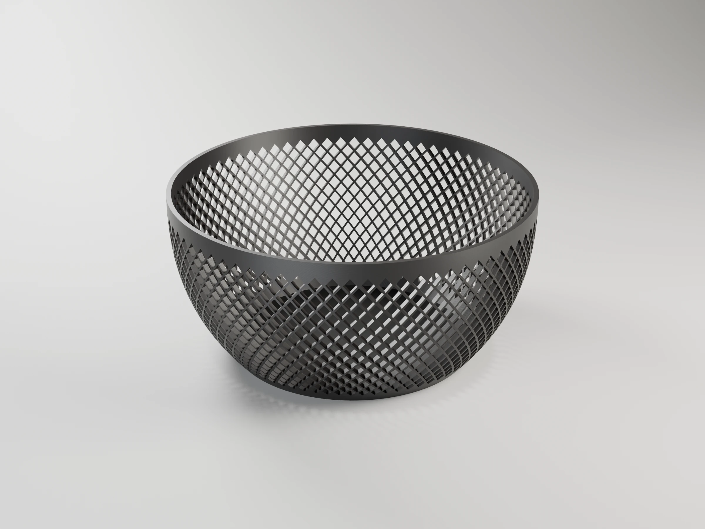
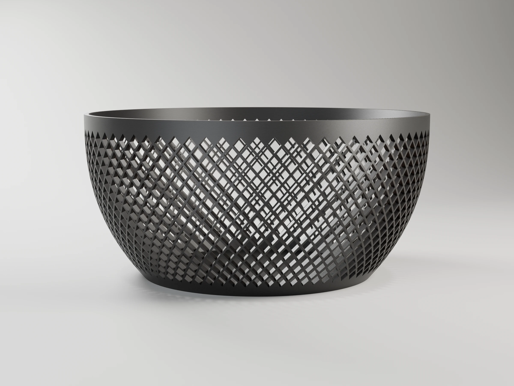
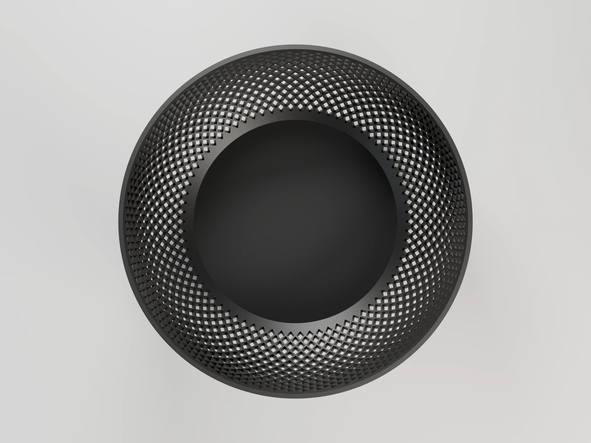
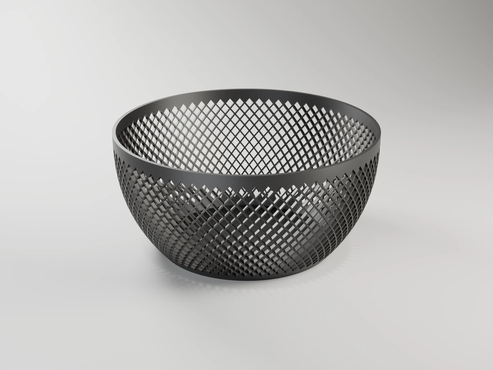

# Lattice bowl

Parametric decorative bowl with a diagonal lattice of diamond openings that
follow the wall curvature. Printable without supports.



```sh
make project                                   # -> lattice-bowl-p1s.3mf (Bambu Studio, ready to print)
make report                                    # rebuild it, slice it, print time and filament
make                                           # -> lattice_bowl.stl
make DEFS='-D top_diameter=200 -D rod_width=2.5'
make OPENSCAD_FLAGS=--backend=Manifold         # OpenSCAD >= 2025, much faster
make render                                    # -> renders/*.webp, studio views with Blender
# or directly:
openscad -o lattice_bowl.stl lattice_bowl.scad
```

All parameters are at the top of `lattice_bowl.scad` (also editable from the
OpenSCAD Customizer). The console prints the number of rows/columns, the
maximum wall tilt, and the minimum overhang angle, with a warning if any of
them is out of the safe range for support-free printing.

## Parameters

All lengths in mm. Override any of them with `make DEFS='-D name=value'` (also
`make project`, `make report` and `make render`).

| Parameter | Default | What it does |
|---|---|---|
| **Bowl shape** | | |
| `top_diameter` | 180 | Outer diameter at the top rim. Keep it under ~250 to fit the bed |
| `base_diameter` | 120 | Outer diameter at the base, the footprint on the bed |
| `height` | 85 | Total height of the bowl (max ~245 on the P1S) |
| `curvature` | 2.6 | Wall profile: 1 = straight cone, >1 = rounded (flares low, near vertical at the rim), <1 = trumpet (flares at the rim; watch the overhangs) |
| `wall_thickness` | 2.4 | Wall thickness, perpendicular to the surface |
| `floor_thickness` | 2.0 | Solid floor thickness |
| **Lattice** | | |
| `rod_width` | 1.0 | Width of the lattice rods. Thicker = stiffer, fewer and smaller holes |
| `opening_size` | 4 | Side of each diamond opening at mid-height; also sets the pitch (opening + rod) |
| `opening_stretch` | 1.25 | Diamond height / width. >1 gives steeper edges, easier to print without supports |
| `side_subdivisions` | 3 | Points per diamond side; more hugs the curvature better but renders slower |
| **Solid bands** | | |
| `top_rim_height` | 6 | Solid band along the rim (stiffness) |
| `bottom_band_height` | 5 | Solid band joined to the floor |
| **Quality** | | |
| `profile_steps` | 80 | Vertical resolution of the wall profile |
| `$fn` | 180 | Segments around the axis |

Keep the console checks green: wall tilt ≤ 50° and overhang faces ≥ 45° (raise
`opening_stretch` or lower `curvature` if they warn).

## Variations

Combinations checked with the console (no warnings, fits the P1S bed). The
times in the default project scale with size: for the large ones consider
*0.20mm Standard* or *0.24mm Draft* in Bambu Studio.

| Use | Parameters | Result |
|---|---|---|
| Fruit bowl (default) | — | Ø180 × 85 mm, fine lattice, 17 × 74 openings |
| **Wastebasket** | `-D top_diameter=240 -D base_diameter=200 -D height=240 -D curvature=1.3 -D rod_width=2 -D opening_size=10 -D top_rim_height=10 -D bottom_band_height=10 -D floor_thickness=2.4` | Ø240 × 240 mm, almost straight wall, thick rods and 10 mm holes so it stays stiff; a long print, use 0.24 mm layers |
| Bread / fruit basket, low and wide | `-D top_diameter=240 -D base_diameter=170 -D height=70 -D curvature=1.8` | Ø240 × 70 mm, open tray-like basket |
| Salad / centre bowl, deep | `-D top_diameter=230 -D base_diameter=150 -D height=90 -D curvature=2.2 -D opening_size=6 -D rod_width=1.6` | Ø230 × 90 mm, wall tilt 44°, close to the limit |
| Key / catch-all tray | `-D top_diameter=170 -D base_diameter=140 -D height=35 -D curvature=1.5 -D top_rim_height=4 -D bottom_band_height=3` | Ø170 × 35 mm, six rows of openings |
| Pen / utensil cup | `-D top_diameter=85 -D base_diameter=75 -D height=110 -D curvature=1 -D opening_size=5 -D rod_width=1.2` | Ø85 × 110 mm straight tapered cup |
| Orchid pot / plant basket | `-D top_diameter=150 -D base_diameter=120 -D height=130 -D curvature=1.2 -D opening_size=6 -D rod_width=2 -D bottom_band_height=2` | Ø150 × 130 mm; the openings start just above the floor so water drains and roots breathe. Use PETG for outdoor or humid spots |
| LED tea-light lantern | `-D top_diameter=90 -D base_diameter=80 -D height=75 -D curvature=1.5 -D opening_size=5` | Ø90 × 75 mm, throws a diamond pattern of light. **LED candles only**: PLA softens at ~55 °C |

## Printing (Bambu P1S)

`make project` builds `lattice-bowl-p1s.3mf`, a Bambu Studio project with the
bowl standing on its base on a Textured PEI plate: P1S 0.4 nozzle,
*0.16mm Optimal* with Precise wall, Bambu PLA Basic in slot 1. The thinner
layers show less stepping on the flared wall and hold the diamond edges
better. About 7 h and 81 g with the default parameters (`make report`
prints the figures for your parameters). It needs Bambu Studio installed.

## Renders

`make render` builds the project and renders studio views of the bowl with Blender
(`../../tools/render_studio.py`), in the project's filaments and with layer lines
at its layer height. 2400 x 1800 WebP, ready for MakerWorld's model images;
add `RENDER_FLAGS="--samples 32 --scale 0.25"` for a quick draft.

| | Hero | Front | Side | Top | Back |
|---|---|---|---|---|---|
|  |  |  |  |  |  |

