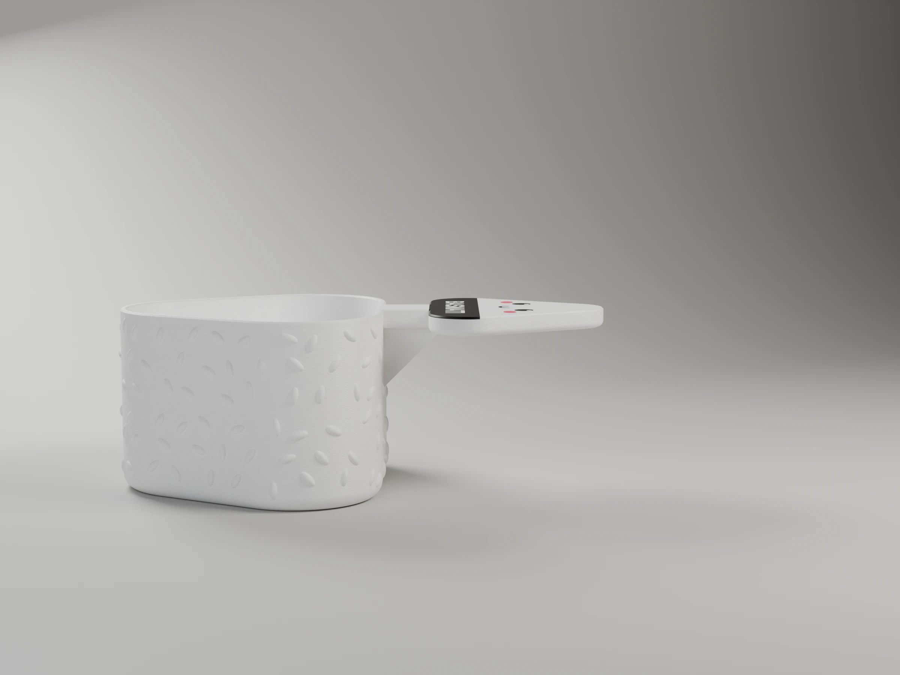
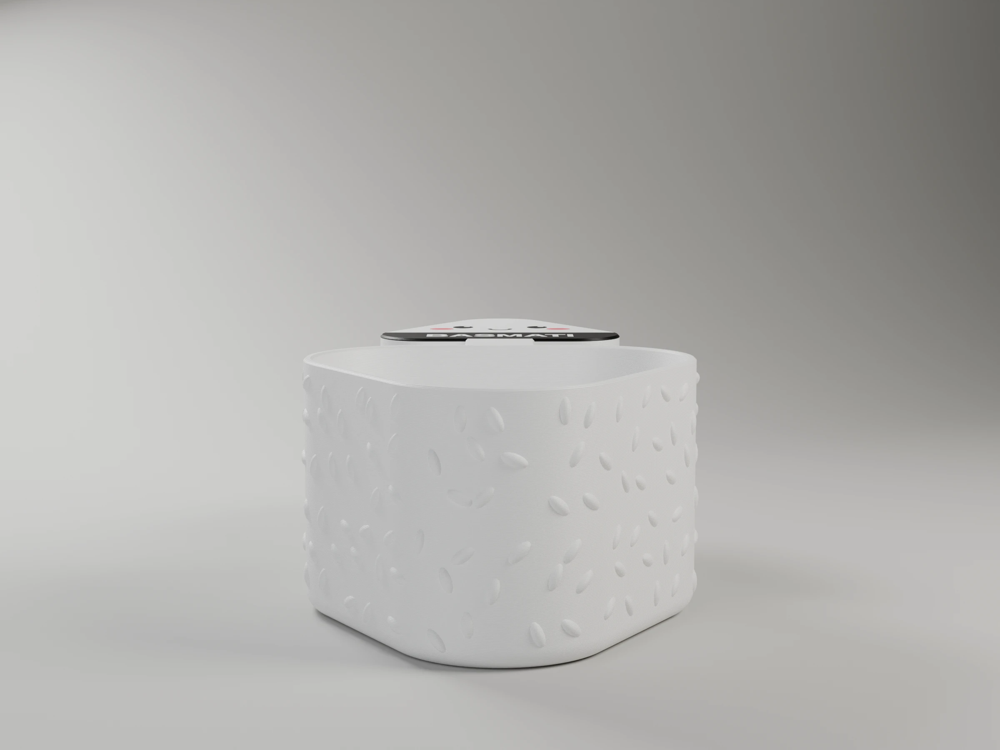
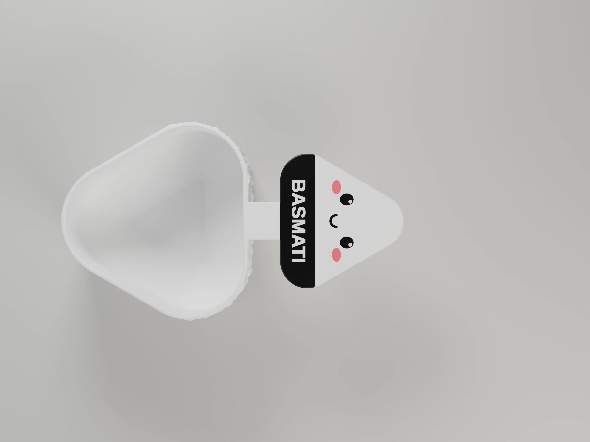
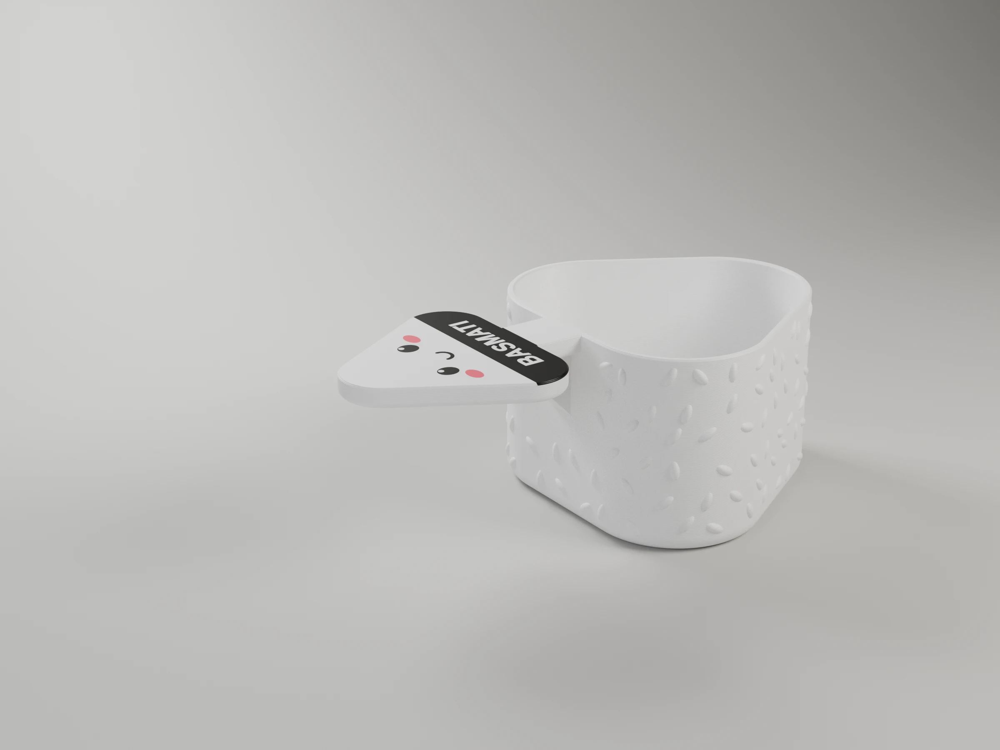

# Onigiri rice scoop

A measuring scoop that holds **100 g of raw rice levelled off at the rim**. The cup is a
rounded onigiri triangle, covered in rice grains in relief, with its tip as a pouring spout.
The handle is a little onigiri on a stick, with a face, pink cheeks and a nori band that
names the rice. There is one scoop per rice, since a gram of basmati takes more room than a
gram of brown rice.


```sh
make project                                    # -> onigiri-rice-scoop-p1s.3mf (both scoops, ready to print)
make report                                     # rebuild it, slice it, print time and filament
make check                                      # each scoop's real volume up to the rim
make project DEFS='-D basmati_density=0.80'     # after weighing your rice (below)
make                                            # -> onigiri-rice-scoop-<rice>.stl, single colour
make 3mf                                        # -> onigiri-rice-scoop-<rice>.3mf, multi-colour
make render                                     # -> renders/*.webp, studio views with Blender
```

## The measure

The cup depth is solved from `grams / density`, so the scoop stays exact whatever its size.
`make check` measures the cavity of the exported model: it matches to 0.05 ml.

| Scoop | Density | Volume to the rim | Inside depth | Label |
|---|---|---|---|---|
| Basmati (white) | 0.78 g/ml | 128.2 ml | 45.6 mm | BASMATI |
| Brown rice | 0.85 g/ml | 117.7 ml | 42.5 mm | INTEGRAL |

The densities come from kitchen tables (about 185 g per US cup of white basmati, 200 g of
brown rice), which disagree with each other by several percent. **Calibrate once:** fill
the printed scoop, level it with a knife, weigh it, and set the density to
`100 / grams weighed × density`.
Then rebuild with `make project DEFS='-D basmati_density=…'` (or `integral_density`).
For another rice, `rice="custom"` with `custom_density` and `custom_label`.

Levelled off at the rim is more repeatable with grains than a fill line. The inside narrows at
45° to a small floor, so it empties cleanly.

## Parameters

All lengths in mm. Override any of them with `make … DEFS='-D name=value'`.

| Parameter | Default | What it does |
|---|---|---|
| **Rice** | | |
| `grams` | 100 | Rice the scoop holds, levelled off |
| `rice` | `basmati` | `basmati`, `integral` or `custom` |
| `basmati_density`, `integral_density`, `custom_density` | 0.78, 0.85, 0.80 | g/ml of raw rice |
| `custom_label` | `ARROZ` | Label on the nori with `rice="custom"` |
| `show_label`, `bottom_text` | true | Rice name on the nori; "100 g" engraved under the cup |
| **Cup** | | |
| `cup_core`, `cup_r` | 30, 20 | The onigiri triangle: side of its sharp core and corner radius at the rim |
| `floor_r` | 2 | Corner radius at the floor (the walls run down to it at 45°) |
| `wall`, `floor_t` | 1.68, 2 | Wall (4 lines) and floor (10 layers) |
| `foot_r`, `rim_c` | 4, 0.4 | Outside foot rounding; rim chamfer |
| **Rice grains** | | |
| `grains` | true | Grains in relief on the outside |
| `grain_size`, `grain_relief`, `grain_step`, `grain_seed` | [5.2, 2.4], 0.7, [9, 7], 7 | Grain size, height, spacing, and the seed that scatters them |
| **Handle** | | |
| `pad_core`, `pad_r` | 30, 10 | The onigiri handle's triangle |
| `neck_l`, `neck_w`, `handle_t` | 12, 14, 5 | The stick: length, width; thickness of the handle |
| `handle_r` | 1.6 | Rounding of the handle's underside edges |
| `gusset`, `gusset_w` | 16, 6.72 | 45° rib under the stick, against the cup wall (sized by FEA, below) |
| **Face** | | |
| `inlay_t` | 0.6 | Inlay depth (3 layers) |
| `eye_d`, `eye_gap`, `eye_shine` | 4.4, 16, 1.4 | Eyes and their white highlight |
| `mouth_r`, `mouth_w` | 2.2, 0.9 | The smile |
| `cheek_size`, `cheek_gap` | [5.2, 3.4], 25 | Pink cheeks |
| `nori_h`, `label_size` | 13, 5 | Nori band and its lettering |
| **Colours** | | `rice_color`, `nori_color`, `cheek_color` (they pick the filament in the project) |
| `part` | `scoop` | `scoop` (coloured), `body` (one colour) or `cavity` (used by `make check`) |

## Printing (Bambu P1S)

`make project` builds `onigiri-rice-scoop-p1s.3mf`: both scoops on one Textured PEI plate,
**upside down** (rim and handle on the bed). The cup needs no supports, and the face, nori and
cheeks are 0.6 mm inlays in the first three layers. Both scoops change colour at the same
heights, so sharing the plate costs nothing extra (CLAUDE.md §3.1).

- Process: *0.20mm Standard @BBL X1C*, gyroid infill, Arachne walls (thin strokes in the first
  layers), elephant foot compensation 0.
- **2 h 29 min, 80.2 g** for both (`make report`).

| AMS slot | Filament | Colour | Used |
|---|---|---|---|
| 1 | PLA Pure | white (rice) | 77.1 g |
| 2 | PLA Pure | black (nori, eyes, mouth) | 1.5 g |
| 3 | PLA Pure | pink (cheeks) | 1.6 g |

The project uses the *Bambu PLA Basic* preset: Bambu Studio 02.08 has no PLA Pure preset, and
the two print alike (PLA Pure: 190–230 °C, bed 35–65 °C). **No glue on the plate**: the PLA
Pure data sheet warns that adhesive residue compromises its food-contact safety.

The floor inside prints as a bridge over a small triangle about 30 mm across; the 45° walls
around it print without support.

## Food contact

PLA Pure is made of EU food-contact certified ingredients, pigments included
([data sheet](../../tools/materials/bambu-pla-pure-tds.pdf)), and the P1S's nozzle is
stainless steel. Raw rice is dry, so the risk is low. Still, layer lines hold dirt
(CLAUDE.md §8): **wash it by hand in warm water and keep it out of the dishwasher**, since PLA
softens at about 55 °C.

## Strength and orientation

The scoop prints upside down, so in use, vertical stresses cross the layers.

| Part | Load | Orientation | Margin |
|---|---|---|---|
| Handle and stick | lifting 100 g; pushing the scoop into rice (20 N, generous) | flat in the first 25 layers: bending runs along the layers | 11× |
| Cup wall behind the handle | the stick pushes on it and bends it locally | standing: that bending crosses the layers | 7× in PLA Pure (derated to 50 %) |

The margins come from an FEA, and the 16 mm rib under the stick from its design study:
[fea/README.md](fea/README.md). The same study chose PLA Pure over PETG.

## Renders

`make render` renders the basmati scoop, turned cup up, in the project's filaments.

| Hero | Front | Side | Top | Back |
|---|---|---|---|---|
|  |  |  |  |  |
