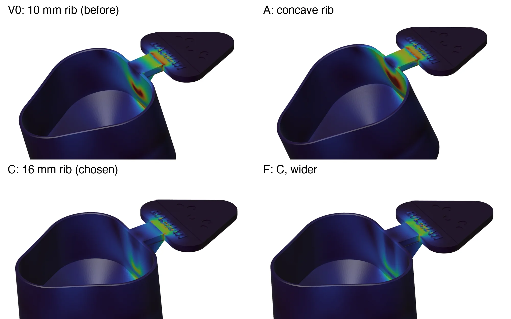

# Onigiri rice scoop: load analysis and the rib under the handle

What was simulated on the scoop, the material it led to, and why the rib under the handle grew
from 10 to 16 mm. The method is in [tools/fea/README.md](../../../tools/fea/README.md); this
page is the project's record (2026-10-25).

**In short:**
- **Material:** PLA Pure. It is the only food-contact filament, it prints without glue,
  and it holds daily use with a 7× margin across the layers.
- **Changed:** the 45° rib under the handle, from 10 to 16 mm. For 0.9 % more plastic, the
  scoop bends 65 % less when pushed into rice, and the stress across the layers at the
  handle's root drops to under half.

## Load cases

The scoop only takes rice out of a jar: no knocking it on a pot, no scraping. The hand holds
the onigiri handle, top and underside clamped beyond the nori.

| Case | Load | For |
|---|---|---|
| Lift | a full scoop: 100 g of rice + the scoop, 1.3 N down on the inside | the everyday load |
| Dig | pushing it into packed rice: 20 N back along the handle on the front of the cup | the largest load in use (generous: loose rice takes a few N) |

No load is permanent: the scoop is stored empty, so creep does not apply.

## Material

From the data sheets in [tools/materials](../../../tools/materials/README.md). The allowable
stress across the layers is derated per CLAUDE.md §2.3: 50 % for PLA and 40 % for PETG.

| | E X-Y | Along the layers | Across them | Notes |
|---|---|---|---|---|
| PLA Pure (TDS V1.0) | 2481 MPa | 51.5 MPa | 25.8 MPa | EU food-contact certified ingredients; no glue on the plate; softens at ~55 °C |
| PETG Basic (TDS V3.0) | 2780 MPa | 51 MPa | 20.4 MPa | tougher (9.5 % elongation) and takes heat; its TDS asks for glue on the plate |

The scoop is held at one end, so its stresses do not depend on E: one run per case serves
both materials, and the deflections scale with 1/E.

## Results

`scoop_fea.py`, OpenSCAD STL without the rice grains (they carry nothing), fTetWild + C3D10,
h = 1.2 mm. Going from h = 2.0 to 1.2 mm changed the p99.5 stresses by 5–10 %. Each variant changes one
parameter from the reference. All values are p99.5 at the handle's root, under the dig case.

| Variant | Change | Plastic | Moves | Along the layers | Across the layers | Margin across, PLA Pure / PETG |
|---|---|---|---|---|---|---|
| V0 | 45° rib, 10 mm (as first drawn) | 61 218 mm³ | 2.46 mm | 8.3 MPa | 8.0 MPa | 3.2× / 2.5× |
| A | V0 with a concave rib, tangent to the wall | −0.3 % | 3.56 | 8.6 | 12.8 | 2.0× / 1.6× |
| B | A, rib 12.18 wide | −0.1 % | 3.13 | 8.1 | 10.6 | 2.4× / 1.9× |
| **C** | **rib 16 mm** | **+0.9 %** | **0.86** | **4.5** | **3.7** | **7.0× / 5.5×** |
| D | rib 12.18 wide | +0.4 % | 2.16 | 8.1 | 7.1 | 3.6× / 2.9× |
| E | rib 22 mm | +2.1 % | 0.18 | 1.7 | 1.5 | 18× / 14× (*) |
| F | C, rib 12.18 wide | +2.0 % | 0.66 | 3.5 | 3.0 | 8.5× / 6.8× |

(*) E's rib reaches under the onigiri, into the clamped grip, which flatters it. It is also
where the fingers go.



*Von Mises, 0–10 MPa, deformation ×10, under the dig case.*

**What it says:**
- **The cup wall, not the handle, is what gives.** The handle pushes on the 1.68 mm wall behind
  it and bends the wall locally. That stress is vertical, across the layers, since the scoop
  prints upside down. A longer rib spreads the push down the wall. A wider one barely helps
  (D), and a concave one is worse (A, B), because it has less material where the bending is.
- **V0's 23 MPa peak** at the tip of the triangular rib grew with every mesh refinement
  (15 → 23 MPa from h 2.0 to 1.2): a singularity, not a real stress. The p99.5 levels are the
  ones to read.
- **Lift is trivial:** 1.0 MPa across the layers with V0 (26×), and less with C.

Chosen: **C** (`gusset = 16`). It is hidden under the onigiri and changes nothing you can see.

## Run it

```sh
openscad -D 'part="body"' -D grains=false -o scoop.stl ../onigiri-rice-scoop.scad
MAMBA_ROOT_PREFIX=~/mamba micromamba run -n fea python scoop_fea.py scoop.stl out 1.2
```

About 5 minutes per variant on an M-series Mac, meshing included (it is cached by the STL's
content). The geometry constants at the top of the script are the basmati scoop's defaults:
update them if the cup changes.
