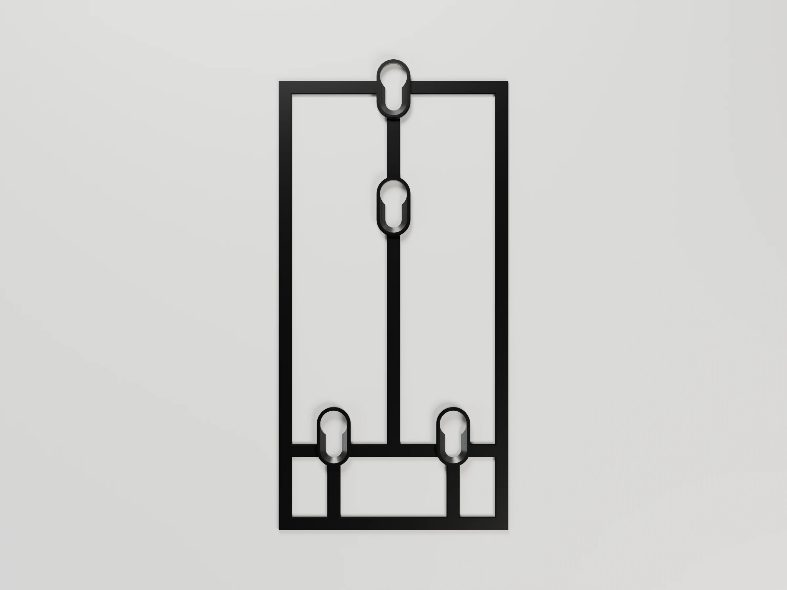
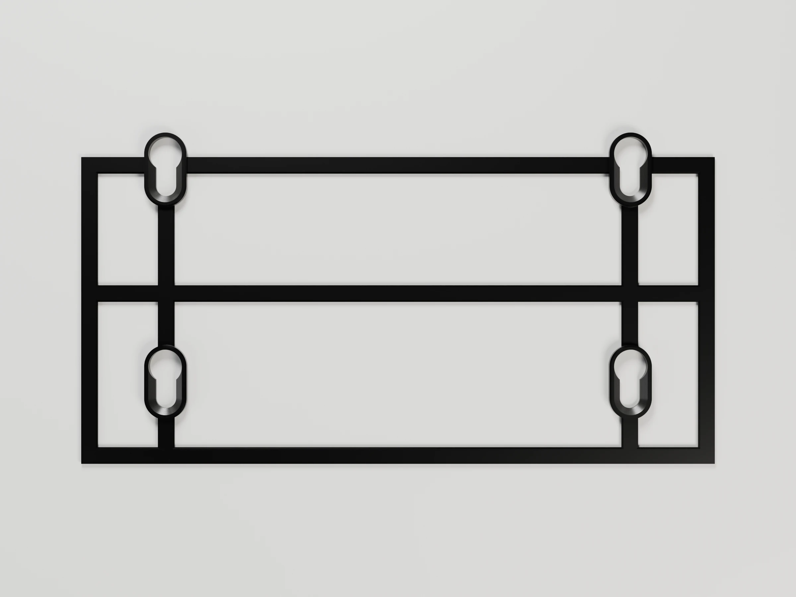
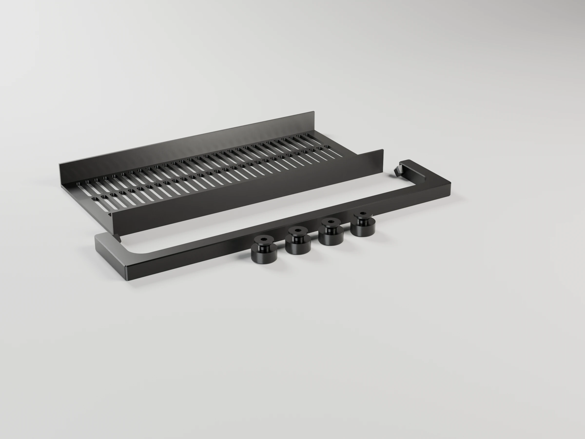

# Sink organizers

Two wall-mounted pieces for either side of the kitchen tap, built on one
pattern so they look and work alike:

- **Soap caddy**: holds the dish soap bottle **upside down** over the scourer
  sponge, so the soap is always at the cap and lands on the sponge.
- **Cutlery drainer**: three bins for the wet cutlery on a rack over a drip
  tray, and a bar for the dish towel.

They replace a metal rack that scratched the counter and was hard to clean
around: nothing touches the counter, everything drips into the sink, and
every piece that gets wet comes out on its own, to wash it or reprint it.

 

```sh
make project                       # -> sink-organizers-p1s.3mf (PETG Basic), -p1s-hf.3mf (PETG HF) and -p1s-matte.3mf (PETG Matte)
make report                        # rebuild them, slice them, print time and filament per plate
make                               # -> one STL per part, soap-caddy-<part>.stl and cutlery-drainer-<part>.stl
make project DEFS='-D bottle_w=86 -D bottle_d=54 -D neck_d=32'   # your bottle
make project DEFS='-D dt_play=0.15'                              # a shared value: both pieces change
make render                        # -> renders/*.webp, studio views with Blender
make help                          # every target
```

## The pattern

Each piece is two parts that slide together:

- **Wall plate**: a flat plate on four suction cups, with two **sliding
  dovetail housings** along its sides. It stays on the wall.
- **Body**: side walls, a slotted floor, ledges for a drip tray and whatever
  closes the front, with a dovetail **tail** along the back edge of each side
  wall. It slides down into the housings and rests on their closed bottoms.

| On the wall | Taken apart |
|---|---|
|  |  |
|  |  |

The split is what lets both parts print the way they need to:

- The plate prints **flat**, the keyholes' best orientation: their slot lips
  carry the pull of the button heads in XY.
- The body prints **standing**, so it can have a front: a wall or a bar
  across it is just another wall. The first frames printed on their backs
  had no front, because a bar across a frame printed that way is a 100–200 mm
  bridge. Their side walls spread, the ledges came apart, and the tray and
  box slid out. Now the floor and the front tie the side walls together, and
  the plate holds them at the back.
- Standing, the soap caddy's 209 mm body has no wall across it until its
  front bar closes at the top, so its thin side walls swayed under the
  nozzle and came out rough above ≈165 mm. It now prints with four
  sacrificial fins beside its walls, tied to them by one-line tabs: snap
  them off after printing ([Analyses](#analyses)).

To put the cups on the wall, use the piece's [installation jig](#installation-jigs-plates-8-and-9),
not the plate.

To take a piece down: lift it 12 mm (`drop`) off its buttons and take it off
the wall; on the table, slide the body up off the plate.

The dovetails are `dovetail_tail` and `dovetail_housing` from
[tools/scad](../../tools/scad/) (CLAUDE.md §4.7):

- **Shape**: 45° flanks, `dt_play` 0.025 per side and
  none at the floor (`dt_floor` 0): the tail slides on the plate's face. The tail is the 1.68 mm side wall widening 1.68 per side,
  4 mm deep. There is a lead-in on the tail's tip and the housing's mouth.
- **First test**: 0.25 per side and 0.35 at the floor were loose in PETG, and
  a head widening only 1.26 per side, printed standing, came out round.
  With the bigger head, 0.05 on the flanks and 0.2 at the floor still
  rocked; 0.025 and 0 slides smoothly with almost no play (two play
  ladders, tools/README.md "Tested fits").
- **Holding**: the tail cannot pull forward out of the housing (the head is
  wider than the neck) or move sideways. It slides only along the wall's
  height and stops on the housing's 2 mm bottom (`dt_cap`).
- **Risk**: no published test of a printed sliding dovetail exists, so print
  the fit test first.

[`common.scad`](common.scad) holds everything the two pieces share: the
plate, the dovetails, the floor, the ledges, the tray, the keyholes and the
house style (straight back, rounded front corners, close rounded slots,
split at `slot_max_len` and at 45° in the side walls). Both piece files
include it, so a change there changes both. The Customizer shows only the
piece's own parameters; the shared ones are overridden with `DEFS` like any
other.

## Soap caddy


Sized for the Bosque Verde 600 ml bottle (90 mm at its widest, 50 mm deep,
210 mm tall) and the Bosque Verde scourer with nail guard (90 × 65 × 45 mm),
both from Mercadona.

**Cups.** Four suction cups (Ø 50 mm with an M4 stud, e.g. DIYexpert on
Amazon) hold the plate: two side by side low down, `lower_cup_span` (56 mm)
apart, and two one above the other behind the box, `cup_pitch` (55 mm)
apart. They are where the earlier caddies had them, so the cups already on
the wall stay put. The top cups pull and the bottom ones press, which takes
the turning moment of the bottle and of a hand on the sponge.

**Wall plate.** Where the drainer's plate has slots, the caddy's has windows
(`plate_window`, `plate_window_inset`): one below the box, and one each side
of the upper keyholes with 20 mm solid bands above and below.
- **Why:** the body, nodding forward, pulls the housings at the plate's edges
  while the upper cups hold it in the middle, so the plate bends across, and
  the solid horizontal bands are what resist that.
- **Against the old slots:** an FEA design study ([fea/README.md](fea/README.md))
  compared 13 variants, one change at a time. The windows take 7.4 % less
  plastic, bend 29 % less in daily use and under the bottle alone, and halve
  the stress.

**Box.** It drops in from the top onto two ledges, which are chamfered at 45°
underneath because the body prints standing.

- **In front of it:** the body has two returns in line with the box's own
  and a bar across the top, so the box cannot slide out. The opening's top
  corners are at 45°, so the bar is a 10 mm bridge, and the returns' bottom
  edges rise at 45° from the side walls: level, they stuck out 11.6 mm with
  nothing under them, and the slicer flagged a floating cantilever.
- **The bottle** drops in cap first; you squeeze it through the open front.
  Its cap goes through a hole in the floor and hangs `tip_gap` (15 mm) over
  the sponge.
- **Removing it:** lift it straight up, with the bottle out first.
- **Under the cabinet:** the top of the body plus the bottle must fit under
  the wall cabinet. The console prints the margin (431 of 460 mm by default).

**Tray.** The sponge sits on level slats over a floor that slopes 6° forward
and spills 10 mm past the edge of the sink (`drip_over`), 130 mm from the
wall with the sink 120 mm out (`sink_dist`, shared by both pieces).

- **Front:** it is open, so you can take the sponge, and the floor under the
  tray stops 5 mm behind its edge, so the drips fall clear.
- **Drip lip:** a 1.5 mm lip hangs under the straight part of the front edge
  (`drip_lip`), 45° behind it. The drops hang on its edge and fall, instead
  of running back under the tray. Both pieces' trays have it.
- **Removing it:** lift its front 2 mm over the bumps at the ends of the
  ledges (`ledge_stop`) and slide it out under the box.


## Cutlery drainer


**Cups.** Four suction cups (Ø 50 mm, M4 stud), one at each corner of the
plate: `cup_span` (175 mm) apart, under the dovetails that carry the body,
and `cup_pitch` (80 mm, the most the plate fits) one above the other. The
cutlery and the towel hang well in front of the wall, and the two rows take
that turning moment.
- **Why the corners:** an FEA design study ([fea/README.md](fea/README.md#cutlery-drainer))
  found the first layout, with the cups 120 mm apart, let the plate twist between them and
  the dovetails. The whole drainer nodded forward about 2° and the towel bar dropped 9 mm.
  Under the dovetails it drops 0.7 mm.
- **Why 80 mm between the rows:** the upper cups pull the turning moment over that distance,
  9 N each all day against 13 N at 55 mm.

**Wall plate.** With the cups at its corners, the middle of the plate
carries nothing: one window (`plate_window`, `plate_window_inset`) with 4 mm
bands above and below takes a quarter of its plastic and changes neither its
stiffness nor its stress.

It is laid out like the soap caddy: the bins stand on a rack over the tray,
and the tray slides out under the rack with the bins in place.

**Bins.** Three bins, 68 × 90 mm and 80 mm tall (`bin_h`): low enough to pick
a teaspoon out. Every wall and floor is slotted, so the cutlery airs and
drips.

- **What holds them:** they stand side by side on the rack with 0.25 mm of
  play round each (`bin_play`, the soap caddy box's tested fit), between
  the side walls, and the rack's 15 mm fences (`fence_h`) hold their feet
  front and back. The first version gave them 0.5 mm and stood them on the
  tray's slats, and they rattled.
- **Removing them:** lift them straight up.

**Rack.** A slotted shelf on two ledges, chamfered at 45° underneath because
the body prints standing.

- **Fences:** at its front and back. They hold the bins' feet and stiffen
  the 206 mm span: they sag about 0.5 mm under 1 kg of cutlery.
- **Floor:** 2.4 mm (`rack_t`), its slots running front to back
  (`rack_slots_across`), so its strips span the 90 mm between the fences,
  the short way.
  - **The first floor** was 1.6 mm with the slots running side to side, and sagged 1.8–2.7 mm
    under the cutlery.
  - **Now:** 0.7–0.85 mm (FEA, [fea/README.md](fea/README.md#the-rack)).
  - **The alternative:** the same thicker floor with the slots side to side sags 35 % more.
- **Stops:** a 2 mm bump on each ledge in front of it (`rack_stop`) keeps it
  from sliding forward. With the bins out, lift it straight up.
- **Height:** its ledges sit over the tray's side rims, high enough for the
  tray to lift over its own bumps and slide out under them.

**Tray.** A floor that slopes 6° forward, with rims, and nothing in front of
or under its edge. It spills 10 mm past the edge of the sink, 130 mm from
the wall, over the same drip lip as the soap caddy's.

- **Why it changed:** the first version's tray stopped 1.3 mm behind a
  front wall that reached down to the floor, 124 mm from the wall, with the
  sink 120 mm out (it was sized for 115). The water dripped on the edge of
  the counter.
- **Removing it:** lift its front 2 mm over the bumps at the ends of its
  ledges and slide it out under the rack.

**No front wall.** A wall across the front, above the tray, would be a 200 mm
bridge with the body printed standing. The floor ties the side walls at the
bottom, the dovetails hold them at the back and the handle at the top
front; the rack only rests between them.

**Towel handle** (optional). The bins stay put with or without it.


- **Shape and fitting:** a U in front of everything, its bar 14 mm
  (`towel_gap`) in front of the body, its arms outside the side walls. The
  towel hangs in front of the tray's edge, over the sink.
  Fold the towel over the bar. It is a **sprung handle** (`sprung_handle`
  from [tools/scad](../../tools/scad/), CLAUDE.md §4.7): spread the arms a
  little and let them close, and a 6 mm diamond pin at the end of each arm
  snaps 5 mm into a socket in a boss on each side wall.
- **Why it stays on:** the pins only come out if you spread the arms again,
  so pulling the towel cannot unseat it, and being square they cannot turn.
  Seated, the arms carry no preload, so the PETG does not creep. Putting it
  on strains the bar 0.5 %, under the 1 % allowed; the console prints it.
- **Printing:** the bosses taper at 45° underneath, because the body prints
  standing. The side wall slots stop under them along a 45° line: cut
  level, each slot got a flat roof with a loose end, which the slicer
  flagged as a floating cantilever.

## Installation jigs (plates 8 and 9)

Sticking the cups on the wall through the plate is awkward: the plate hides
them, so you cannot see them seal or press each one firmly on its own. Each
piece has a jig that puts its four cups exactly where the plate's keyholes
hang them, and nothing else (`install_jig` in [common.scad](common.scad)):

| Soap caddy | Cutlery drainer |
|---|---|
|  |  |

- **Keyholes, upside down:** the plate's keyhole cut (tested) with the entry
  above the slot. In the plate the entry is below, because the plate drops
  onto buttons already on the wall. In the jig the cups hang from it, so an
  entry below would let them slide down and fall out. With the entry above,
  their weight holds each button at the bottom of its slot, where the plate
  will hold it (shifted 0.6 mm up, since the shank rests on the slot's other
  end). Each keyhole has a rim 1.68 mm wide (`jig_rim`) and is as thick as
  the plate's pads.
- **Outline:** a frame of 6.3 × 2 mm bars (`jig_bar_w`, `jig_bar_t`) round
  what the piece takes up seen from the front, its outer edge on the outline:
  the plate and the body for the soap caddy (108 × 211), the plate, body and
  towel handle for the cutlery drainer (239 × 116). Put a spirit level on
  its bottom bar. The upper keyholes stick out over the top bar, since their
  entries are above.
- **Bars and legs:** the soap caddy's keyholes hang on a bar across through
  the lower pair and one up through the upper two, the cutlery drainer's on
  an H; legs run from the lower cups down to the frame. In their plane the
  bars keep the spacing; across it they are thin, so pressing one cup does
  not lift the others off the wall.

To use it:
1. Screw the buttons onto the cups and hang each cup in its keyhole: in
   through the round entry at the top, then down to the bottom of the slot.
2. Clean and dry the wall. Hold the jig against it where the piece goes,
   with a spirit level on the bottom bar.
3. Press each keyhole hard against the wall with your thumb, one at a time,
   until the cup lies flat and clear of air.
4. Push the jig down 12 mm (`drop`), so its entries come to the button
   heads, and take it off. Hang the plate on the buttons.

The loads are a thumb pressing each rim onto its button's flange, in
compression: no analysis needed. The soap caddy's jig: 37 min, 13 g; the
cutlery drainer's: 40 min, 15 g.

## Fit tests (plate 6)

Each piece tests the real thing, printed the way the real part prints. The
button hole and the dovetail were settled in black PETG Basic on the P1S
(tools/README.md, "Tested fits"); with PETG HF or PETG Matte, print
the ladders once in that filament before the big plates. PETG Matte is
filled, about 20 % stiffer and a sixth weaker in tension than PETG Basic (Bambu's
data sheets), so check above all that the button taps onto the stud
without cracking.

- **Buttons on the cup**: three buttons with pilot holes of 3.8, 3.9 and
  4.0 mm as modelled (≈3.55, 3.65 and 3.75 printed), marked by 1 to 3
  notches in the flange. 3.7 tapped but was hard to turn by hand. Use the
  one that screws on easily and does not come loose when the cup is turned,
  with `-D stud_hole=…`. Tested: 3.9 (the default) taps with little effort
  and holds; 3.8 is harder to turn and holds harder. The flange must reach the cup's hub; if the stud
  stops it short, measure the stud and raise `stud_len`.
- **Keyhole**: push the button (on its cup) through the pad's entry and slide
  it up the slot. It should slide freely and seat with no play. Too tight:
  raise `keyhole_play`; loose front to back: lower `shank_play`.
- **Dovetail**: a strip of plate with four housings (flat) and a strip of
  wall with its tail (standing), 20 mm long.
  - **The ladder**: the housings have 0, 0.025 and 0.05 mm of play per side
    on the flanks with none at the floor, and 0.05 with 0.2 at the floor
    (the fit that rocked), marked by 1 to 4 notches in the strip's edge past
    their mouths.
  - **Why the floor**: the first ladder (0.05–0.20 on the flanks, 0.2 at
    the floor) was loose all the way. The head's straight sides keep the
    sideways play to the flank play, but the floor play lets the tail move
    0.2 towards the plate, off its flanks, and tilt there. The floor is the
    plate's top face, printed flat, so it takes 0 or a whole layer.
  - **Picking the play**: use the tightest housing the tail slides all the
    way down without forcing and without rocking, with `-D dt_play=…` and
    `-D dt_floor=…`. Then rebuild the project. Tested: 0.025 / 0 (2
    notches, the default) slides smoothly; 0 / 0 rubs.
  - **Margin**: the real joints are 100–210 mm long, so a fit that is only
    just free here may bind there. If in doubt, take the next one up.
- **Box width**: the top 12 mm of the soap caddy's body and the bottom 12 mm
  of its box. The box must drop through with a little play and stop against
  the returns. Too tight: raise `box_play` and `tray_play`; sloppy: lower
  them. The slice keeps the body's fins and one row of their tabs.
- **Sway test** (plate 7, 17 g, about 2 h): two strips of the soap caddy's side wall,
  as flexible at the top as its body was where it printed rough. The bare
  strip should come out rough above ~85 mm, as the body did; the one
  with fins should be clean, and its fins should snap off flush. Tabs gone
  before the end (the fins loose): raise `tab_h` to 0.6 or lower
  `tab_pitch`. Bumps where the tabs were: a knife takes them off; note
  them in tools/README.md, "Tested fits". A bare strip that prints clean
  means the slicer slowed down for the small layers (minimum layer time)
  and hid the sway: print it next to something bigger.
- **Handle pins**: snap the small handle onto the block: the pins must click
  in and hold. Too stiff: raise `pin_play`.

## Parts

| Part | Size (mm) | Notes |
|---|---|---|
| soap caddy `plate` | 108 × 211 × 6 | Wall plate: four keyholes, two housings, three windows; printed flat on its back |
| soap caddy `body` | 101 × 114 × 209 | Side walls with the tails, floor, ledges, the box's returns and bar; printed standing, with four fins (142 mm wide on the bed) to cut off |
| soap caddy `tray` | 97 × 103 × 24 | Sloping floor, slats, rims; printed on its back |
| soap caddy `box` | 97 × 56 × 90 | Bottle box; printed standing on its floor |
| cutlery drainer `plate` | 217 × 116 × 6 | Wall plate: four keyholes at its corners, two housings, one window; printed flat on its back |
| cutlery drainer `body` | 218 × 114 × 114 | Side walls with the tails, floor, ledges for the tray and the rack, the handle's bosses; printed standing |
| cutlery drainer `tray` | 206 × 103 × 21 | Sloping floor with rims and a drip lip; printed on its back |
| cutlery drainer `rack` | 206 × 94 × 17 | Shelf, 2.4 mm, slotted front to back, with a fence at the front and back; printed on its floor |
| cutlery drainer `bin` | 68 × 90 × 80 | Three; printed standing on their floors |
| cutlery drainer `handle` | 239 × 49 × 10 | The U with its two diamond pins; printed flat |
| soap caddy `jig` | 108 × 221 × 4.2 | Installation jig: four upside-down keyholes on bars, in a frame round the piece's outline; printed flat |
| cutlery drainer `jig` | 239 × 125 × 4.2 | Installation jig: an H through four upside-down keyholes, in a frame round the piece's outline; printed flat |
| `button` | Ø 16 × 13 | One per cup (8); the stud goes right through; printed on its flange |
| `test_*` | — | The fit tests above |

## Analyses

Decided per CLAUDE.md §2.3:

| Trigger | Analysis | Result |
|---|---|---|
| Loads with margins near 5× and a tangled load path (plate, tray, cups) | FEA, single parts and the assembly on the wall | Done: [Strength and orientation](#strength-and-orientation), [fea/README.md](fea/README.md) |
| Tall thin walls printed standing; the first soap caddy body came out rough above ≈165 mm | Print stiffness FEA | Done: the body's top layer moved 33 mm/N sideways (clean up to ≈17). With the fins, ≤1.3 at every height ([fea/README.md](fea/README.md#5-the-body-while-it-prints)). Checked in print with the sway test: the bare strip rough from where the model said, the one with fins clean. The cutlery drainer's body (114 mm): ≤9 mm/N on its walls, 12 at the very top, inside what printed clean (≈17) but over the ≤10 aim: no fins, watch its top band on the first print |
| Free-standing piece | Stability | Not needed: both pieces hang on suction cups |
| Installation jigs | — | Not needed: a thumb presses each rim onto its button in compression; the jig holds four cups (≈80 g) |

## Strength and orientation

Each loaded part is checked against its load, derating PETG to 40 % across
the layers (CLAUDE.md §2.3). Loads: a full 600 ml bottle (≈6.5 N), a hand
pressing the sponge (≈30 N), wet cutlery and a towel (≈10 N), and squeezing
the bottle towards the wall (≈30 N).

Both pieces were also checked by FEA (gmsh + CalculiX, [fea/README.md](fea/README.md)): the
soap caddy's tray alone, then each piece whole on its cups.
- **Soap caddy, daily use:** the top cup pulls off the wall with ≈14 N while a hand presses
  the sponge, and ≈3 N under the bottle alone, all day. The cup under it hardly works; the
  lower ones press and carry the weight.
- **Squeezing the bottle:** the box's back wall closes its 1.9 mm gap and rests on the
  upper buttons' heads.
- **Cutlery drainer, daily use:** with 1 kg of cutlery and a wet towel the towel bar drops
  0.7 mm and each upper cup pulls ≈9 N all day. A 20 N pull on the towel at one end takes the
  worst cup to ≈43 N, and 23 N sideways, for a moment. The first layout (cups 120 mm apart)
  nodded 2° and dropped the bar 9 mm; [fea/README.md](fea/README.md#cutlery-drainer) has the
  design study that moved the cups.

| Part | Load | Printed | Across the layers? | Margin |
|---|---|---|---|---|
| plate keyholes | ≈2 N·m of turning moment over cups 55–120 mm apart: ≤15 N pull on each upper button head in daily use (FEA) | flat: the slot lips in XY | no | > 20× |
| plate housings | the body's moment pulls the tails forward: a few N along 100–210 mm of lip | flat: the lips are pulled along Z | yes | > 100× (≈0.03 MPa) |
| body tails | the same, bending the necks | standing: within the layers | no | > 100× |
| body side walls | the hand on the sponge or the trays and the rack on the ledges, held by the plate, the floor and the front (the handle on the drainer) | standing: bending within the layers | no | > 20× |
| body floor and front | tension across when the walls are pushed apart (a few N) | standing: in XY | no | > 50× |
| ledges | the box, the trays and the rack | standing, chamfered underneath | no | > 50× |
| drainer `rack` | 1 kg of cutlery over a 206 mm span; its floor's strips span the 90 mm between the fences | on its floor: it bends within its layers | no | ≈20× (FEA: 2.2 MPa p99.9; the floor sags 0.7–0.85 mm) |
| drainer `plate` | the body's moment, held by the cups at its corners, under the dovetails | flat | no | ≈9× (FEA: 5.4 MPa p99.9 with the towel pulled) |
| tray slats | the hand on the sponge: ≈4.3 N per slat over ≈35 mm | on its back, slats along Z | yes | ≈5× (FEA: 3.9 MPa across the layers) |
| tray front tie | carries the slats' front ends across the 94 mm between the side rims; sags ≈2 mm (FEA) | on its back, the tie along X | no | ≈4.7× (FEA: 10 MPa) |
| soap caddy `plate` | bends across, held by the upper cups in the middle, pulled by the housings at its edges | flat | no | ≈4.7× (FEA: 10.2 MPa peak by the top keyhole, 16.9 with the old slots) |
| soap caddy `box` back wall | squeezing the bottle: 30 N towards the wall, onto the upper buttons' heads | standing: the wall bends across its layers | yes | ≈1.4× at the head, ≈2.5× around it (FEA: 13.7 / p99 7.7 MPa). Squeeze gently |
| `handle` | the towel on a 230 mm bar: ≈0.1 N·m at mid-span | flat: the U in XY | no | > 50× |
| `button` | shear on the shank and pull on the head, ≤10 N | standing on its flange | yes | > 50× |

## Printing (Bambu P1S)

`make project` builds the three projects on a Textured PEI plate:
- **Settings:** P1S 0.4 nozzle, *0.20mm Standard* with gyroid infill, the
  seam at the back, scarf seam and precise outer walls.
- **Filament:** black Bambu PETG in slot 1: `sink-organizers-p1s.3mf` for
  PETG Basic, `sink-organizers-p1s-hf.3mf` for PETG HF and
  `sink-organizers-p1s-matte.3mf` for PETG Matte (the same plates, with
  their presets). The matte surface hides layer lines but holds soap and
  limescale more than glossy PETG does, so it takes a brush to clean. PETG takes warm soapy water
  and the top rack of the dishwasher, where PLA softens and creeps.
- **Supports:** none. The plates lie on their backs, the bodies stand, the
  trays lie on their backs, the box, rack and bins stand on their floors,
  and the handle lies flat.
- **Soap caddy body:** prints with four sacrificial fins (`stabilizer_fin`,
  tools/scad/print_aids.scad), 20 mm out from its side walls and tied to
  them by tabs one line wide and 2 layers tall every 20 mm (Arachne walls
  on the objects with fins: Classic drops tabs that thin); plate 1 holds it
  turned a quarter to fit them.
  Its walls print at 60 mm/s (outer) and 80 (inner) above 100 mm (a height
  range modifier), and the project avoids travel across walls, where PETG
  strings. After printing, bend the fins off; if a tab leaves a bump, a
  knife takes it off.

With the default parameters:

| Plate | Contents | PETG Basic | PETG HF | PETG Matte |
|---|---|---|---|---|
| 1 · Soap caddy: body and wall plate | body (standing, with fins), plate (flat) | 6 h 52 min, 135 g | 6 h 33 min, 138 g | 6 h 53 min, 148 g |
| 2 · Soap caddy: tray, box and buttons | tray, box, 4 buttons | 3 h 22 min, 69 g | 3 h 06 min, 71 g | 3 h 22 min, 75 g |
| 3 · Cutlery drainer: body and wall plate | body (standing), plate (flat) | 4 h 25 min, 94 g | 4 h 04 min, 96 g | 4 h 25 min, 103 g |
| 4 · Cutlery drainer: tray, rack, handle and buttons | tray, rack, handle, 4 buttons | 3 h 56 min, 94 g | 3 h 36 min, 96 g | 3 h 56 min, 103 g |
| 5 · Cutlery drainer: bins | 3 bins | 5 h 19 min, 78 g | 5 h 06 min, 80 g | 5 h 19 min, 86 g |
| 6 · Fit tests | keyhole pad, 3 buttons, dovetail ladder and tail, box width (with fin tabs), handle pins | 1 h 32 min, 36 g | 1 h 27 min, 36 g | 1 h 32 min, 39 g |
| 7 · Sway test | two strips of side wall, bare and with fins | 2 h 26 min, 17 g | 2 h 05 min, 17 g | 2 h 26 min, 19 g |
| 8 · Soap caddy: installation jig | the jig | 37 min, 13 g | 36 min, 14 g | 37 min, 15 g |
| 9 · Cutlery drainer: installation jig | the jig (239 mm: the whole bed) | 40 min, 15 g | 39 min, 16 g | 40 min, 17 g |

Avoiding travel across walls costs 5–25 min on the other plates (the bins
the most). PETG bonds hard to the textured plate: use a glue stick as a release layer,
and let the plate cool before removing the parts.

## Parameters

All lengths in mm. Override any of them with `make DEFS='-D name=value'` (also
`make project`, `make report` and `make render`). The console prints the
sizes, the cup heights and the cabinet margin; asserts stop the build if the
pieces do not fit.

| Parameter | Default | What it does |
|---|---|---|
| **Shared** ([common.scad](common.scad)) | | |
| `cup_d`, `cup_h`, `stud_len`, `stud_hole` | 50, 12, 12, 3.9 | Suction cups: diameter, wall to the hub face, stud length (measure yours), pilot hole for the stud |
| `shank_d`, `head_d`, `flange_d`, `keyhole_play`, `shank_play`, `drop`, `pad_t`, `pad_w` | 7, 12, 16, 0.3, 0.1, 12, 4.2, 22 | Buttons and keyholes |
| `jig_bar_w`, `jig_bar_t`, `jig_rim` | 6.3, 2, 1.68 | Installation jigs: bars and outline frame, rim round the keyholes |
| `back_t`, `side_t` | 1.68, 1.68 | Wall plate; the body's walls (and the tails' necks) |
| `tie_t`, `drip_clear` | 1.6, 5 | The body's floor; how far it stops behind the tray's front edge |
| `ledge_w`, `ledge_h`, `ledge_stop` | 3.36, 4, 2 | Ledges under the tray; the bump at their front ends |
| `dt_w`, `dt_d`, `dt_play`, `dt_floor`, `dt_lip`, `dt_side`, `dt_cap` | 1.68, 4, 0.025, 0, 1.26, 1.68, 2 | Dovetails: widening, depth, play on the flanks and at the floor, housing lip and side, closed bottom |
| `sink_dist`, `drip_over` | 120, 10 | Wall to the sink bowl; how far the trays reach past it |
| `tray_play`, `tray_t`, `tray_wall`, `tray_slope`, `drip_lip` | 0.25, 1.26, 1.68, 6, 1.5 | Tray: clearance in the body, floor, rims, slope, the drip lip under its front edge |
| `slat_w`, `slat_h`, `slat_clear` | 2.1, 5, 3 | Slats |
| `corner_r`, `slot_w`, `slot_rib`, `slot_margin`, `side_slot_tilt`, `slot_max_len` | 14, 4, 2.6, 6, 45, 30 | Style: front corners, slots, 45° in the side walls, longest slot (longer ones split: in a wall that prints standing the ribs between long slots sway under the nozzle) |
| `plate_window`, `plate_window_r`, `plate_window_inset` | [], 5, 0 | Wall plate: the slot zones (0 = the lowest) that get one window per field of slots instead, the windows' corner radius, and the solid bands above and below them (one value, or one per zone). The soap caddy sets [0, 1] and [0, 20], the cutlery drainer [0] and 4 |
| `plate_slot_clear`, `plate_bridge`, `plate_slot_max_len` | 0, 0, 0 | Wall plate slots: extra clearance from the pads, wider bridges between segments, a shorter longest slot (0: `slot_max_len`). Variants of the FEA study, off by default |
| **Soap caddy** | | |
| `bottle_w`, `bottle_d`, `bottle_h`, `neck_d`, `seat_to_tip`, `bottle_play` | 90, 50, 210, 34, 35, 1.5 | The bottle |
| `sponge_w`, `sponge_d`, `sponge_h`, `sponge_play`, `tip_gap` | 90, 65, 45, 2, 15 | The sponge; closed cap tip to sponge top |
| `counter_gap`, `cabinet_h` | 12, 460 | Counter to the body; counter to the wall cabinet |
| `cup_pitch`, `lower_cup_span` | 55, 56 | Upper cups one above the other; lower cups side by side |
| `sponge_rim`, `step_r`, `bar_h` | 12, 10, 6 | The deep part of the side walls; the step; the bar across the front |
| `slat_pitch` | 9 | Slat spacing |
| `box_play`, `box_h`, `wall_t`, `floor_t`, `collar_t`, `return_w` | 0.25, 90, 1.68, 2, 4, 10 | The box |
| `fin_w`, `fin_t`, `fin_gap`, `fin_flange`, `fin_sides` | 20, 1.26, 0.3, 0, [-1, 1] | The body's printing fins (0: none), a flange on their outer edge (for fins with no tabs), which side walls get them |
| `tab_w`, `tab_h`, `tab_pitch` | 0.42, 0.4, 20 | Tabs tying the fins to the walls (0 tall: none, and the fins only stop the walls leaning their way) |
| `test_sway_h`, `test_sway_len`, `test_sway_fin` | 100, 40, 12 | The sway test's strips and fins |
| `side_add`, `side_add_z`, `frame_t`, `back_wall` | 0, 0, 1.68, 0 | Thicker side walls (from a height), front frame, a slotted back wall. Variants of the print stiffness study, off by default |
| **Cutlery drainer** | | |
| `frame_w`, `bins`, `bin_d`, `bin_h` | 210, 3, 90, 80 | Width along the wall; number of bins, their depth and height |
| `counter_gap` | 15 | Counter to the body |
| `cup_span`, `cup_pitch` | 175, 80 | Between the cups of a row (under the dovetails), and between the rows |
| `towel_gap`, `step_r` | 14, 6 | Room for the towel in front of the body; the step between the side walls' deep and shallow parts |
| `tray_rim` | 5 | The tray's rims above its floor, at the back |
| `rack_t`, `fence_t`, `fence_h`, `rack_stop` | 2.4, 1.68, 15, 2 | Rack: floor, fences, their height, the bumps in front of it |
| `rack_slots_across` | true | The rack floor's slots run front to back, so its strips span fence to fence |
| `bin_wall`, `bin_floor`, `bin_r`, `bin_play` | 1.26, 1.6, 5, 0.25 | Bins |
| `handle_s`, `handle_drop`, `pin_s`, `pin_len`, `pin_play`, `boss_t`, `boss_w`, `handle_play` | 10, 12, 6, 5, 0.15, 4.2, 16, 0.4 | Towel handle, its pins and bosses |

## Renders

`make render` builds the project and renders both pieces with Blender
(`../../tools/render_studio.py`), in the filament colour and with layer
lines at the project's layer height, 2400 × 1800 WebP:
- each piece bare, on the wall with its cups, bottle, sponge, cutlery and
  towel, and taken apart (`-D explode=1`, `-D body_lift=…`);
- sections through the keyholes and the handle's pins;
- the print plates.

Add `RENDER_FLAGS="--samples 32 --scale 0.25"` for a quick draft.

| | Hero | Front | Side | Top | Back |
|---|---|---|---|---|---|
| Soap caddy |  |  |  |  |  |
| Cutlery drainer |  |  |  |  |  |

Plates:      
