# Sink organizers

Two wall-mounted pieces for either side of the kitchen tap, built on one
pattern so they look and work alike:

- **Soap caddy**: holds the dish soap bottle **upside down** over the scourer
  sponge, so the soap is always at the cap and lands on the sponge.
- **Cutlery drainer**: three bins for the wet cutlery, and a bar for the dish
  towel.

They replace a metal rack that scratched the counter and was hard to clean
around: nothing touches the counter, everything drips into the sink, and
every piece that gets wet comes out on its own, to wash it or reprint it.

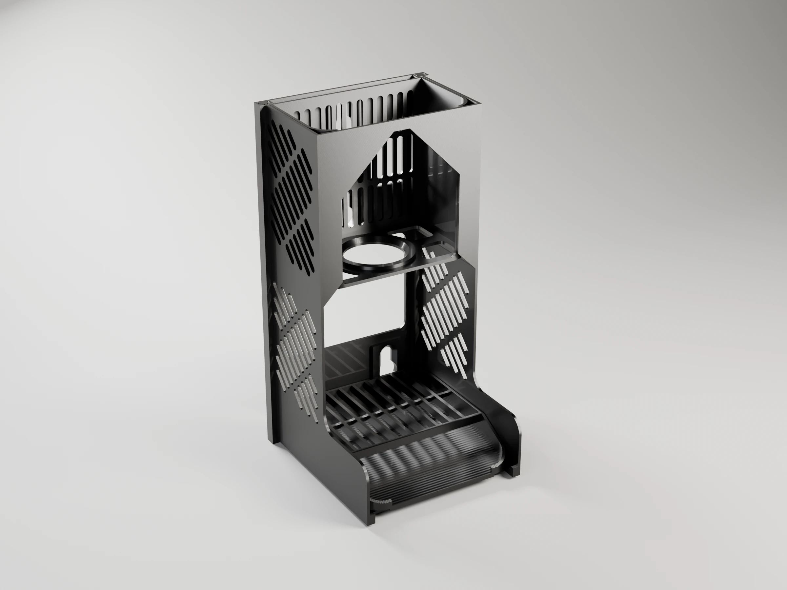 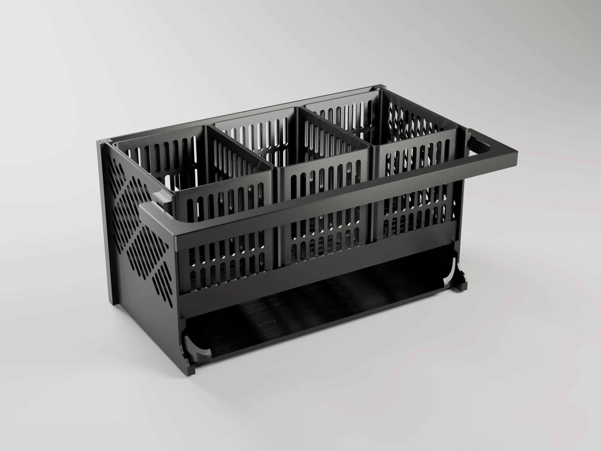

```sh
make project                       # -> sink-organizers-p1s.3mf (Bambu Studio, ready to print, both pieces)
make report                        # rebuild it, slice it, print time and filament per plate
make                               # -> one STL per part, soap-caddy-<part>.stl and cutlery-drainer-<part>.stl
make project DEFS='-D bottle_w=86 -D bottle_d=54 -D neck_d=32'   # your bottle
make project DEFS='-D dt_play=0.15'                              # a shared value: both pieces change
make render                        # -> renders/*.webp, studio views with Blender
make help                          # every target
```

## The pattern

Each piece is two parts that slide together:

- **Wall plate**: a flat plate on four suction cups, with two **sliding
  dovetail housings** along its sides. It stays on the wall.
- **Body**: side walls, a slotted floor, ledges for a drip tray and whatever
  closes the front, with a dovetail **tail** along the back edge of each side
  wall. It slides down into the housings and rests on their closed bottoms.

| On the wall | Taken apart |
|---|---|
| 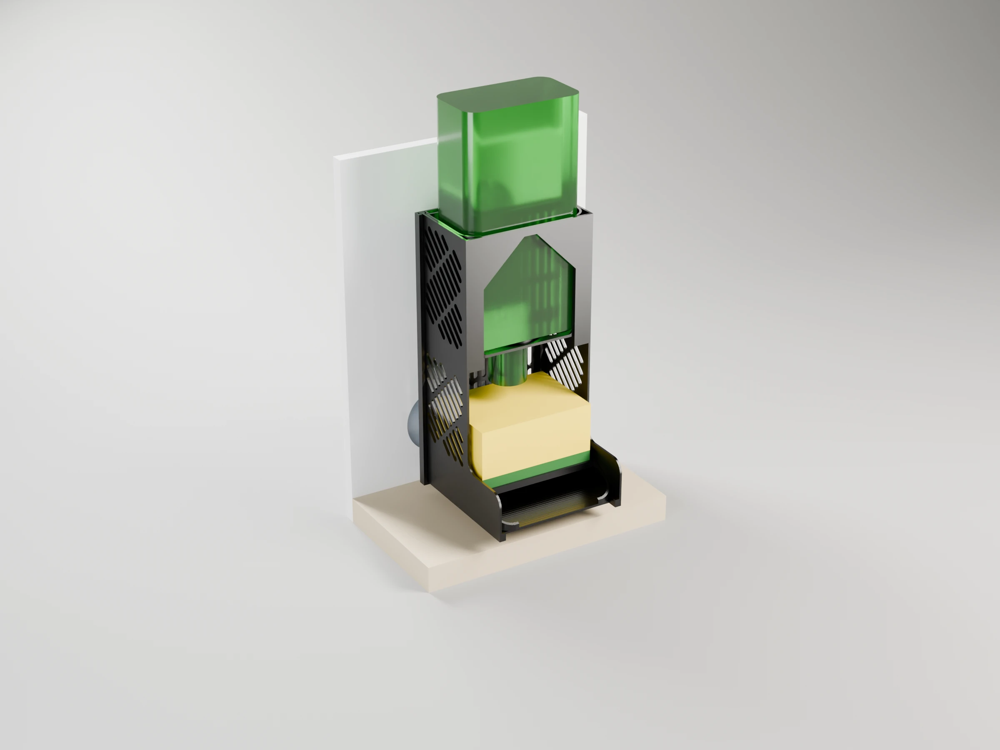 | 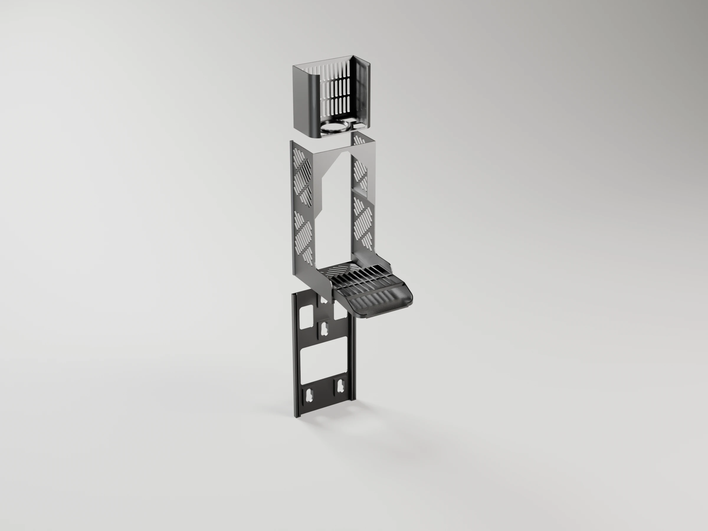 |
| 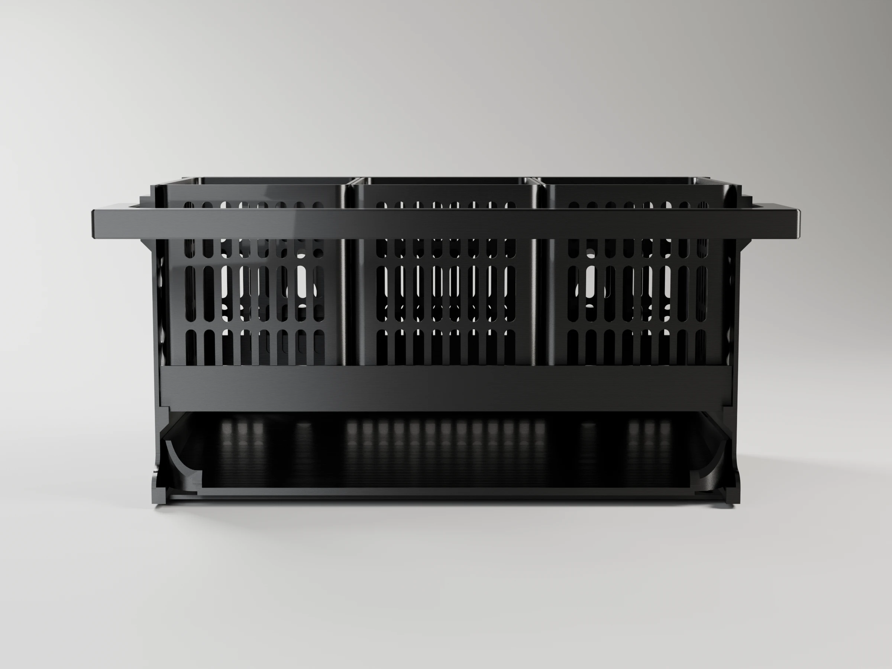 | 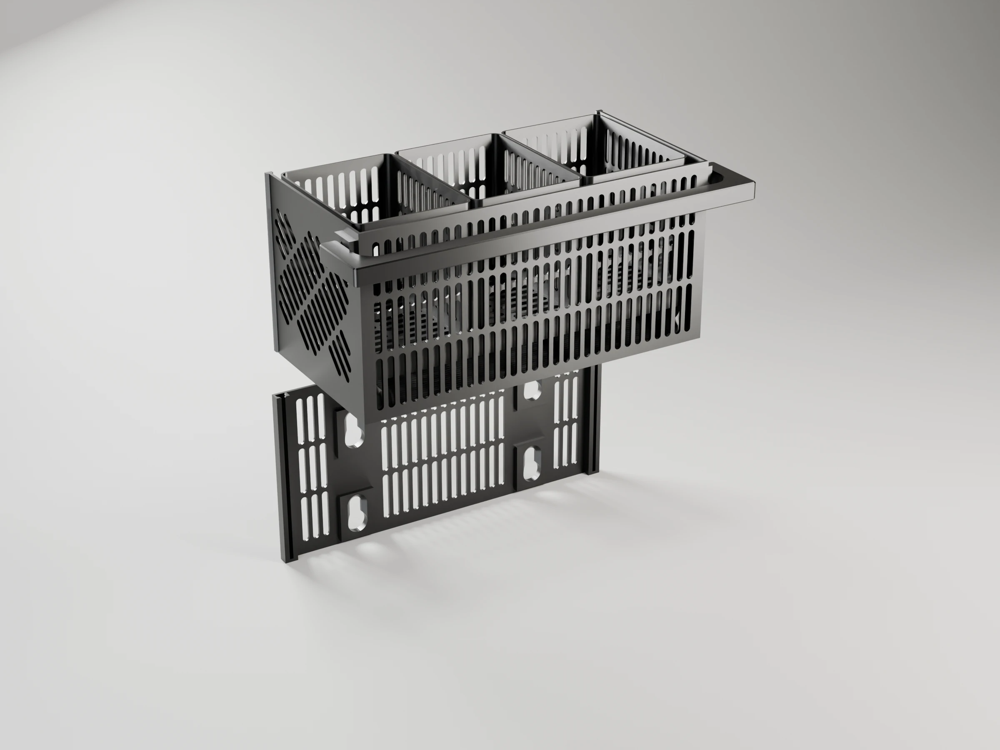 |

The split is what lets both parts print the way they need to:

- The plate prints **flat**, the keyholes' best orientation: their slot lips
  carry the pull of the button heads in XY.
- The body prints **standing**, so it can have a front: a wall or a bar
  across it is just another wall. The first frames printed on their backs
  had no front, because a bar across a frame printed that way is a 100–200 mm
  bridge. Their side walls spread, the ledges came apart, and the tray and
  box slid out. Now the floor and the front tie the side walls together, and
  the plate holds them at the back.

To take a piece down: lift it 12 mm (`drop`) off its buttons and take it off
the wall; on the table, slide the body up off the plate.

The dovetails are `dovetail_tail` and `dovetail_housing` from
[tools/scad](../../tools/scad/) (CLAUDE.md §4.7):

- **Shape**: 45° flanks, `dt_play` (0.05 until the second ladder says) per side and
  0.2 at the floor. The tail is the 1.68 mm side wall widening 1.68 per side,
  4 mm deep. There is a lead-in on the tail's tip and the housing's mouth.
- **First test**: 0.25 per side and 0.35 at the floor were loose in PETG, and
  a head widening only 1.26 per side, printed standing, came out round.
- **Holding**: the tail cannot pull forward out of the housing (the head is
  wider than the neck) or move sideways. It slides only along the wall's
  height and stops on the housing's 2 mm bottom (`dt_cap`).
- **Risk**: no published test of a printed sliding dovetail exists, so print
  the fit test first.

[`common.scad`](common.scad) holds everything the two pieces share: the
plate, the dovetails, the floor, the ledges, the tray, the keyholes and the
house style (straight back, rounded front corners, close rounded slots,
split at `slot_max_len` and at 45° in the side walls). Both piece files
include it, so a change there changes both. The Customizer shows only the
piece's own parameters; the shared ones are overridden with `DEFS` like any
other.

## Soap caddy

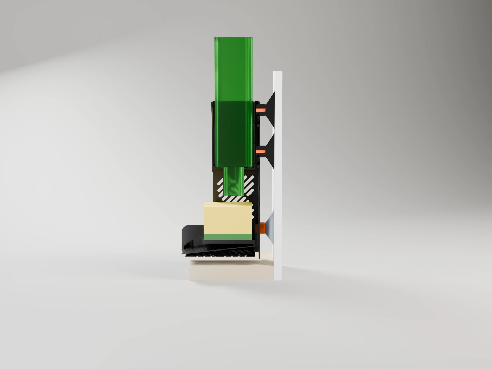

Sized for the Bosque Verde 600 ml bottle (90 mm at its widest, 50 mm deep,
210 mm tall) and the Bosque Verde scourer with nail guard (90 × 65 × 45 mm),
both from Mercadona.

**Cups.** Four suction cups (Ø 50 mm with an M4 stud, e.g. DIYexpert on
Amazon) hold the plate: two side by side low down, `lower_cup_span` (56 mm)
apart, and two one above the other behind the box, `cup_pitch` (55 mm)
apart. They are where the earlier caddies had them, so the cups already on
the wall stay put. The top cups pull and the bottom ones press, which takes
the turning moment of the bottle and of a hand on the sponge.

**Box.** It drops in from the top onto two ledges, which are chamfered at 45°
underneath because the body prints standing.

- **In front of it:** the body has two returns in line with the box's own
  and a bar across the top, so the box cannot slide out. The opening's top
  corners are at 45°, so the bar is a 10 mm bridge.
- **The bottle** drops in cap first; you squeeze it through the open front.
  Its cap goes through a hole in the floor and hangs `tip_gap` (15 mm) over
  the sponge.
- **Removing it:** lift it straight up, with the bottle out first.
- **Under the cabinet:** the top of the body plus the bottle must fit under
  the wall cabinet. The console prints the margin (431 of 460 mm by default).

**Tray.** The sponge sits on level slats over a floor that slopes 6° forward
and spills 10 mm past the edge of the sink.

- **Front:** it is open, so you can take the sponge, and the floor under the
  tray stops 5 mm behind its edge, so the drips fall clear.
- **Removing it:** lift its front 2 mm over the bumps at the ends of the
  ledges (`ledge_stop`) and slide it out under the box.

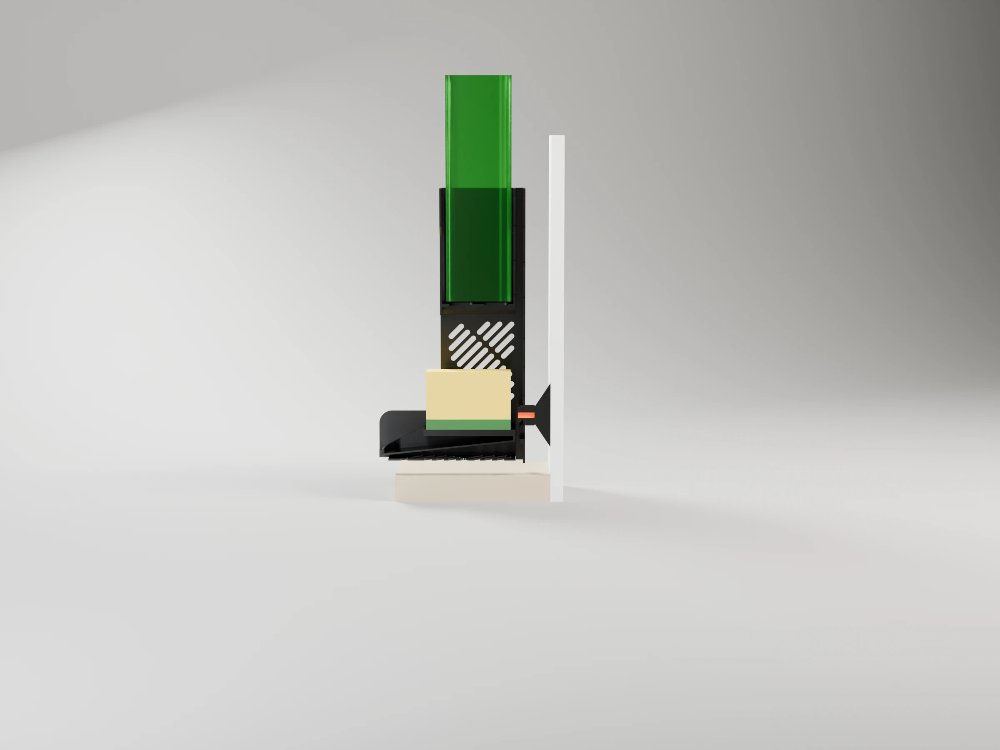

## Cutlery drainer

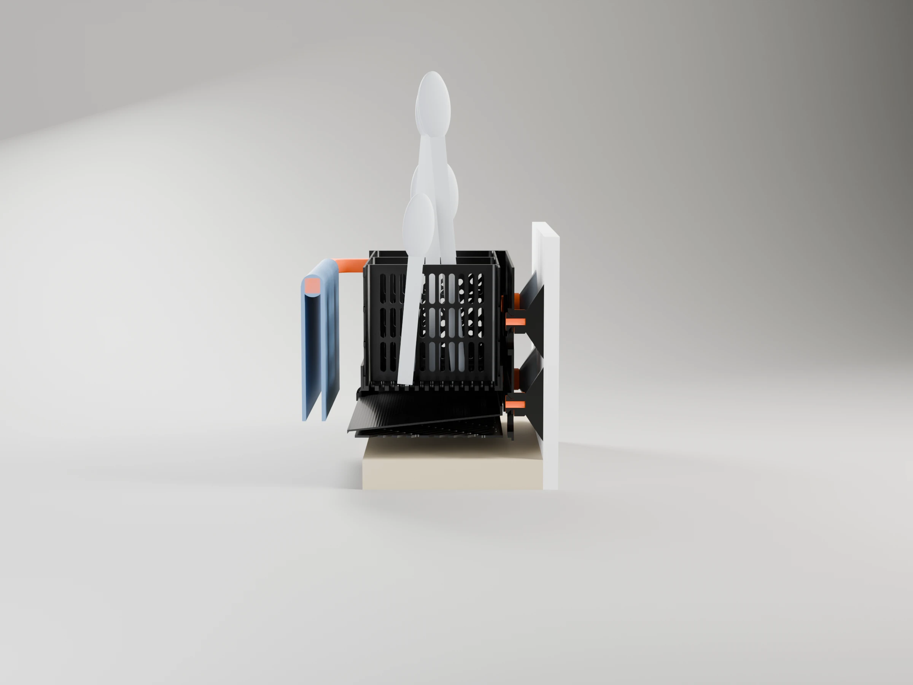

**Cups.** Four suction cups (Ø 50 mm, M4 stud) in two rows of two,
`cup_span` (120 mm) apart and `cup_pitch` (55 mm) one above the other. The
cutlery and the towel hang well in front of the wall, and the two rows take
that turning moment.

**Bins.** Three bins, 67 × 90 mm and 80 mm tall (`bin_h`): low enough to pick
a teaspoon out. Every wall and floor is slotted, so the cutlery airs and
drips.

- **What holds them:** a tie across the front of the tray's slats holds them
  at the bottom (0.5 mm of play). The body's front wall holds the tray
  (1.3 mm in front of it), and with it the bins.
- **Free play at the top:** a bin can lean about 9 mm before its top touches
  the front wall. That gap is the strip of tray where the water spills.

**Tray.** It drains forward and spills over its front edge, 124 mm from the
wall and past the edge of the sink, through the gap between the floor and
the front wall.

- **Removing it:** lift the bins out, then lift the tray out upwards. The
  front wall stops it going forward.

**Towel handle** (optional). The bins stay put with or without it.

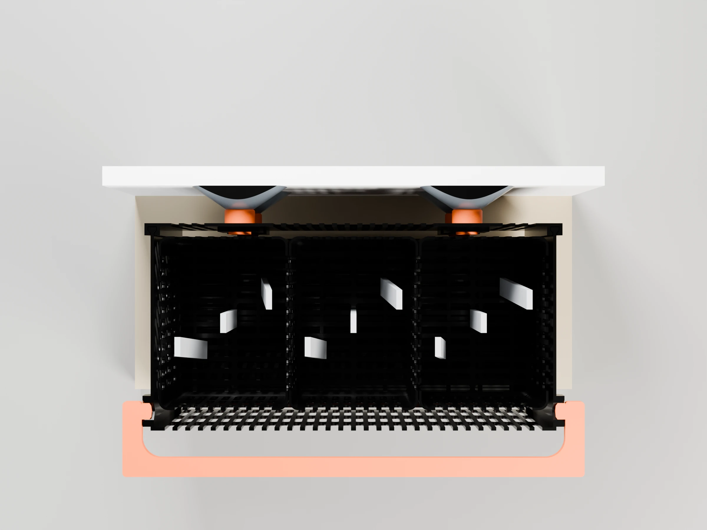

- **Shape and fitting:** a U in front of everything, its bar 14 mm
  (`towel_gap`) clear of the front wall, its arms outside the side walls.
  Fold the towel over the bar. It is a **sprung handle** (`sprung_handle`
  from [tools/scad](../../tools/scad/), CLAUDE.md §4.7): spread the arms a
  little and let them close, and a 6 mm diamond pin at the end of each arm
  snaps 5 mm into a socket in a boss on each side wall.
- **Why it stays on:** the pins only come out if you spread the arms again,
  so pulling the towel cannot unseat it, and being square they cannot turn.
  Seated, the arms carry no preload, so the PETG does not creep. Putting it
  on strains the bar 0.8 %, under the 1 % allowed; the console prints it.
- **Printing:** the bosses taper at 45° underneath, because the body prints
  standing.

## Fit tests (plate 5)

About 1 h 15 min and 32 g, before the big plates (the dovetail ladder alone: 32 min, 6.6 g). Each piece tests the real
thing, printed the way the real part prints.

- **Button on the cup**: screw the test button onto a cup. The flange must
  reach the cup's hub; if the stud stops it short, measure the stud and raise
  `stud_len`. Too hard to turn: raise `stud_hole` by 0.1.
- **Keyhole**: push the button (on its cup) through the pad's entry and slide
  it up the slot. It should slide freely and seat with no play. Too tight:
  raise `keyhole_play`; loose front to back: lower `shank_play`.
- **Dovetail**: a strip of plate with four housings (flat) and a strip of
  wall with its tail (standing), 20 mm long.
  - **The ladder**: the housings have −0.025, 0, 0.025 and 0.05 mm of play
    per side, marked by 1 to 4 notches in the strip's edge past their mouths.
    The first ladder (0.05–0.20) was loose all the way: 0.05 rocked a little.
  - **Picking the play**: use the tightest housing the tail slides all the
    way down without forcing and without rocking, with `-D dt_play=…`.
    Then rebuild the project.
  - **Margin**: the real joints are 100–210 mm long, so a fit that is only
    just free here may bind there. If in doubt, take the next one up.
- **Box width**: the top 12 mm of the soap caddy's body and the bottom 12 mm
  of its box. The box must drop through with a little play and stop against
  the returns. Too tight: raise `box_play` and `tray_play`; sloppy: lower
  them.
- **Handle pins**: snap the small handle onto the block: the pins must click
  in and hold. Too stiff: raise `pin_play`.

## Parts

| Part | Size (mm) | Notes |
|---|---|---|
| soap caddy `plate` | 108 × 211 × 6 | Wall plate: four keyholes, two housings; printed flat on its back |
| soap caddy `body` | 101 × 109 × 209 | Side walls with the tails, floor, ledges, the box's returns and bar; printed standing |
| soap caddy `tray` | 97 × 99 × 24 | Sloping floor, slats, rims; printed on its back |
| soap caddy `box` | 97 × 56 × 90 | Bottle box; printed standing on its floor |
| cutlery drainer `plate` | 216 × 106 × 6 | Wall plate: four keyholes, two housings; printed flat on its back |
| cutlery drainer `body` | 218 × 107 × 104 | Side walls with the tails, front wall, floor, ledges, the handle's bosses; printed standing |
| cutlery drainer `tray` | 206 × 98 × 32 | Sloping floor, slats, the tie in front of the bins; printed on its back |
| cutlery drainer `bin` | 67 × 90 × 80 | Three; printed standing on their floors |
| cutlery drainer `handle` | 239 × 39 × 10 | The U with its two diamond pins; printed flat |
| `button` | Ø 16 × 13 | One per cup (8); the stud goes right through; printed on its flange |
| `test_*` | — | The fit tests above |

## Strength and orientation

Each loaded part is checked against its load, derating PETG to 40 % across
the layers (CLAUDE.md §2.3). Loads: a full 600 ml bottle (≈6.5 N), a hand
pressing the sponge (≈30 N), wet cutlery and a towel (≈10 N).

| Part | Load | Printed | Across the layers? | Margin |
|---|---|---|---|---|
| plate keyholes | ≈2 N·m of turning moment over cups 55–120 mm apart: ≤10 N pull on each upper button head | flat: the slot lips in XY | no | > 20× |
| plate housings | the body's moment pulls the tails forward: a few N along 100–210 mm of lip | flat: the lips are pulled along Z | yes | > 100× (≈0.03 MPa) |
| body tails | the same, bending the necks | standing: within the layers | no | > 100× |
| body side walls | the hand on the sponge or the tray on the ledges, held by the plate, the floor and the front | standing: bending within the layers | no | > 20× |
| body floor and front | tension across when the walls are pushed apart (a few N) | standing: in XY | no | > 50× |
| ledges | the box, the tray and the bins | standing, chamfered underneath | no | > 50× |
| tray slats | the hand on the sponge: ≈4.3 N per slat over ≈35 mm | on its back, slats along Z | yes | ≈4×. Raise `slat_h` if needed: the stress drops with its square |
| `handle` | the towel on a 230 mm bar: ≈0.1 N·m at mid-span | flat: the U in XY | no | > 50× |
| `button` | shear on the shank and pull on the head, ≤10 N | standing on its flange | yes | > 50× |

## Printing (Bambu P1S)

`make project` builds `sink-organizers-p1s.3mf` on a Textured PEI plate:
- **Settings:** P1S 0.4 nozzle, *0.20mm Standard* with gyroid infill, the
  seam at the back, scarf seam and precise outer walls.
- **Filament:** black Bambu PETG Basic in slot 1. PETG takes warm soapy water
  and the top rack of the dishwasher, where PLA softens and creeps.
- **Supports:** none. The plates lie on their backs, the bodies stand, the
  trays lie on their backs, the box and bins stand on their floors, and the
  handle lies flat.

With the default parameters:

| Plate | Contents | Time | Filament |
|---|---|---|---|
| 1 · Soap caddy: body and wall plate | body (standing), plate (flat) | 6 h 06 min | 114 g |
| 2 · Soap caddy: tray, box and buttons | tray, box, 4 buttons | 3 h 10 min | 68 g |
| 3 · Cutlery drainer: body and wall plate | body (standing), plate (flat) | 5 h 33 min | 121 g |
| 4 · Cutlery drainer: tray, bins, handle and buttons | tray, 3 bins, handle, 4 buttons | 7 h 46 min | 151 g |
| 5 · Fit tests | keyhole pad, button, dovetail ladder and tail, box width, handle pins | 1 h 16 min | 32 g |

PETG bonds hard to the textured plate: use a glue stick as a release layer,
and let the plate cool before removing the parts.

## Parameters

All lengths in mm. Override any of them with `make DEFS='-D name=value'` (also
`make project`, `make report` and `make render`). The console prints the
sizes, the cup heights and the cabinet margin; asserts stop the build if the
pieces do not fit.

| Parameter | Default | What it does |
|---|---|---|
| **Shared** ([common.scad](common.scad)) | | |
| `cup_d`, `cup_h`, `stud_len`, `stud_hole` | 50, 12, 12, 3.7 | Suction cups: diameter, wall to the hub face, stud length (measure yours), pilot hole for the stud |
| `shank_d`, `head_d`, `flange_d`, `keyhole_play`, `shank_play`, `drop`, `pad_t`, `pad_w` | 7, 12, 16, 0.3, 0.1, 12, 4.2, 22 | Buttons and keyholes |
| `back_t`, `side_t` | 1.68, 1.68 | Wall plate; the body's walls (and the tails' necks) |
| `tie_t`, `drip_clear` | 1.6, 5 | The body's floor; how far it stops behind the tray's front edge |
| `ledge_w`, `ledge_h`, `ledge_stop` | 3.36, 4, 2 | Ledges under the tray; the bump at their front ends |
| `dt_w`, `dt_d`, `dt_play`, `dt_floor`, `dt_lip`, `dt_side`, `dt_cap` | 1.68, 4, 0.05, 0.2, 1.26, 1.68, 2 | Dovetails: widening, depth, play on the flanks and at the floor, housing lip and side, closed bottom |
| `tray_play`, `tray_t`, `tray_wall`, `tray_slope` | 0.25, 1.26, 1.68, 6 | Tray: clearance in the body, floor, rims, slope |
| `slat_w`, `slat_h`, `slat_clear` | 2.1, 5, 3 | Slats |
| `corner_r`, `slot_w`, `slot_rib`, `slot_margin`, `side_slot_tilt`, `slot_max_len` | 14, 4, 2.6, 6, 45, 30 | Style: front corners, slots, 45° in the side walls, longest slot (longer ones split: in a wall that prints standing the ribs between long slots sway under the nozzle) |
| **Soap caddy** | | |
| `bottle_w`, `bottle_d`, `bottle_h`, `neck_d`, `seat_to_tip`, `bottle_play` | 90, 50, 210, 34, 35, 1.5 | The bottle |
| `sponge_w`, `sponge_d`, `sponge_h`, `sponge_play`, `tip_gap` | 90, 65, 45, 2, 15 | The sponge; closed cap tip to sponge top |
| `sink_dist`, `drip_over`, `counter_gap`, `cabinet_h` | 115, 10, 12, 460 | Wall to the sink bowl; how far the tray reaches past it; counter to the body; counter to the wall cabinet |
| `cup_pitch`, `lower_cup_span` | 55, 56 | Upper cups one above the other; lower cups side by side |
| `sponge_rim`, `step_r`, `bar_h` | 12, 10, 6 | The deep part of the side walls; the step; the bar across the front |
| `slat_pitch` | 9 | Slat spacing |
| `box_play`, `box_h`, `wall_t`, `floor_t`, `collar_t`, `return_w` | 0.25, 90, 1.68, 2, 4, 10 | The box |
| **Cutlery drainer** | | |
| `frame_w`, `bins`, `bin_d`, `bin_h` | 210, 3, 90, 80 | Width along the wall; number of bins, their depth and height |
| `sink_dist`, `counter_gap` | 115, 15 | Wall to the sink bowl; counter to the body |
| `cup_span`, `cup_pitch` | 120, 55 | Between the cups of a row, and between the rows |
| `front_lip`, `towel_gap` | 8, 14 | Tray floor in front of the bins, where the water spills; room for the towel |
| `slat_pitch`, `stop_h` | 18, 8 | Slat spacing; the tie in front of the bins |
| `bin_wall`, `bin_floor`, `bin_r`, `bin_play` | 1.26, 1.6, 5, 0.5 | Bins |
| `handle_s`, `handle_drop`, `pin_s`, `pin_len`, `pin_play`, `boss_t`, `boss_w`, `handle_play` | 10, 12, 6, 5, 0.15, 4.2, 16, 0.4 | Towel handle, its pins and bosses |

## Renders

`make render` builds the project and renders both pieces with Blender
(`../../tools/render_studio.py`), in the filament colour and with layer
lines at the project's layer height, 2400 × 1800 WebP:
- each piece bare, on the wall with its cups, bottle, sponge, cutlery and
  towel, and taken apart (`-D body_lift=…`);
- sections through the keyholes and the handle's pins;
- the print plates.

Add `RENDER_FLAGS="--samples 32 --scale 0.25"` for a quick draft.

| | Hero | Front | Side | Top | Back |
|---|---|---|---|---|---|
| Soap caddy |  | 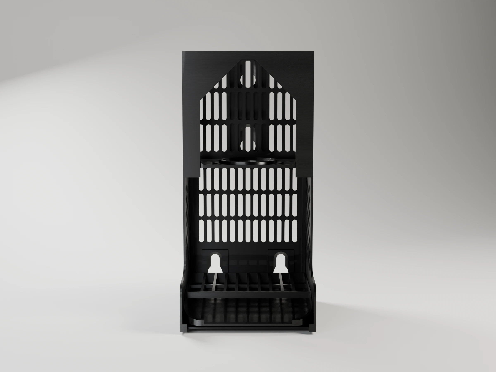 | 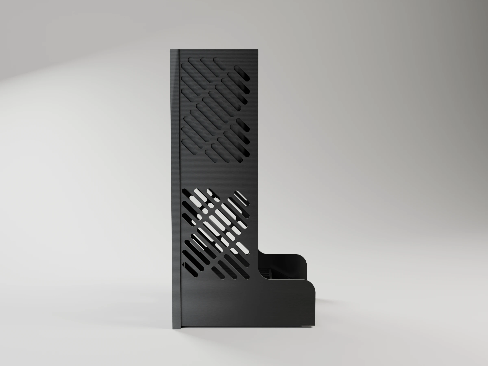 | 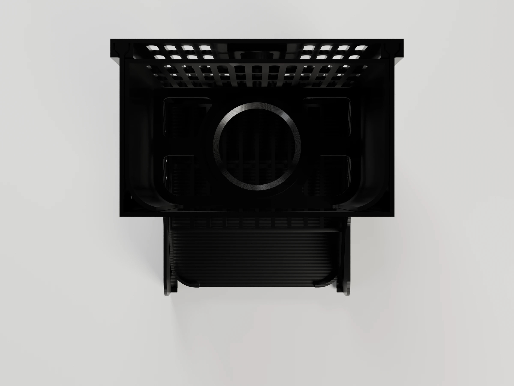 | 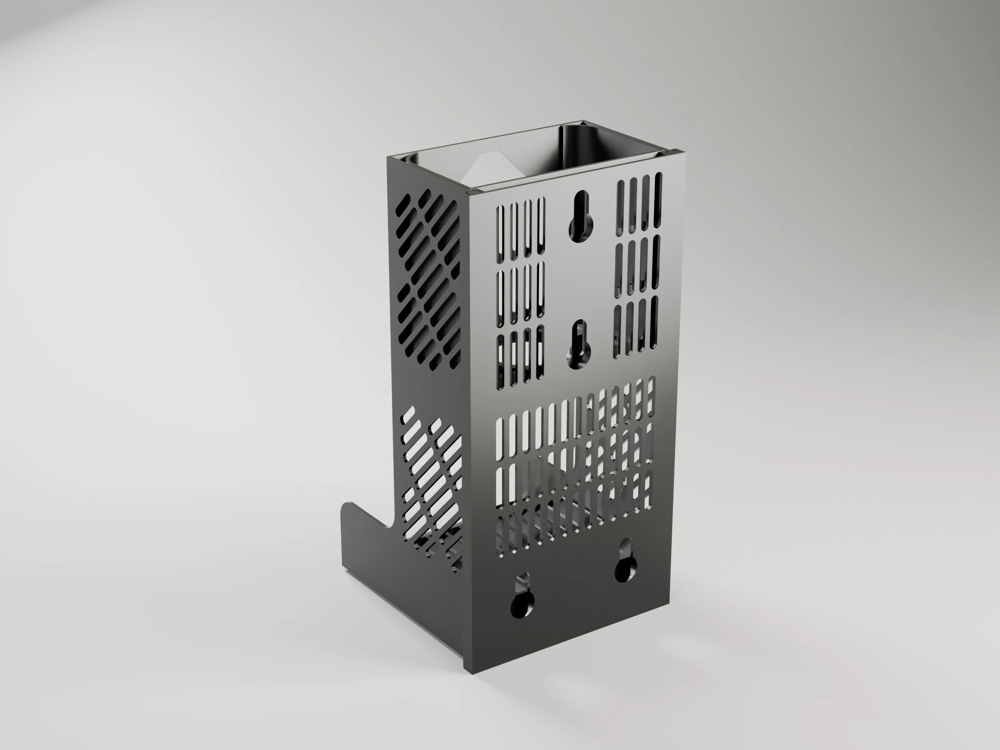 |
| Cutlery drainer |  |  | 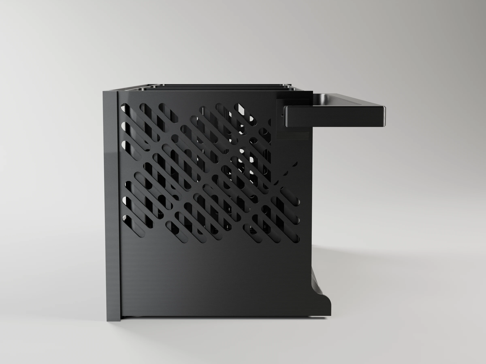 | 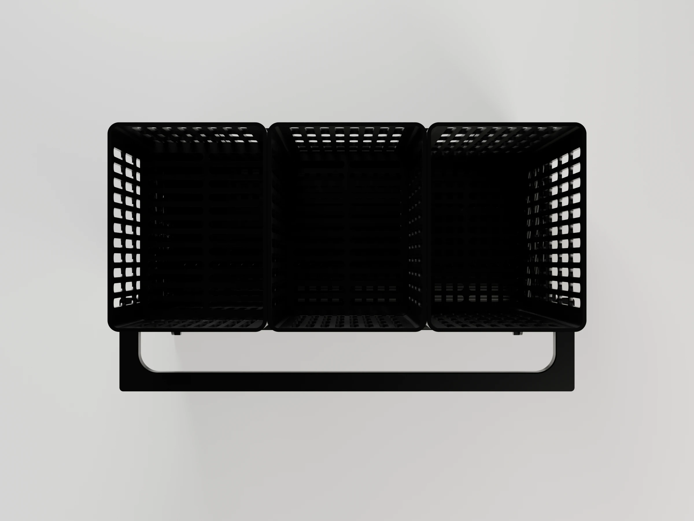 | 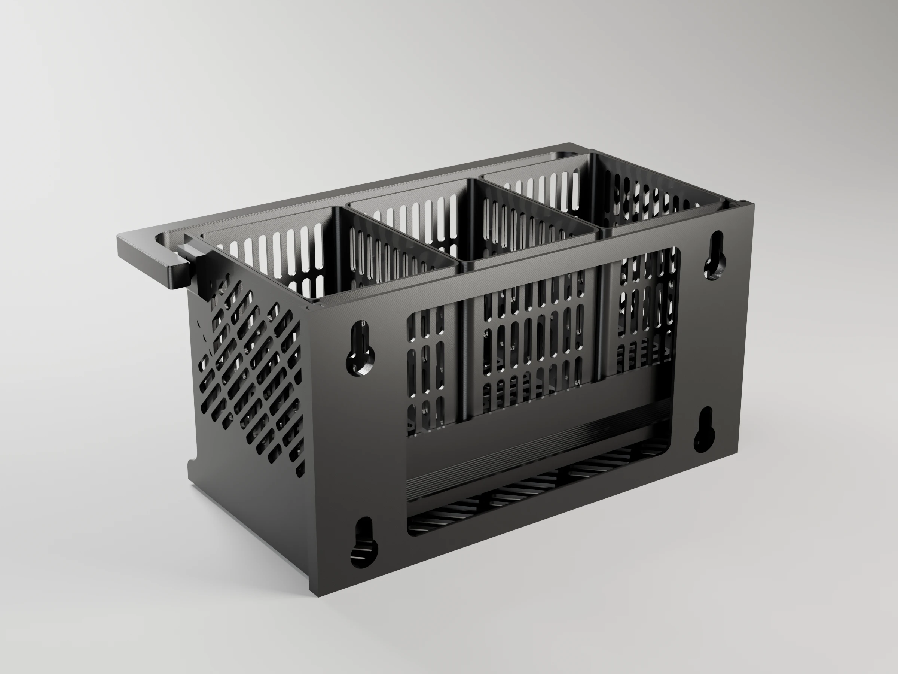 |

Plates: 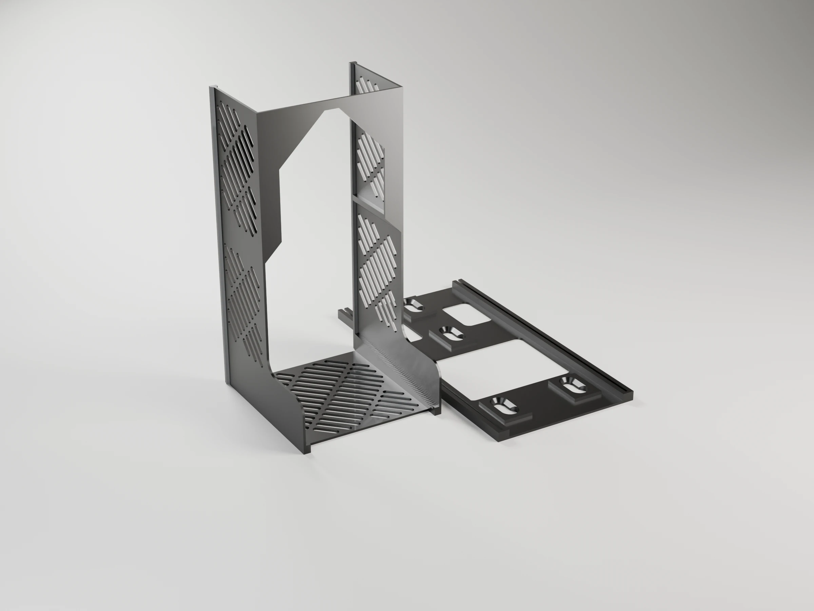 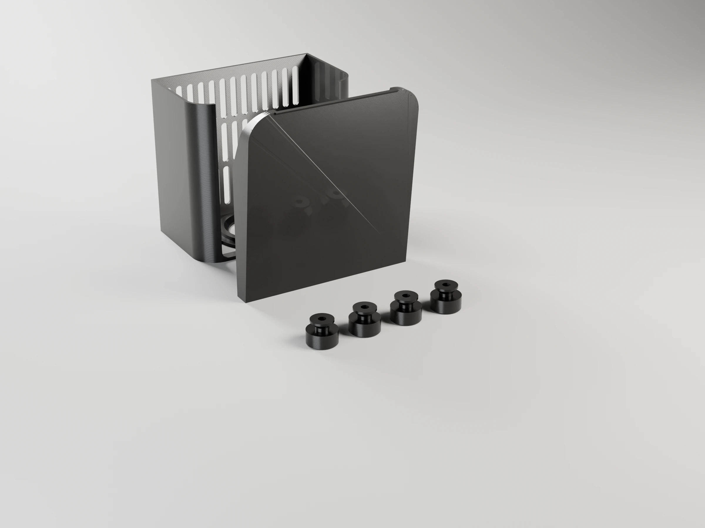 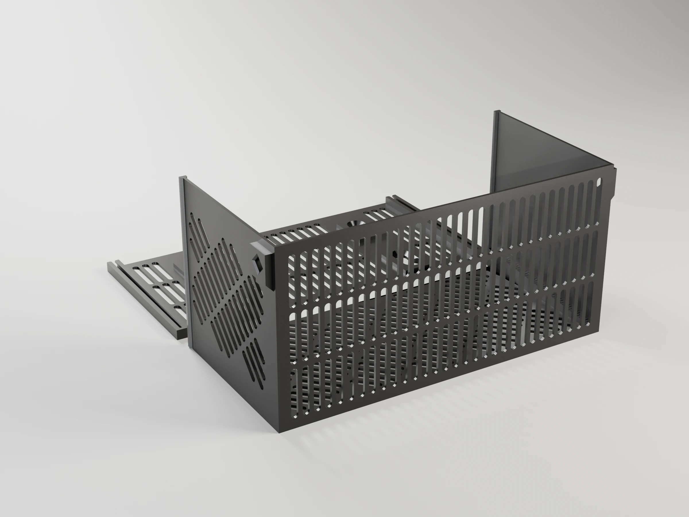 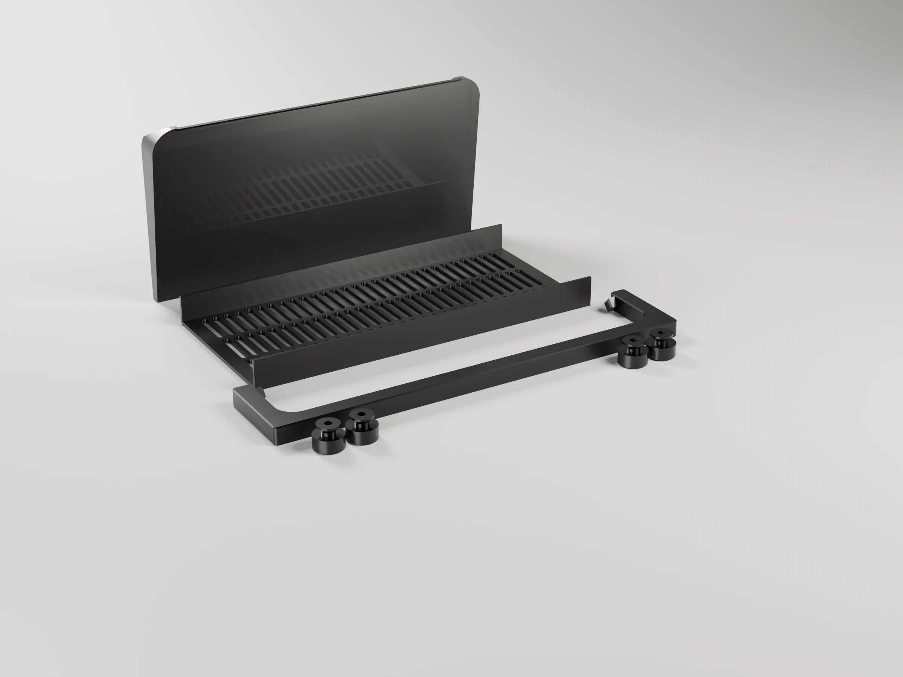 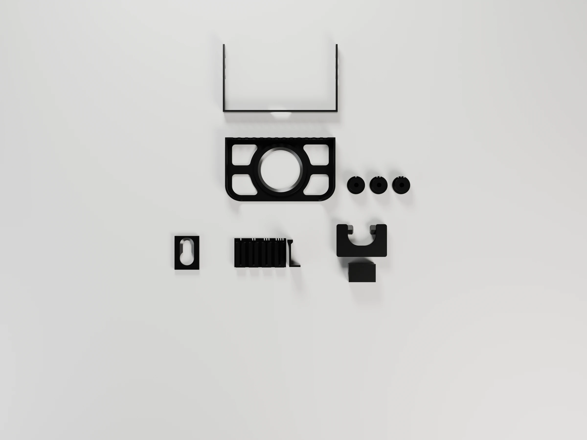
