# Sink organizers: load analysis and design studies

What was simulated on the soap caddy and the cutlery drainer, the results, and the design
decisions they led to. The soap caddy's wall plate now has windows instead of slots; the cutlery
drainer's study is in [Cutlery drainer](#cutlery-drainer). The method (tools, meshing, modelling choices, how to read results) is in
[tools/fea/README.md](../../../tools/fea/README.md). This page is the project's record.

**Corrected 2026-10-25:** the cup forces below were first computed with the cups clamped, so each
cup also resisted the plate turning, which a suction cup cannot do, and with ties that lost part
of the turning moment (tools/fea/README.md, Assembly). Rerun with hinged cups, the top cup pulls
13.8 N in daily use and 2.8 N under the bottle alone, not 5.3 and 1.0. See
[Correction](#correction-hinged-cups). The plate's ranking held.

**Soap caddy, in short:**
- **Checked:** the caddy holds its loads with comfortable margins everywhere but one place. Squeezing
  the bottle hard bends the box's back wall onto the upper buttons, with about 1.4× margin at
  that point, across the box's layers.
- **Changed:** a design study of the wall plate, one variable at a time over 13 variants. It
  replaced the plate's slot fields with windows: 7.4 % less plastic, 29 % less bending and a
  third of the stress.
- **Printing:** the body printed rough above ≈165 mm, its walls swaying under the nozzle. A
  print stiffness study ([5](#5-the-body-while-it-prints)) put six fixes side by side; the body
  now prints with sacrificial fins beside its walls.

## Load cases

Agreed from how the caddy is used:

| Case | Loads (plus the parts' own weight) | For |
|---|---|---|
| Daily use | the bottle on its 45° neck seat (6.5 N, a full 600 ml bottle), a hand pressing the sponge (30 N on the slat tops) | margins and load sharing in normal use |
| Bottle only | the bottle on its seat | the permanent load: creep, and what the cups hold all day |
| Squeeze | the bottle on its seat, 30 N pushing it towards the wall on the inside of the box's back wall | the box's back wall and its 1.9 mm gap to the upper buttons |

Left out: pushing the bottle down into its seat (it goes in gently), squeezing it against the
collar (it is squeezed towards the wall).

**The wall:**
- each button is rigid and its cup holds it;
- the shank bears on the top of its keyhole slot;
- the flange and the cone head hold the plate front and back.

**Material:** PETG Basic (Bambu TDS): E 1460 MPa. Allowable stress 48 MPa within the layers,
19 MPa across them (40 %).

## 1. The tray alone

`tray_fea.py`. The tray stands on its two side ledges, with the hand's 30 N on the slats.

| Mesh h | Nodes | Sag | Slats p99.5 | Peak (singular) |
|---|---|---|---|---|
| 2.0 mm | 74 k | 1.68 mm | 7.1 MPa | 19 MPa |
| 1.2 mm | 199 k | 1.69 mm | 7.1 MPa | 25 MPa |
| 0.8 mm | 487 k | 1.71 mm | 7.1 MPa | 33 MPa |

| Von Mises, deformation ×5 | Stress along the slats, across the layers |
|---|---|
| 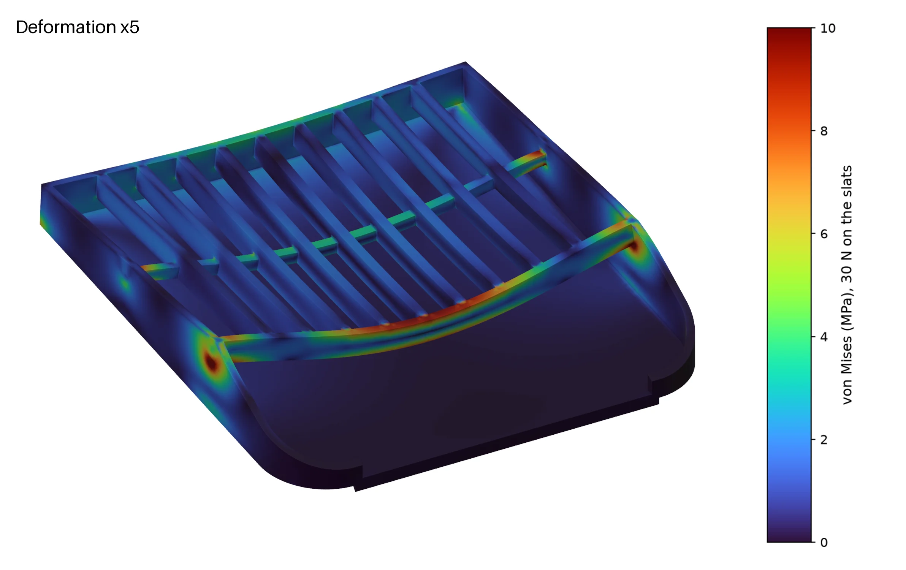 | 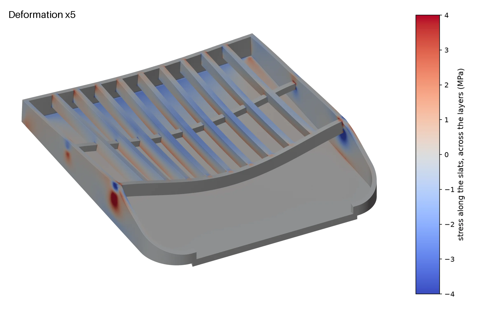 |

- **The hardest-working member is the front tie, not the slats:** 10 MPa within the layers,
  ≈ 4.7×. The tie carries the slats' front ends across the 94 mm between the side rims.
- **The slats:** 3.9 MPa across the layers, ≈ 5×. The README's hand calculation had them at ≈ 4×
  and did not look at the tie.
- **The sag:** 1.7 mm at the middle of the tie.
- **Cross-check:** solved again straight from the OpenSCAD STL (fTetWild), the same within 3 %.

## 2. The whole caddy on the wall

`assembly_tie.py` (bonded joints, linear) and `assembly_contact.py` (contact on every joint and
on everything that guides or stops the loose parts).

| Daily use, deformation ×10 | From the side, the wall on the right |
|---|---|
| 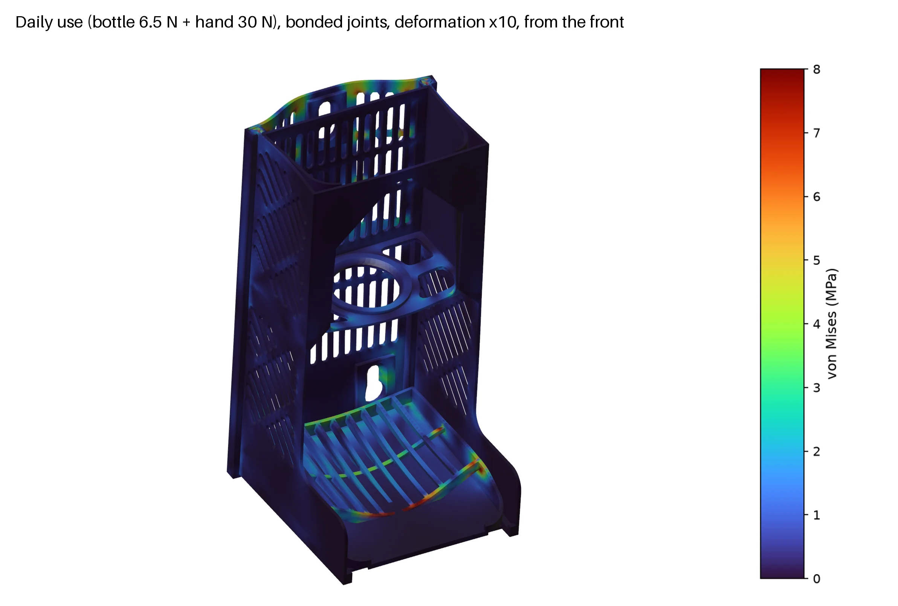 | 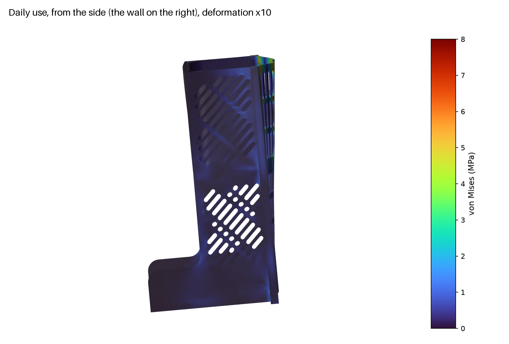 |

- **Cups:** the lower pair carry the weight (≈ 18 N each in daily use) and press on the wall.
  The upper pair pull off it with ≈ 4.5 N each, ≈ 0.8 N under the bottle alone.
- **The tray:** sags 2.35 mm in the assembly, against 1.7 mm alone, as the body, plate and cups
  give a little.
- **Bonded against contact, at 25 % of the load:**
  - each cup's push or pull on the wall came out the same (1.11 against 1.11 N);
  - the vertical shares differed by up to 0.5 N;
  - so bonded is good enough for what the wall sees, at about a hundredth of the cost.
- **But bonded is not equivalent everywhere:** about 30 % of the tray's and the box's seats come
  out in tension. Their backs would lift off the ledges, which a bonded joint hides.
- **Contact never finished:**
  - **first attempt:** it diverged because the box and the tray were not held sideways by the
    body's side walls;
  - **second attempt:** with those walls and the stops, it converged a quarter of the load in
    12 min, then stalled.

## 3. Squeezing the bottle

**Bonded, it is wrong.** At real scale the box's back wall goes 3.4 mm into the plate, because
nothing in the model keeps them apart. A cut through the upper buttons shows it, and
`penetration.py` finds it on its own.

**With contact** (`squeeze_contact.py`):
- the joints stay bonded;
- contact only between the box's back wall and what it can close on: the upper buttons' heads
  (rigid discs, 1.9 mm behind it) and the plate's front faces;
- it converges in 4 increments (≈ 25 min).

| Bonded: the box goes through the plate | With contact: it rests on the button heads |
|---|---|
| 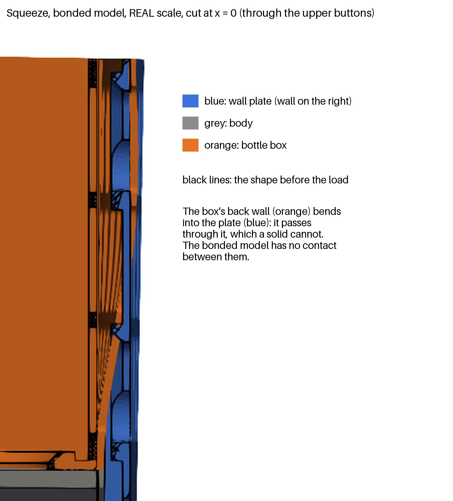 | 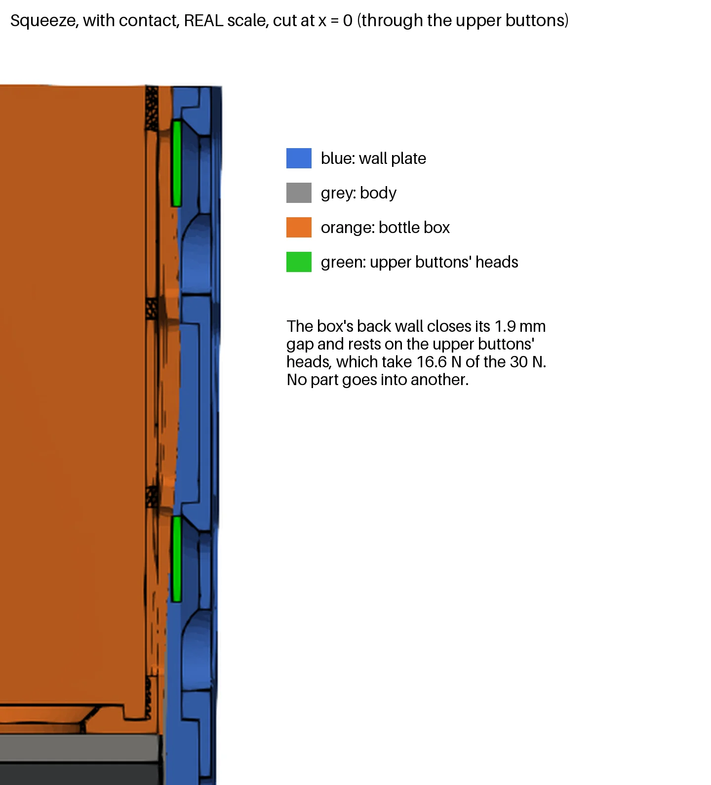 |

| Squeeze | Plate as it was | Plate as it is now (windows) |
|---|---|---|
| The box's back wall moves | 3.12 mm | 3.11 mm |
| The button heads take | 16.6 of the 30 N | 15.5 N |
| Box p99 / peak (vertical: across its layers) | 7.5 / 13.8 MPa | 7.7 / 13.7 MPa |
| The plate moves | 1.50 mm | 1.16 mm |

- **The tightest place in the caddy:** the inside of the box's back wall where it rests on the
  top button. It has ≈ 1.4× against 19 MPa across the layers, ≈ 2.5× around it.
- **Why it is accepted:** 30 N is a firm squeeze, and the wall is held by the button before it
  goes further.
- **If it ever cracks there:** a rib on the box's back, level with the top button, is the fix.

## 4. The wall plate: one variable at a time

**What started it.** Looking at the daily-use result in ParaView, the plate's back face lit up at
the ends of its upper slots, with the stress horizontal:
- the body, nodding forward, pulls the housings at the plate's edges while the upper cups hold
  the middle, so the plate bends across;
- the vertical slot columns cut that bending, and only the 2.6 mm bridges between their segments
  carry it.

Refining the plate's mesh from 2.5 to 1 mm raised the peak 15 % and it settled, so it is a real
stress raiser and not the mesh.

**The study** (`variants.py`):
- each variant changes one `common.scad` parameter, all defaulting to the old geometry;
- each is exported from OpenSCAD, meshed with fTetWild and solved bonded;
- "moves" is the plate's own bending.

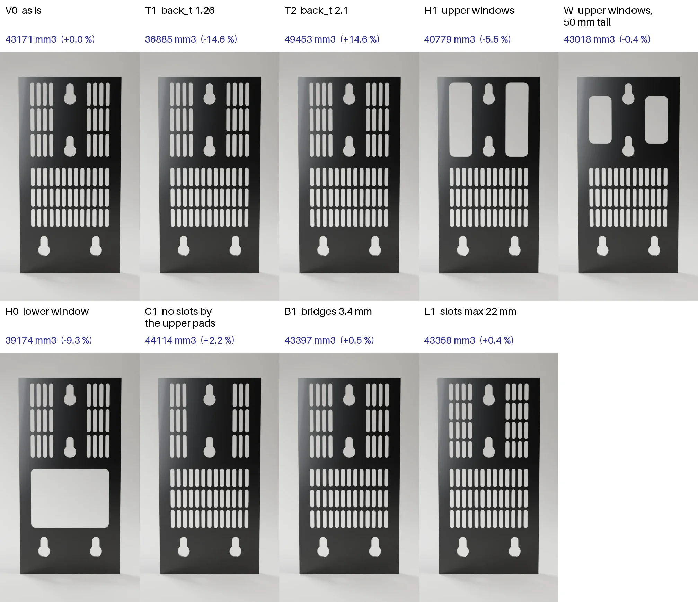

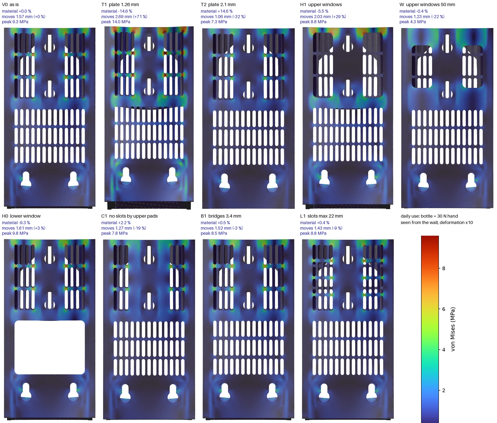

| Variant | Change | Plate | Moves, daily | Peak / p99 |
|---|---|---|---|---|
| V0 | as it was: slots | 43 171 mm³ | 1.57 mm | 9.3 / 6.4 MPa |
| T1 | plate 1.26 mm | −14.6 % | +71 % | 14.0 / 9.9 |
| T2 | plate 2.1 mm | +14.6 % | −33 % | 7.3 / 4.4 |
| H1 | upper windows, full height | −5.5 % | +29 % | 8.8 / 6.9 |
| W | H1 + 14 mm solid bands above and below | −0.4 % | −22 % | 4.3 / 3.8 |
| H0 | lower window | −9.3 % | +3 % | 9.8 / 6.5 |
| C1 | no slot column beside the upper pads | +2.2 % | −19 % | 7.8 / 4.9 |
| B1 | bridges 3.4 mm | +0.5 % | −3 % | 8.5 / 5.9 |
| L1 | slots at most 22 mm | +0.4 % | −9 % | 8.8 / 5.8 |

- **The solid horizontal bands carry the plate:** opening the whole upper field loses 29 %, and
  keeping bands above and below the window gains 22 % for the same plastic.
- **The lower field hardly works:** a window there saves 9.3 % for 3 % more bending.
- **Thickness** buys stiffness at the worst rate.
- **Bridges** barely matter.

**Second round, from W plus the lower window, sweeping the bands:**

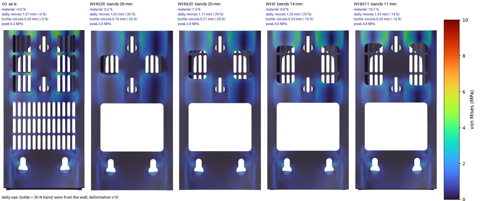

| Variant | Bands | Plate | Moves, daily | Moves, bottle only | Peak, daily | Top cup pull, daily / bottle |
|---|---|---|---|---|---|---|
| V0 | (slots) | 43 171 mm³ | 1.57 mm | 0.29 mm | 9.3 MPa | 4.5 / 0.8 N |
| WH0i26 | 26 mm | −5.2 % | −35 % | −35 % | 3.5 | 5.1 / 1.0 |
| **WH0i20** | **20 mm** | **−7.4 %** | **−29 %** | **−29 %** | **3.9** | 5.3 / 1.0 |
| WH0 | 14 mm | −9.6 % | −20 % | −19 % | 4.5 | 5.3 / 1.0 |
| WH0i11 | 11 mm | −10.7 % | −14 % | −14 % | 4.8 | 5.3 / 1.0 |
| WH0i8 | 8 mm | −11.8 % | −6 % | −5 % | 5.6 | 5.2 / 1.0 |

Every candidate beats the old plate on plastic, bending and stress, and the two load cases rank
them alike. Each 6 mm of band costs about 2.2 % of the plate and takes off about 0.2 mm of bending.

## Decision

**WH0i20:** `plate_window = [0, 1]`, `plate_window_inset = [0, 20]`, set in `soap-caddy.scad`.
The aim was the most reliable plate for normal use: the least plastic and the least bending.
- **Why this one:** −7.4 % plastic (≈ 4 g, 20 min less on plate 1), −29 % bending under both the
  daily and the permanent load, and the peak stress from 9.3 to 3.9 MPa.
- **The squeeze:** unchanged on the box; the plate bends less.
- **Rejected:**
  - **WH0i26:** stiffer, but saves half as much;
  - **the narrower bands:** save 1–4 % more and give up a third to four fifths of the gain;
  - **a thicker plate:** costs the most plastic for its stiffness.
- **The price:** the windows move a little of the pull onto the top cup (4.5 → 5.3 N daily,
  0.8 → 1.0 N all day). Small for a 50 mm cup.

The cutlery drainer's plate is unchanged: the new parameters default to the old slots.

### Correction: hinged cups

The figures above (`variants.py`) came from cups held fixed at every node of the shank and the
flange, and from ties at 0.6 mm tolerance. Both let the model shed part of the caddy's turning
moment: the clamped cups took it as local bending, and the ties lost it across the tails'
stepped lead-ins. Now each button is a rigid body hinged where the cup meets the wall, and the
ties stop at 0.25 mm and skip the lead-ins (tools/fea/README.md, Assembly). The same two plates,
rerun:

| Daily use | Slots, as it was | Windows (WH0i20) |
|---|---|---|
| Plate moves | 2.32 mm | 1.51 mm (−35 %) |
| Plate peak / p99 | 16.9 / 9.5 MPa | 10.2 / 5.2 MPa |
| Top cup pull, daily / bottle only | 13.5 / 2.75 N | 13.8 / 2.8 N |
| The other upper cup | 1.4 / 0.2 N | 0.9 / 0.1 N |

- **The decision holds:** the windows win by more than the first figures said.
- **The plate:** about 4.7× within its layers against 48 MPa, peaking by the top keyhole.
- **The cups:** the top one carries nearly all the upper row's pull, 2.8 N all day and 14 N with a
  hand on the sponge. That is moderate for a 50 mm cup.
- **The squeeze** (section 3), rerun with the hinged cups, is unchanged:
  - the box's back wall moves 3.11 mm and the heads take 15.5 N;
  - the box works at 7.7 / 13.7 MPa (p99 / peak);
  - the plate moves 1.18 mm.

  The box rests on the button heads, so the cups' tilt hardly enters.


## 5. The body while it prints

`print_sway.py`, the method in tools/fea/README.md ("Print stiffness"). The body printed in red
PETG HF (2026-10) came out clean up to ≈165 mm and rough, stringy and tangled above, worst at
the far front return's tip and along the top band.

**The model:** the body cut at the nozzle's height (`body_cut.scad`), fixed at the bed, and 1 N
sideways on a 3 mm patch of the top layer, along x and along y, at the side wall's back edge,
middle and front, the front return's tip and the front's middle. Each value is the worst of
those, in mm of the layer moving per N.

| Variant (one change from R) | 100 mm | 150 mm | 190 mm | 209 mm | Worst | Plastic |
|---|---|---|---|---|---|---|
| R as printed | 8.8 | 17.0 | **32.6** | 5.9 | 32.6 | 84 g |
| A side walls 2.52 (`side_add=0.84`) | 3.2 | 9.1 | 18.3 | 3.3 | 18.3 | +22 g |
| B side walls 3.36 (`side_add=1.68`) | 1.5 | 5.1 | 10.4 | 2.0 | 10.4 | +44 g |
| C front frame 2.52 (`frame_t=2.52`) | 8.6 | 16.8 | 32.0 | 4.9 | 32.0 | ≈0 |
| D walls 2.52 from 60 mm up (`side_add_z=60`) | 5.8 | 14.6 | 27.8 | 3.8 | 27.8 | < +22 g |
| E slotted back wall 1.68 (`back_wall=1.68`) | 7.2 | 3.1 | 4.5 | 1.1 | 7.2 | +31 g |
| F stabilizer fins 20 mm, tabs 0.84 × 1.6 every 10 | 1.0 | 0.8 | 1.3 | 1.1 | 1.3 | +26 g, cut off |
| **F2 the same, tabs 0.42 × 0.4 every 20 (the default)** | 1.2 | 0.9 | 1.3 | 1.2 | **1.3** | +26 g, snapped off |
| G fins with a 12 mm flange, no tabs: contact only | 8.8 | 16.9 | 32.5 | 4.5 | 32.5 | +41 g |
| H the same, fins 12 mm | 8.8 | 16.9 | 32.6 | 4.7 | 32.6 | +30 g |

R at 60, 130 and 170 mm: 2.0, 11.3, 24.1.

- **It matches the print.** Clean at 9–17 mm/N, rough from ≈24 (170 mm), and the worst
  point is the front return's free tip, where the tangle was. The top band is rough too, though
  the finished body is stiff there (5.9): the front only closes at 203 mm, so the layers under
  the bar print with the U still open. The walls hardly move along y (≤0.6).
- **The whole U leans.** Both side walls bend the same way along x, and nothing across the body
  stops them: the floor at the bottom and the bar at the very top are its only ties.
- **Thicker walls gain less than t³ (A, B, D):** 1.8× for 2.52 mm instead of 3.4×, as the lower
  part and the corners bend too. And it has to start at the bed: D, thickened from 60 mm up,
  loses most of A's gain.
- **The frame does nothing (C):** it is in the plane that is already stiff.
- **A wall across closes the U (E):** the top drops 5–7×. What is left is the front edge of
  the deep lower part (7.2 at 100 mm), which printed clean anyway.
- **Fins hold it everywhere (F):** ≤1.3 at every height, 25× less than R, with the body itself
  unchanged. They cost ≈26 g per print and cutting them off, and the body is 142 mm wide on the
  bed, so plate 1 holds it turned a quarter. The tabs are modelled fully bonded: if one lets go
  mid-print, the real figure is higher.
- **Fins that only touch do not work (G, H).** Run with fins on one side and tabs standing in
  for the contact (`LEFT=1`, every load towards the fins): the wall pushed out onto its fins
  moves 1.1, but pushed in, 32.5, as bare. The walls bend each on its own, and the outer
  face's perimeter pushes its wall inwards, so the fins need tabs.
- **One-line tabs every 20 mm hold as well (F2)** in the model, but a 0.42 × 0.4 tab is two
  elements across at h = 2: read 1.3 as optimistic. In the G-code, Classic walls drop a
  one-line tab; Arachne prints it (the project sets it on the objects with fins).

**The sway test** (`test_sway`, plate 7): two strips of the side wall, 40 long and 120 tall, on
a thin foot. The bare one, along x at its free end: 8.5 mm/N at 60 mm, 26 at 90 and 60 at 120,
so it passes 17, 24 and 33 at about 78, 88 and 98 mm (the body's 150–190 mm) and goes on to
nearly twice the body's worst, so it cannot fail to show the sway. The one with fins: ≤0.5 at
the end, ≤2.9 at the middle, 18 mm from them.

**Printed (PETG HF, 2026-10-26):** the bare strip swayed visibly under the nozzle and came out
rough above ≈85 mm, where the model has it at 24 mm/N; the strip with fins came out clean to
the top, and its one-line tabs held all the way and snapped off with no mark.

**The cutlery drainer's body**, the same check (`PIECE=drainer`, cut at 40, 70, 95 and 114 mm):
0.4, 3.6, 9.2 and 11.9 mm/N, its worst at the front's middle, along x. Shorter (114 mm) and
tied by the rack's ledges and the handle's bosses, it stays inside what printed clean on the
soap caddy (≈17), though over the ≤10 aim at the top: no fins.

**Decision (2026-10-26):** F, chosen by the user over E (the piece unchanged) and B, then F2:
the smallest tabs that print, so the fins snap off with as little as possible to clean. The
project also slows the body's walls above 100 mm (60/80 mm/s) and avoids crossing walls.

## Cutlery drainer

`drainer_fea.py`, with the model in `drainer_model.py`. Not printed yet: the study is there to
avoid printing a drainer the simulation already says will not work. Chosen: SPW4 + RX24
([Decision](#decision-1)).

### Load cases

Agreed from how it is used, for a household of four. The weights come from product sheets: a
teaspoon 20–30 g, a fork 35–46 g, a spoon 50–60 g, a table knife 75–92 g, a chef's knife
170–260 g, a paring knife 20–60 g.

| Case | Loads (plus the parts' own weight) | For |
|---|---|---|
| Daily use | 350 g of cutlery in each bin (≈1050 g, a meal for four with the kitchen knives), a soaked towel of 300 g over the bar | Stiffness, what the cups hold all day, creep: the load is there for hours, so this is also the permanent case |
| One end bin | 600 g in one end bin (four table knives, a chef's and a paring knife), the others empty, the towel | Asymmetry: milder than daily use, left out of the study |
| Towel pulled | daily use + 20 N on the bar, down and forward at 45°, in the middle or at the right-hand end | The handle, the plate, the cups' peak pull |

Left out: leaning on a bin (nobody does).

### The model

- **Parts:** plate, body, tray, rack and handle, meshed from the OpenSCAD STLs.
- **Joints, bonded:** the tray and the rack on their ledges, the tails in their housings, the
  handle's pins in their sockets.
- **Bins:** not meshed. They rest on the rack and stiffen nothing, so each bin's weight (30 g)
  and its cutlery become a pressure on its footprint.
- **Cups:** each button is a rigid body hinged where its cup meets the wall, free to tilt.
- **Gaps:** what can touch was listed before the run (proximity of the STLs) and checked after
  it (`penetration.py`). In daily use nothing closes. Under the towel pull, on the drainer as it
  is, the body's floor reaches the lower keyhole pads (3 mm gap), so those numbers are overstated.

### The drainer as it was

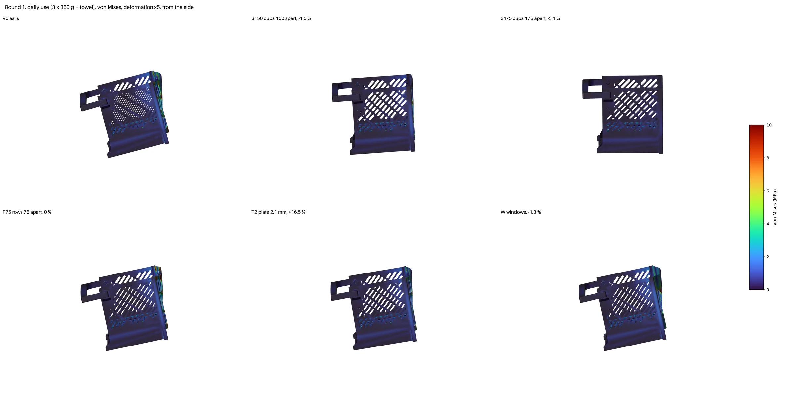

- **It nods:**
  - the cups are 120 mm apart (x = ±60), but the dovetails that carry the body are at ±104;
  - the 44 mm of slotted plate between them twists, and the whole body turns forward on it, about
    2° in daily use;
  - the towel bar drops 8.8 mm under the daily load and 36 mm when the towel is pulled
    (overstated, see above).
- **Stresses are moderate:** the plate 13 MPa (p99.9) in daily use, 48 when the towel is pulled,
  at the ends of the outer slots.
- **The cups:** each upper cup pulls 12.6 N all day.

### The plate and the cups: three rounds, one variable at a time

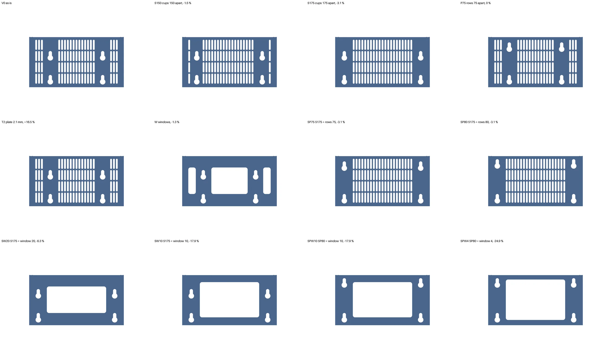

| Variant | Change | Plate | Bar drops, daily | Plate p99.9, daily | Upper cup pull, daily | Bar drops, towel pulled | Worst cup, towel pulled |
|---|---|---|---|---|---|---|---|
| V0 | as it is | 39 242 mm³ | 8.8 mm | 13.2 MPa | 12.6 N | 35.6 mm* | 52 N |
| S150 | cups 150 mm apart | −1.5 % | 2.9 | 6.2 | 13.1 | 12.3 | 57 |
| S175 | cups 175 mm apart | −3.1 % | 0.80 | 1.8 | 13.2 | 3.3 | 62 |
| P75 | cup rows 75 mm apart | 0 % | 7.2 | 11.6 | 9.3 | 29.1* | 39 |
| T2 | plate 2.1 mm | +16.5 % | 5.8 | 8.5 | 12.9 | 23.6* | 55 |
| W | windows, 20 mm bands | −1.3 % | 7.4 | 9.1 | 12.7 | 30.1* | 53 |
| SP75 | S175 + rows 75 mm apart | −3.1 % | 0.72 | 1.7 | 9.7 | 2.9 | 46 |
| SP80 | S175 + rows 80 mm apart | −3.1 % | 0.71 | 1.6 | 9.1 | 2.9 | 43 |
| SW20 | S175 + a window, 20 mm bands | −6.3 % | 0.80 | 1.9 | 13.2 | 3.2 | 62 |
| SW10 | S175 + a window, 10 mm bands | −17.9 % | 0.80 | 1.9 | 13.2 | 3.3 | 62 |
| SPW10 | SP80 + a window, 10 mm bands | −17.9 % | 0.70 | 1.8 | 9.1 | 2.9 | 43 |
| SPW4 | SP80 + a window, 4 mm bands | −24.9 % | 0.71 | 1.8 | 9.1 | 3.0 | 42 |

\* Overstated: with that much nod, the body's floor rests on the lower keyhole pads.

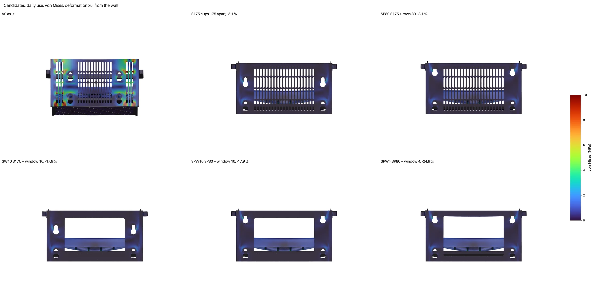

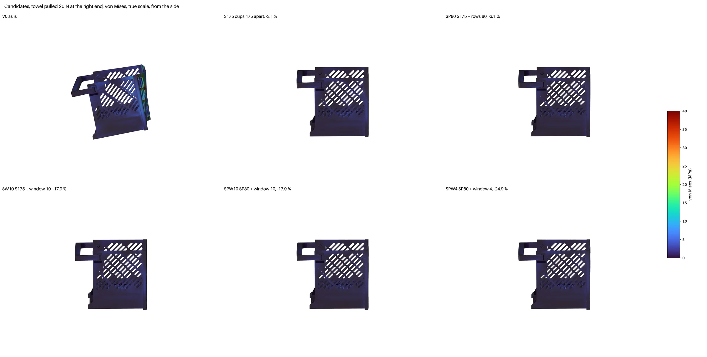

- **The supports matter most:**
  - with the cups 175 mm apart, under the dovetails, the bar drops 0.8 mm instead of 8.8, the
    plate works at a seventh of the stress, and it takes less plastic;
  - no other single change comes close: a 25 % thicker plate gains a third of that for 16.5 %
    more plastic.
- **Row distance sets the cups' pull:** what the upper cups pull is the drainer's turning moment
  over the distance between the rows. At 80 mm (the most the plate fits) it drops from 13.2 to
  9.1 N per cup all day, and the worst cup under a towel pull from 62 to 43 N.
- **With the cups at the edges, the middle of the plate does nothing:** one window with 4 mm
  bands takes a quarter of its plastic and changes nothing else.

### The rack

With the plate stiff, the rack was the softest part.
- **How it sagged in daily use:** 2.7 mm in the middle of its floor, while its fences sag only
  0.5–0.6 mm. The 1.6 mm floor, its slots running side to side, spans the 90 mm between the
  fences.
- **Strength:** 5.4 MPa (p99.9) within its layers, about 9×: soft, not weak.
- **Correction:** the README's hand calculation (0.4 mm) had counted only the fences.

**The bins' load is the uncertainty**, so each rack was solved twice:
- **An even pressure on each bin's footprint:** the pessimistic case.
- **The load in a band under each bin's walls:** as a stiff box would bring it down.

Two other ways were tried and dropped:
- **The bins meshed and bonded to the rack:** gave 0.28 mm. Too optimistic, because the bonded
  bins turn the rack into an 80 mm deep box girder that resting bins are not.
- **The bins meshed and resting on it (frictional contact):** did not converge in 1.5 hours.
  The two slotted floors open and close thousands of contact patches.

Variants from SPW4, one change at a time:

| Rack | Plastic | Sag, even load | Sag, load under the walls | p99.9 |
|---|---|---|---|---|
| as it was: 1.6 mm, slots side to side | 26.9 cm³ | 2.74 mm | 1.82 mm | 5.4 MPa |
| FH25: fences 25 mm | +26 % | 2.43 | — | 5.1 |
| RX: slots front to back | +0.4 % | 1.95 | 1.54 | 4.2 |
| RT24: floor 2.4 mm | +31 % | 1.15 | — | 2.9 |
| RX20: RX + floor 2.0 mm | +16 % | 1.22 | 0.91 | 3.0 |
| **RX24: RX + floor 2.4 mm** | **+31 %** | **0.85** | **0.69** | **2.2** |

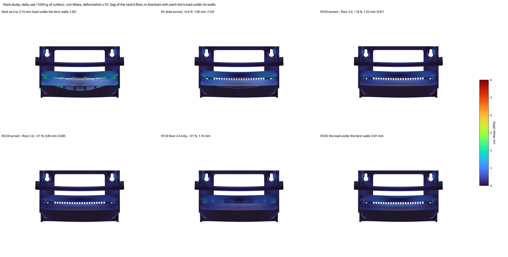

- **Turning the slots** is nearly free: the floor's strips then span the 90 mm between the fences
  instead of the 206 mm between the ledges.
- **A thicker floor works:** the same 2.4 mm floor sags 35 % more with the slots side to side.
- **Taller fences hardly help:** it is not the fences that sag.
- **A central partition under the rack** was considered and dropped.
  - **Why it does not help on its own:** the body's floor under it hangs from the wall and spans
    the same 206 mm, so the partition only moves the load there.
  - **What it would take:** to work it needs its own dovetail on the plate (a third, which must
    slide true with the other two), a solid column in the plate, and the tray split in two.

### Decision

Chosen by the user: **SPW4 + RX24**, the drainer's defaults now. The plate:
- `cup_span=175`, the cups at the plate's corners, under the dovetails;
- `cup_pitch=80`;
- `plate_window=[0]`, `plate_window_inset=4`, set in `cutlery-drainer.scad`.

The rack: `rack_t=2.4`, `rack_slots_across=true`. Solved as `F` in `drainer_fea.py`, all four load
cases:

| | As it was | Now |
|---|---|---|
| The bar drops, daily | 8.8 mm | **0.7 mm** |
| Rack sag, daily | 1.8–2.7 mm | **0.7–0.85 mm** |
| Each upper cup pulls, all day | 12.6 N | **9.1 N** |
| Towel pulled at one end: the bar / the worst cup | 36 mm / 52 N | **3.0 mm / 43 N** (and 23 N sideways) |
| Plate p99.9, worst case | 48 MPa | **5.4 MPa** |
| Plastic: plate / rack | 39.2 / 26.9 cm³ | 29.6 (−24.5 %) / 35.4 (+31 %) cm³ |
| Printing (PETG Basic): plates 3 + 4 | 8 h 26 min, 191 g | 8 h 11 min, 188 g |

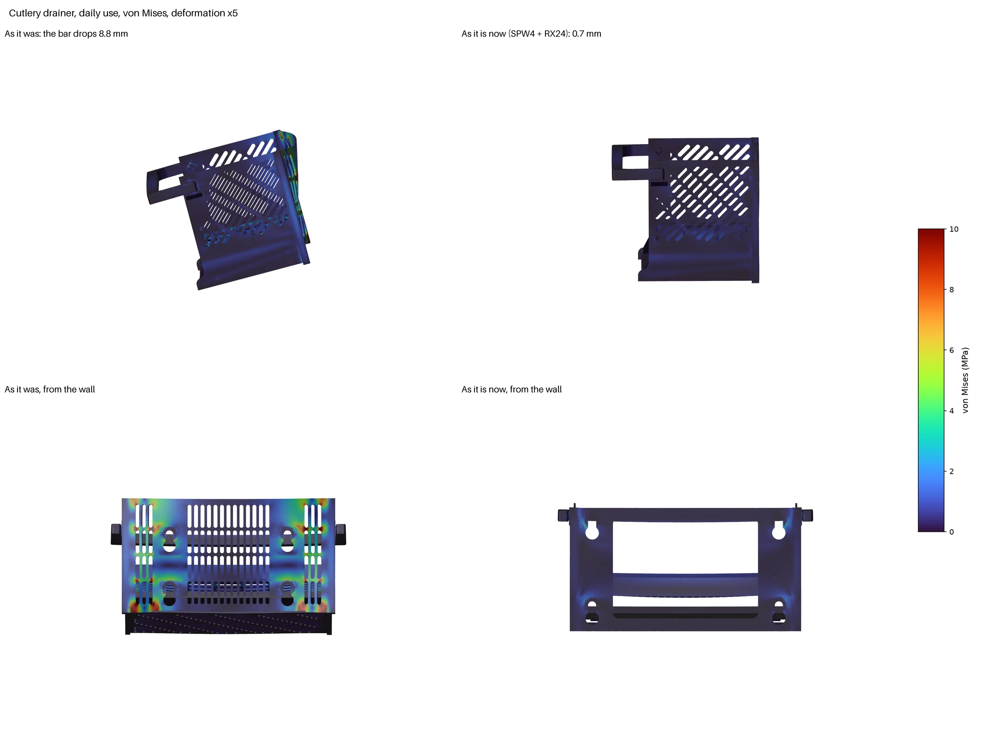

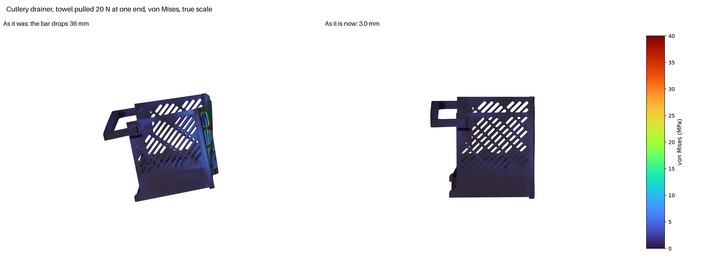

- **Nothing closes:** `penetration.py` finds no part going into another under any case, so the
  bonded, linear model holds for this design.
- **Stresses:** everything works under 6 MPa (p99.9) in the worst case.
- **What is left:** the cups. 9 N all day each, and 43 N for a moment when the towel is yanked.

## Not checked

- **Material:** isotropic, with the X-Y modulus. Bending across the layers is about a quarter
  stiffer in the model than in print.
- **Not modelled:** walls, infill and seams.
- **The cups:** rigid, so their give and how much pull they hold were not modelled.
- **Time-dependent effects:** creep and fatigue were not simulated. The permanent stresses are
  under 2 MPa, where PETG barely creeps.
- **Contact:** the full contact model of daily use never finished. The comparison rests on its
  first quarter of the load.
- **The cutlery drainer:** the bins resting on the rack (the contact model did not converge;
  the rack is bracketed instead), and the cups' holding force, which no model here knows.

## Reproduce

From this folder, with the `fea` environment (tools/fea/README.md, Toolchain):

```sh
micromamba run -n fea python variants.py <out> V0 WH0i20      # plate variants, daily use and bottle only
micromamba run -n fea python squeeze_contact.py <out> WH0i20  # squeeze, with contact
micromamba run -n fea python assembly_tie.py <step dir> <out> 2.5   # the bonded assembly from STEP files
micromamba run -n fea python tray_fea.py ../soap-caddy-tray.stl <out> 1.2
micromamba run -n fea python drainer_fea.py <out> F V0       # the drainer as it is now and as it was, all four cases
CUTS=100,150,190,209 micromamba run -n fea python print_sway.py <out> R F   # the body while it prints
PIECE=drainer CUTS=40,70,95,114 micromamba run -n fea python print_sway.py <out>   # the drainer's body
```

| File | What it is |
|---|---|
| `caddy_model.py` | The caddy as an FEA model: meshes (STEP or OpenSCAD STL), surfaces, the wall, loads, checks |
| `soap_dims.scad` | Echoes the caddy's dimensions, with any `-D` overrides, for `caddy_model.py` |
| `variants.py` | The plate variants, every load case, one table line each |
| `squeeze_contact.py` | The squeeze with contact on the box's back wall |
| `assembly_tie.py`, `assembly_contact.py` | The bonded and the contact assemblies (STEP input) |
| `tray_fea.py` | The tray alone |
| `drainer_dims.scad` | Echoes the drainer's dimensions, and exports its handle in place |
| `drainer_model.py` | The drainer as an FEA model: STL meshes, surfaces, the hinged cups, loads |
| `drainer_fea.py` | The drainer's variants and load cases, one block of results each |
| `body_cut.scad`, `drainer_body_cut.scad`, `print_sway.py` | Each body as it stands on the bed at a given height, and the print stiffness study on it |
| `img/` | The images on this page |
