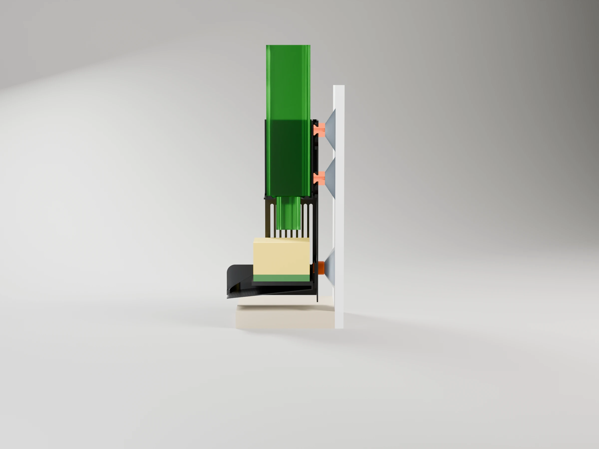
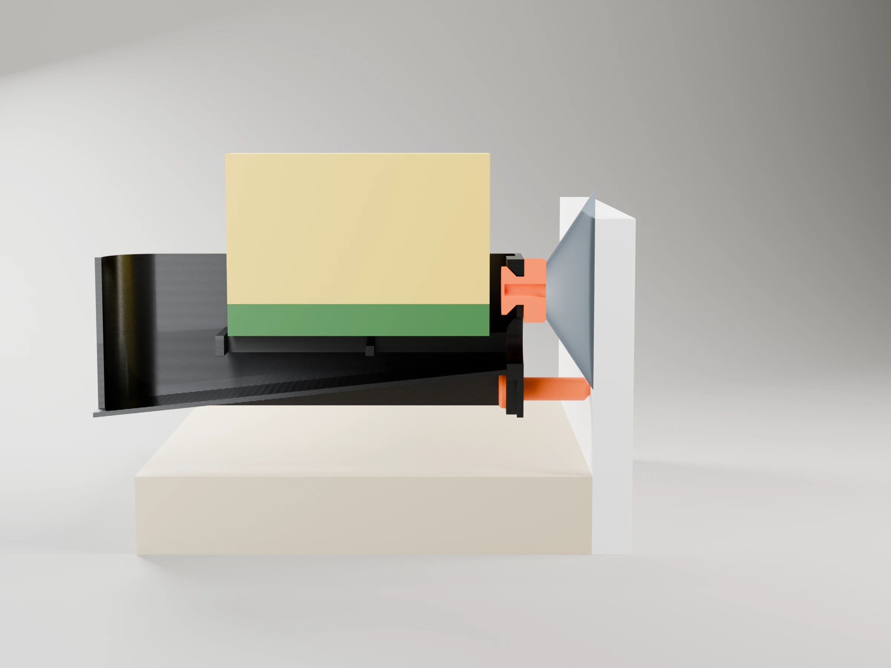
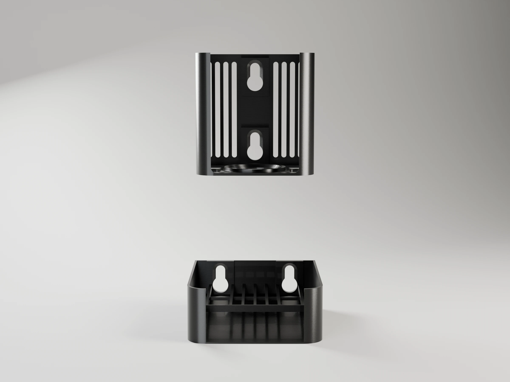
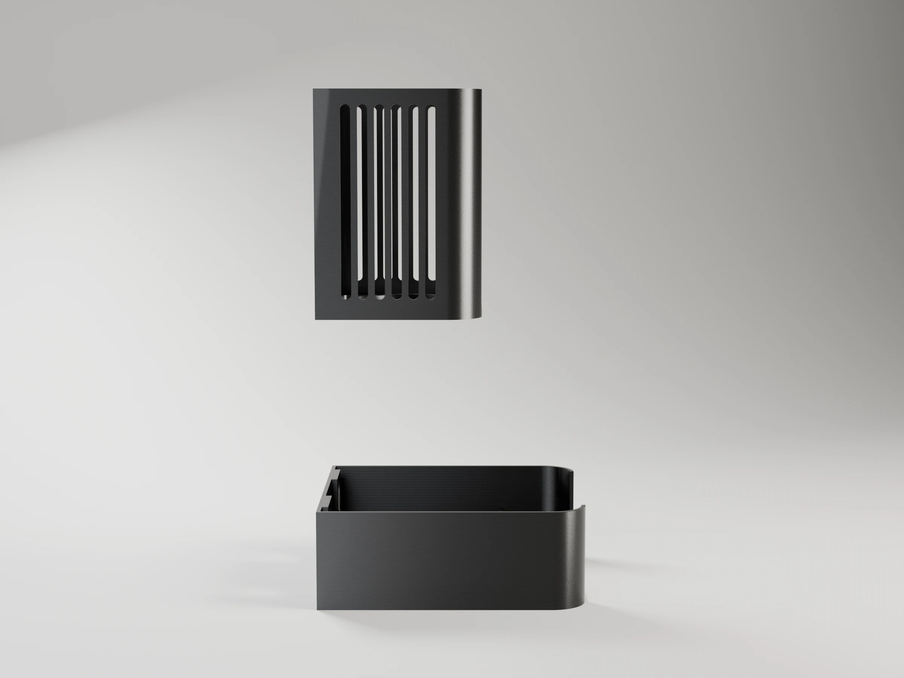
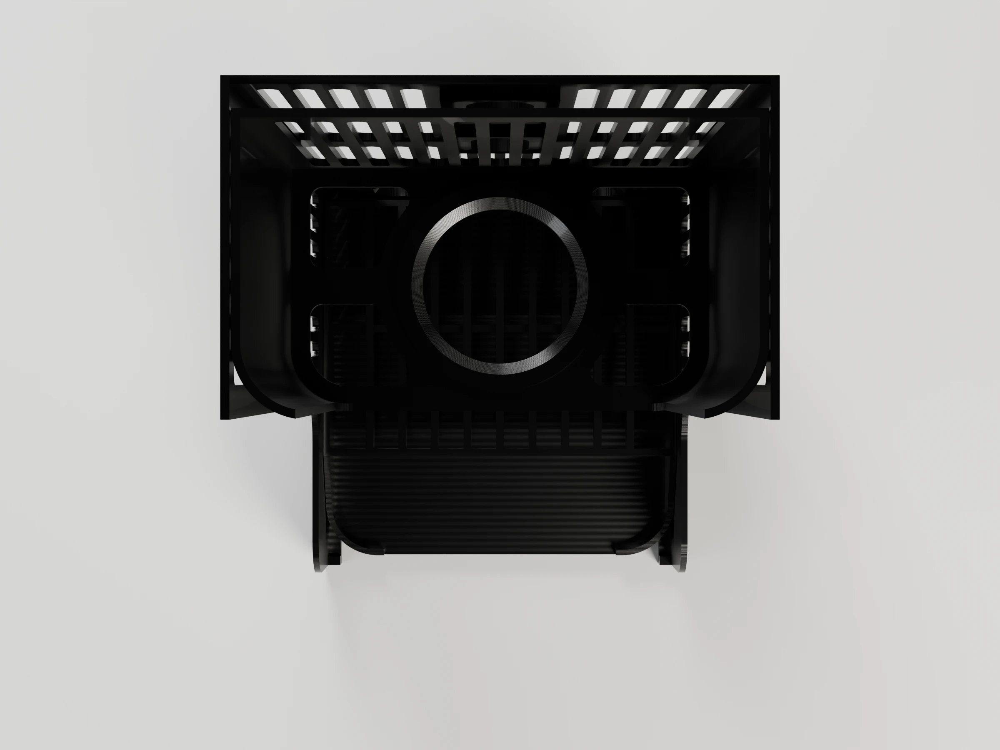
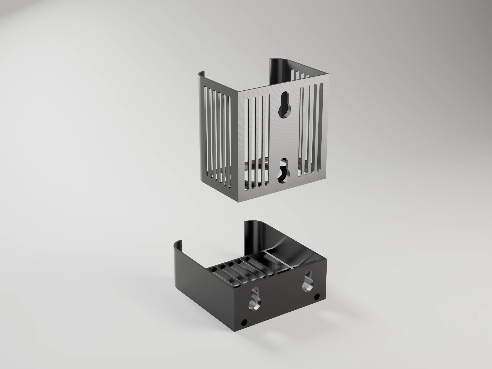
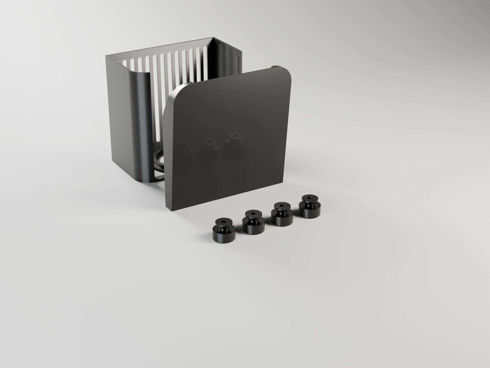

# Soap caddy

A wall-mounted holder for the dish soap bottle and the scourer sponge, next to
the sink. It replaces a metal rack that scratched the counter and was hard to
clean around: nothing touches the counter, and both pieces lift off the wall
for washing while the suction cups stay in place.

- **Upper piece**: an open-front box that holds the bottle **upside down**, so
  the soap is always at the cap. The cap goes through a hole in the floor and
  hangs right over the sponge: open it, squeeze the bottle against the back
  and the soap lands on the sponge.
- **Lower piece**: a slatted cradle where the sponge dries, over a tray that
  slopes forward and spills into the sink.

Sized by default for the Bosque Verde 600 ml bottle and the Bosque Verde
scourer with nail guard (90 × 65 × 45 mm), both from Mercadona. Every size is
a parameter: measure your bottle and adjust before printing.


```sh
make project                                   # -> soap-caddy-p1s.3mf (Bambu Studio, ready to print)
make report                                    # rebuild it, slice it, print time and filament per plate
make                                           # -> one STL per part
make project DEFS='-D bottle_w=80 -D bottle_d=54 -D neck_d=32'   # your bottle
make render                                    # -> renders/*.webp, studio views with Blender
make help                                      # every target
```

## How it hangs



Four suction cups (Ø 50 mm with an M4 × 10 stud, e.g. DIYexpert on Amazon)
stick to the wall: the upper pair one above the other, `cup_pitch` (55 mm)
apart, centred over the sink; the lower pair side by side,
`lower_cup_span` (56 mm) apart, which keeps the tray piece only 40 mm tall. A printed
**button** screws onto each stud: a flange that rests on the cup, a shank and
a cone head. Each piece has two **keyholes**: push it onto its two buttons
through the round entries and let it drop `drop` (12 mm). The cone heads seat
in 45° countersinks and pull the piece tight against the flanges.

The upper pair, one above the other, takes the bottle's turning moment. The
lower pair, side by side, only stops the tray swinging sideways; two printed
**pegs**, pressed into bosses under the tray floor, rest on the wall and
stop it nodding forward when you press on the sponge.



To clean, lift the upper piece 12 mm and pull it off, then the lower one.
There is room under the box to lift the tray piece off on its own.

- The bottle drops in from the top, cap first. The box is open at the front
  (where you squeeze the bottle); its sides round into 10 mm returns that
  keep it from tipping forward. Box top + bottle height must fit under the wall cabinet: the
  console prints the margin (431 of 460 mm by default).
- The cap tip hangs `tip_gap` (15 mm) over the sponge. The push-pull cap
  comes out ~5 mm when open, so it still clears the sponge.
- The sponge sits on level slats, between the side walls and with nothing
  at the front, so it slides in and out freely. Water drips through onto a
  tray sloping 6° forward. Its front edge reaches 10 mm past the edge of the
  sink (`sink_dist` + `drip_over` from the wall).
- Seen from the side the tray piece is a plain rectangle: the side walls run
  at full height out to the front edge and hide the slope inside.
- Style: a straight back against the wall, front corners rounded in plan
  (`corner_r`), close rounded slots in the walls and rounded floor windows
  round a round collar. 4-line walls keep it under 90 g. The style, the
  keyholes, the buttons and the pegs come from the shared library
  ([`tools/scad/`](../../tools/scad/)), for the next kitchen pieces.

## Installing

1. Clean the tile with isopropyl alcohol. On tile that is not quite smooth,
   a very thin film of petroleum jelly on each cup rim seals much better.
2. Screw a button onto each cup by turning the cup: the M4 stud taps its own
   thread into the 3.4 mm hole. Press the two pegs into the bosses under the
   tray, from the front.
3. Hang both pieces on their buttons on the table, then press the whole
   assembly against the wall, pushing over each cup.
4. Lift the pieces off and on again to check they slide freely.

Measure `cup_h` (wall to the hub face of a pressed cup) once the cups are on
the wall: it sets how far the tray reaches.

## Parts

| Part | Size (mm) | Notes |
|---|---|---|
| `upper` | 88 × 66 × 90 | Bottle box; printed standing on its floor |
| `lower` | 97 × 108 × 40 | Sponge cradle and tray; printed lying on its back |
| `button` | Ø 16 × 11 | One per cup (4); printed on its flange |
| `peg` | Ø 10 × 23 | Two; press-fit into the tray's bosses, tip on the wall; printed on its collar |
| `test_keyhole` | 22 × 30 × 4.2 | Fit test: one keyhole pad, printed flat |

## Parameters

All lengths in mm. Override any of them with `make DEFS='-D name=value'` (also
`make project`, `make report` and `make render`). The console prints the piece
sizes, the cup heights and the cabinet margin; asserts stop the build if the
cups do not fit their pieces.

| Parameter | Default | What it does |
|---|---|---|
| **Bottle** | | |
| `bottle_w`, `bottle_d` | 82, 55 | Bottle body, along the wall and front to back |
| `bottle_h` | 210 | Total height with the cap (cabinet check) |
| `neck_d` | 34 | Widest part that goes through the floor hole (cap, neck ring) |
| `seat_to_tip` | 35 | How far the cap tip hangs below the floor |
| `bottle_play` | 1.5 | Clearance round the bottle, per side |
| **Sponge** | | |
| `sponge_w`, `sponge_d`, `sponge_h` | 90, 65, 45 | Sponge size |
| `sponge_play` | 2 | Clearance round the sponge |
| `tip_gap` | 15 | Closed cap tip to sponge top |
| **Kitchen** | | |
| `sink_dist` | 115 | Wall to the inner edge of the sink bowl |
| `drip_over` | 10 | How far the tray reaches past the sink edge |
| `counter_gap` | 15 | Counter to the bottom of the tray |
| `cabinet_h` | 460 | Counter to the wall cabinet |
| **Suction cups** | | |
| `cup_d`, `cup_h` | 50, 12 | Cup diameter; wall to the hub face, pressed on |
| `cup_pitch` | 55 | Vertical distance between the upper cups |
| `lower_cup_span` | 56 | Horizontal distance between the lower cups |
| `stud_len`, `stud_hole` | 10, 3.4 | Stud length; pilot hole the stud taps into |
| **Keyhole** | | |
| `shank_d`, `head_d`, `flange_d` | 7, 12, 16 | Button sizes |
| `keyhole_play` | 0.3 | Radial clearance in the keyhole |
| `shank_play` | 0.2 | Axial clearance between pad and head |
| `drop` | 12 | How far a piece drops onto its buttons |
| `pad_t`, `pad_w` | 4.2, 22 | Pad round each keyhole |
| **Upper piece** | | |
| `frame_h` | 90 | Box height |
| `wall_t`, `back_t` | 1.68, 1.68 | Side walls and returns; back plates of both pieces |
| `floor_t`, `collar_t` | 2, 4 | Box floor; collar round the hole |
| `return_w` | 10 | Front returns, rounding into the sides |
| **Lower piece** | | |
| `tray_slope` | 6 | Tray slope, degrees |
| `tray_t`, `side_t` | 1.26, 1.68 | Tray floor and side walls |
| `slat_w`, `slat_h`, `slat_pitch` | 2.1, 5, 9 | Slats |
| `sponge_rim` | 12 | Side walls above the slats (they run at that height out to the front) |
| `peg_d`, `peg_fit`, `peg_inset` | 6, 0.1, 10 | Pegs; extra on their holes (press fit); axis in from each side |
| **Style** | | |
| `corner_r` | 14 | Front corners, rounded in plan (the back stays straight) |
| `slot_w`, `slot_rib`, `slot_margin` | 4, 2.6, 6 | Rounded vertical slots in the walls |

## Strength and orientation

Each loaded part is checked against its load, derating PETG to 40 % across
the layers (CLAUDE.md §2.3). Loads: a full 600 ml bottle (≈6.5 N) and a hand
pressing the sponge (≈30 N).

| Part | Load | Printed | Across the layers? | Margin |
|---|---|---|---|---|
| `upper` | bottle on the floor, hung from the back wall; its pitch pulls the top button head out with ≈6 N (bottle 52 mm from the wall, cups 55 mm apart) | standing on its floor | yes: walls in tension along Z | > 100× (≈0.05 MPa in the walls) |
| `lower` slats | the hand on the sponge: ≈4.3 N per slat (7 slats), simply supported over ≈38 mm (back plate, middle tie) | on its back, slats along Z | yes: they bend across the layers | ≈4× (≈4.7 MPa against ≈19). Raise `slat_h` if needed: the stress drops with its square |
| `lower` tray | dripping water | on its back | yes | no real load |
| `button` | shear on the shank and pull on the head, ≤6 N | standing on its flange | yes | > 50× (≈0.2 MPa on a 7 mm shank) |
| `peg` | pushes on the wall along its axis | standing on its collar | no: compression | — |

Lying on its side would put the slats in XY, but the side wall would
then be a 108 × 40 mm roof in the air. With a 4× margin, the back is the
better trade.

## Keyhole fit test

**Plate 2** (19 min, 3 g): one keyhole pad and one button. Push the button
through the entry and slide it up the slot. It should slide freely and seat
with no play. Too tight: raise `keyhole_play`; loose front to back: lower
`shank_play`.

## Printing (Bambu P1S)

`make project` builds `soap-caddy-p1s.3mf`, on a Textured PEI plate: P1S 0.4
nozzle, *0.20mm Standard* with gyroid infill, the seam at the back, scarf seam
and precise outer walls. Black Bambu PETG Basic in slot 1. PETG takes warm
soapy water and the top rack of the dishwasher, where PLA softens and creeps.
No supports: the upper piece stands on its floor and the lower one lies on
its back, so the sloping tray, the slats and the side walls all print as
upright walls. With the default parameters:

| Plate | Contents | Time | Filament |
|---|---|---|---|
| 1 · Soap caddy | upper, lower, 4 buttons, 2 pegs | 3 h 57 min | 85 g |
| 2 · Keyhole fit test | keyhole pad, button | 19 min | 3 g |

PETG bonds hard to the textured plate: use a glue stick as a release layer,
and let the plate cool before removing the parts.

## Renders

`make render` builds the project and renders the caddy, a section through
its middle on the wall (`-D section="upper"`, and `"lower"` through a lower keyhole: the bottle,
sponge, cups and counter are cut with it) and the print plate with Blender
(`../../tools/render_studio.py`), in the filament colour and with
layer lines at the project's layer height. 2400 × 1800 WebP; add
`RENDER_FLAGS="--samples 32 --scale 0.25"` for a quick draft.

| Hero | Front | Side | Top | Back |
|---|---|---|---|---|
|  |  |  |  |  |

Print plate: 
