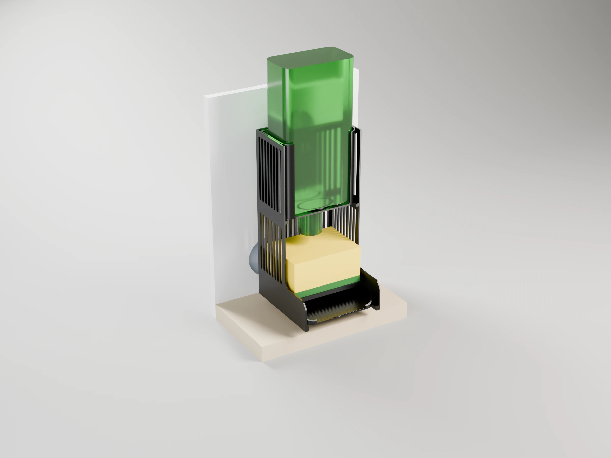
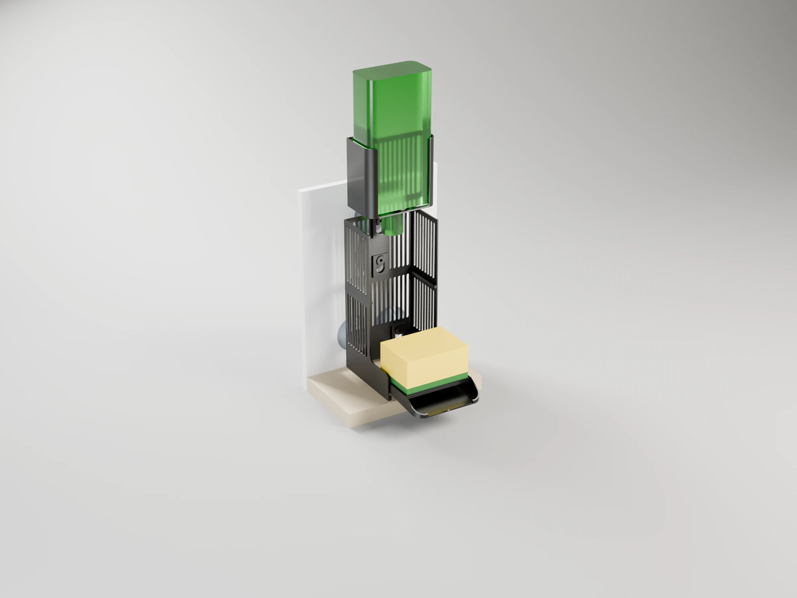
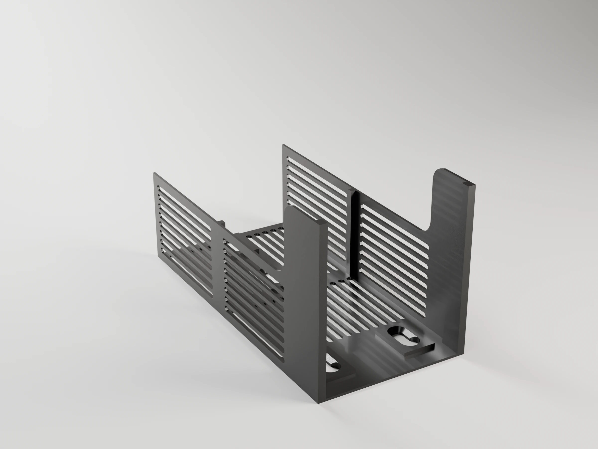
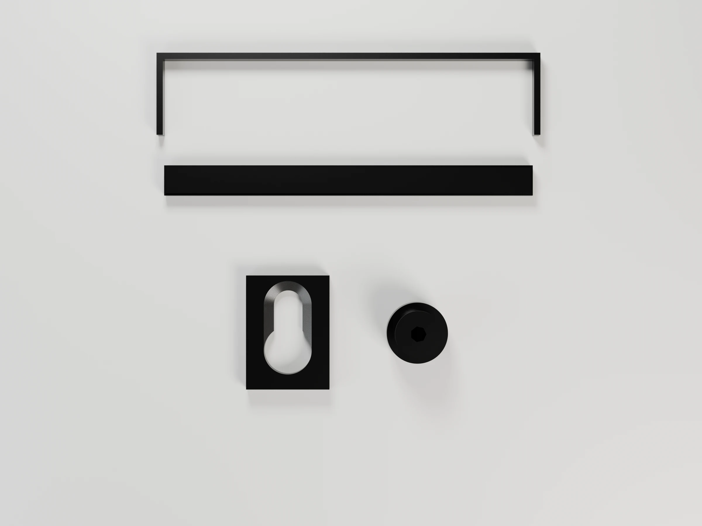

# Soap caddy

A wall-mounted holder for the dish soap bottle and the scourer sponge, next to
the sink. It replaces a metal rack that scratched the counter and was hard to
clean around: nothing touches the counter, and every piece that gets wet
comes out on its own, to wash it or reprint it, while the frame stays on the
wall. It is modular in the same way as the [cutlery drainer](../cutlery-drainer/).

- **Frame**: the back plate and two side walls. It hangs on four suction
  cups and stays there.
- **Box**: an open-front box that holds the bottle **upside down**, so the
  soap is always at the cap. The cap goes through a hole in the floor and
  hangs right over the sponge: open it, squeeze the bottle against the back
  and the soap lands on the sponge. It drops into the frame from the top and
  lifts out.
- **Tray**: a slatted cradle where the sponge dries, over a floor that slopes
  forward and spills into the sink. It slides out to the front.

Sized by default for the Bosque Verde 600 ml bottle (90 mm at its widest,
50 mm deep, 210 mm tall) and the Bosque Verde scourer with nail guard
(90 × 65 × 45 mm), both from Mercadona. Every size is a parameter: measure
yours and adjust before printing.


```sh
make project                                   # -> soap-caddy-p1s.3mf (Bambu Studio, ready to print)
make report                                    # rebuild it, slice it, print time and filament per plate
make                                           # -> one STL per part
make project DEFS='-D bottle_w=86 -D bottle_d=54 -D neck_d=32'   # your bottle
make render                                    # -> renders/*.webp, studio views with Blender
make help                                      # every target
```

| On the wall | Taken apart |
|---|---|
|  |  |

## How it hangs


Four suction cups (Ø 50 mm with an M4 stud, e.g. DIYexpert on Amazon) stick
to the wall: two side by side low down, `lower_cup_span` (56 mm) apart, and
two one above the other behind the box, `cup_pitch` (55 mm) apart, centred
over the sink. They are where the earlier two-piece caddy had them, so the
cups already on the wall stay put. A printed **button** screws onto each
stud: a flange that rests on the cup, a shank and a cone head. The frame has
four **keyholes**: push it onto the buttons through the round entries and
let it drop `drop` (12 mm). The cone heads seat in 45° countersinks and pull
the frame tight against the flanges.

One frame on all four cups takes the turning moment of the bottle and of a
hand pressing the sponge: the top cups pull, the bottom ones press. Nothing
else rests on the wall, so the earlier caddy's stand-off pegs are gone.


- **Box**: it stands on two ledges inside the side walls. Lift it straight
  up to take it out (with the bottle out first). The bottle drops in from the
  top, cap first; the box is open at the front, where you squeeze the bottle,
  and its sides round into 10 mm returns that keep it from tipping forward.
  Inside it is 94 × 53 mm: the box is as wide as the tray below it, so a
  narrower bottle has room to spare. Frame top + bottle height must fit under
  the wall cabinet: the console prints the margin (430 of 460 mm by default).
- **Tray**: it rests on ledges that follow its sloping underside. Lift its
  front 2 mm over the bumps at their ends (`ledge_stop`) and slide it out to
  the front, under the box. The sponge sits on level slats, between the side
  walls and with nothing at the front, so it slides in and out freely. Water
  drips through onto the floor, which slopes 6° forward and spills 10 mm past
  the edge of the sink (`sink_dist` + `drip_over` from the wall).
- The cap tip hangs `tip_gap` (15 mm) over the sponge. The push-pull cap
  comes out ~5 mm when open, so it still clears the sponge.
- Style: a straight back against the wall, side walls deep round the tray
  and as deep as the box above it with a rounded step between them, front
  corners rounded in plan (`corner_r`), close rounded slots in the walls and
  rounded floor windows round a round collar. The style, the keyholes and the
  buttons come from the shared library ([`tools/scad/`](../../tools/scad/)).

## Installing

1. Print plate 3 first (below) and check the fits.
2. Clean the tile with isopropyl alcohol. On tile that is not quite smooth,
   a very thin film of petroleum jelly on each cup rim seals much better.
3. Screw a button onto each cup by turning the cup: the M4 stud taps its own
   thread into the ≈3.45 mm hole (3.7 as modelled), which goes right through
   the button, until the flange sits on the cup.
4. Hang the frame on its buttons on the table, then press it against the
   wall, pushing over each cup. Lift it off and on again to check it slides.
5. Slide the tray in and drop the box in.

Measure `cup_h` (wall to the hub face of a pressed cup) and `stud_len` (the
stud, from the hub face) before printing: they set how far the frame stands
off the wall and how long the buttons are.

## Parts

| Part | Size (mm) | Notes |
|---|---|---|
| `frame` | 102 × 109 × 209 | Back plate with four keyholes, side walls with the ledges; printed lying on its back |
| `tray` | 97 × 100 × 20 | Sloping floor, slats, rims; printed lying on its back |
| `box` | 97 × 56 × 90 | Bottle box; printed standing on its floor |
| `button` | Ø 16 × 13 | One per cup (4); the stud goes right through; printed on its flange |
| `test_keyhole` | 22 × 30 × 4.2 | Fit test: one keyhole pad, printed flat |
| `test_width` | 102 × 40 × 4 | Fit test: a strip of the frame and a bar as wide as the tray and the box, printed flat |

## Fit tests (plate 3)

25 minutes and 6 g, before the 6 hours of the big plates:

- **Button on the cup**: screw the test button onto a cup. The flange must
  reach the cup's hub; if the stud stops it short, measure the stud and raise
  `stud_len`. Too hard to turn: raise `stud_hole` by 0.1.
- **Keyhole**: push the button (on its cup) through the pad's entry and slide
  it up the slot. It should slide freely and seat with no play. Too tight:
  raise `keyhole_play`; loose front to back: lower `shank_play`.
- **Width**: the bar must slide between the strip's side walls with a little
  play: the tray and the box fit the frame the same way. Too tight: raise
  `tray_play` and `box_play`; sloppy: lower them.

## Parameters

All lengths in mm. Override any of them with `make DEFS='-D name=value'` (also
`make project`, `make report` and `make render`). The console prints the
sizes, the cup heights and the cabinet margin; asserts stop the build if the
pieces do not fit.

| Parameter | Default | What it does |
|---|---|---|
| **Bottle** | | |
| `bottle_w`, `bottle_d` | 90, 50 | Bottle at its widest, along the wall and front to back |
| `bottle_h` | 210 | Total height with the cap (cabinet check) |
| `neck_d` | 34 | Widest part that goes through the floor hole (cap, neck ring) |
| `seat_to_tip` | 35 | How far the cap tip hangs below the floor |
| `bottle_play` | 1.5 | Clearance round the bottle, per side, at least |
| **Sponge** | | |
| `sponge_w`, `sponge_d`, `sponge_h` | 90, 65, 45 | Sponge size |
| `sponge_play` | 2 | Clearance round the sponge |
| `tip_gap` | 15 | Closed cap tip to sponge top |
| **Kitchen** | | |
| `sink_dist` | 115 | Wall to the inner edge of the sink bowl |
| `drip_over` | 10 | How far the tray reaches past the sink edge |
| `counter_gap` | 15 | Counter to the tray's front bottom edge |
| `cabinet_h` | 460 | Counter to the wall cabinet |
| **Suction cups** | | |
| `cup_d`, `cup_h` | 50, 12 | Cup diameter; wall to the hub face, pressed on |
| `cup_pitch` | 55 | Vertical distance between the upper cups |
| `lower_cup_span` | 56 | Horizontal distance between the lower cups |
| `stud_len`, `stud_hole` | 12, 3.7 | Stud length, from the hub face (measure yours); pilot hole the stud taps into, right through the button, as modelled (it prints ≈0.25 smaller) |
| **Keyhole** | | |
| `shank_d`, `head_d`, `flange_d` | 7, 12, 16 | Button sizes |
| `keyhole_play` | 0.3 | Radial clearance in the keyhole |
| `shank_play` | 0.2 | Axial clearance between pad and head |
| `drop` | 12 | How far the frame drops onto its buttons |
| `pad_t`, `pad_w` | 4.2, 22 | Pad round each keyhole |
| **Frame** | | |
| `back_t`, `side_t` | 1.68, 1.68 | Back plate and side walls |
| `ledge_w`, `ledge_h`, `ledge_stop` | 3.36, 4, 2 | Ledges under the tray and the box; the bump at the front of the tray's |
| `sponge_rim` | 12 | The side walls' deep part, above the slats |
| `step_r` | 10 | Radius of the step in the side walls |
| **Tray** | | |
| `tray_play` | 0.4 | Clearance in the frame, per side |
| `tray_slope` | 6 | Floor slope, degrees |
| `tray_t`, `tray_wall` | 1.26, 1.68 | Floor and rims |
| `slat_w`, `slat_h`, `slat_pitch`, `slat_clear` | 2.1, 5, 9, 3 | Slats |
| **Box** | | |
| `box_play` | 0.4 | Clearance in the frame, per side |
| `box_h` | 90 | Box height (and the top of the frame) |
| `wall_t`, `floor_t`, `collar_t` | 1.68, 2, 4 | Walls, floor, collar round the hole |
| `return_w` | 10 | Front returns, rounding into the sides |
| **Style** | | |
| `corner_r` | 14 | Front corners of the tray and box, rounded in plan |
| `slot_w`, `slot_rib`, `slot_margin` | 4, 2.6, 6 | Rounded vertical slots in the walls |

## Strength and orientation

Each loaded part is checked against its load, derating PETG to 40 % across
the layers (CLAUDE.md §2.3). Loads: a full 600 ml bottle (≈6.5 N) and a hand
pressing the sponge (≈30 N).

| Part | Load | Printed | Across the layers? | Margin |
|---|---|---|---|---|
| `frame` keyholes | ≈2 N·m of turning moment (hand on the sponge ≈60 mm out, the bottle ≈30 mm out) over cups ≈120 mm apart in height: ≈8 N pull on each upper button head | on its back: the slot lips in XY | no | > 20× |
| `frame` side walls | the hand on the sponge through the tray ledges, cantilevered from the back plate (≈15 N per wall, 60 mm out) | on its back: bending along Z | yes | ≈7× (≈2.6 MPa against ≈20) |
| `frame` box ledges | the bottle and the box, ≈7 N on two ledges | on its back: each layer is a short ledge loaded in XY | no | > 50× |
| `tray` slats | the hand on the sponge: ≈4.3 N per slat, over ≈35 mm (back rim, middle tie) | on its back, slats along Z | yes | ≈4×. Raise `slat_h` if needed: the stress drops with its square |
| `box` | the bottle on its floor, standing on the ledges | standing on its floor | floor in XY | > 50× |
| `button` | shear on the shank and pull on the head, ≤8 N | standing on its flange | yes | > 50× (≈0.2 MPa on a 7 mm shank) |

## Printing (Bambu P1S)

`make project` builds `soap-caddy-p1s.3mf`, on a Textured PEI plate: P1S 0.4
nozzle, *0.20mm Standard* with gyroid infill, the seam at the back, scarf seam
and precise outer walls. Black Bambu PETG Basic in slot 1. PETG takes warm
soapy water and the top rack of the dishwasher, where PLA softens and creeps.
No supports: the frame and the tray lie on their backs, so the side walls,
ledges, sloping floor and slats all print as upright walls; the box stands on
its floor. With the default parameters:

| Plate | Contents | Time | Filament |
|---|---|---|---|
| 1 · Frame | frame | 3 h 13 min | 70 g |
| 2 · Tray, box and buttons | tray, box, 4 buttons | 3 h 12 min | 68 g |
| 3 · Fit tests | keyhole pad, button, width strip and bar | 25 min | 6 g |

PETG bonds hard to the textured plate: use a glue stick as a release layer,
and let the plate cool before removing the parts.

## Renders

`make render` builds the project and renders the caddy (bare, on the wall
with the bottle and sponge, and taken apart with `-D explode=1`), two
sections on the wall (`-D section="upper"` through the upper keyholes and
`"lower"` through a lower one; buttons in orange) and the print plates with
Blender (`../../tools/render_studio.py`), in the filament colour and with
layer lines at the project's layer height. 2400 × 1800 WebP; add
`RENDER_FLAGS="--samples 32 --scale 0.25"` for a quick draft.

| Hero | Front | Side | Top | Back |
|---|---|---|---|---|
|  |  |  |  |  |

Plates:   
