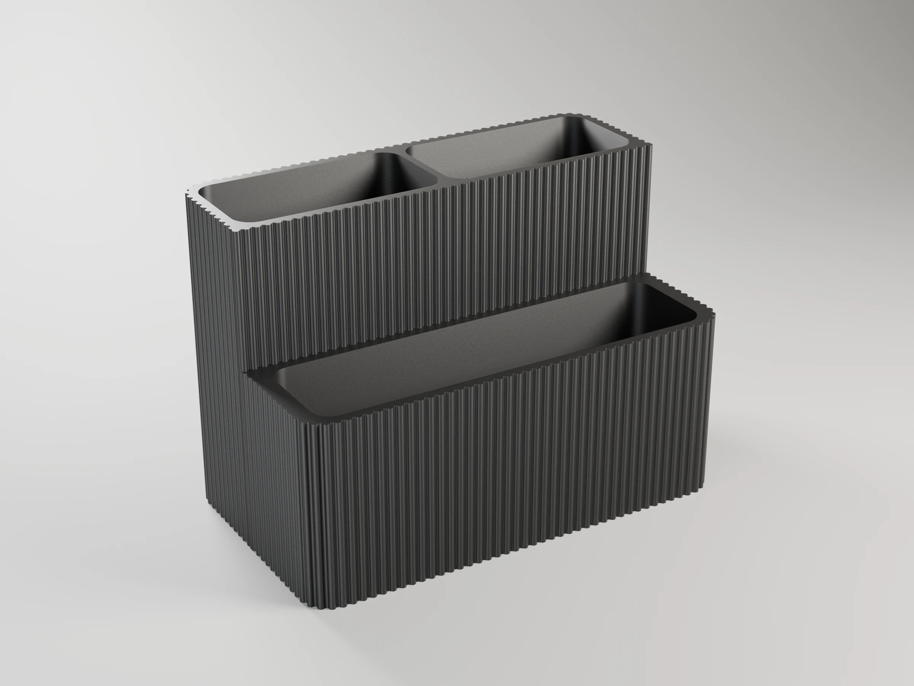
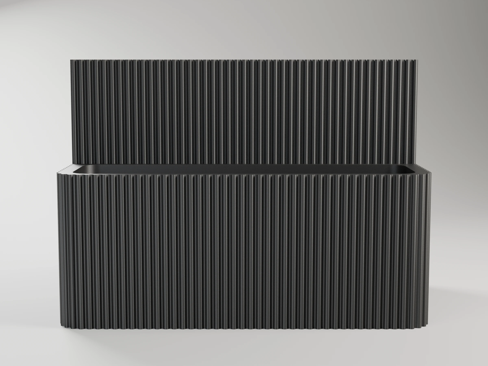
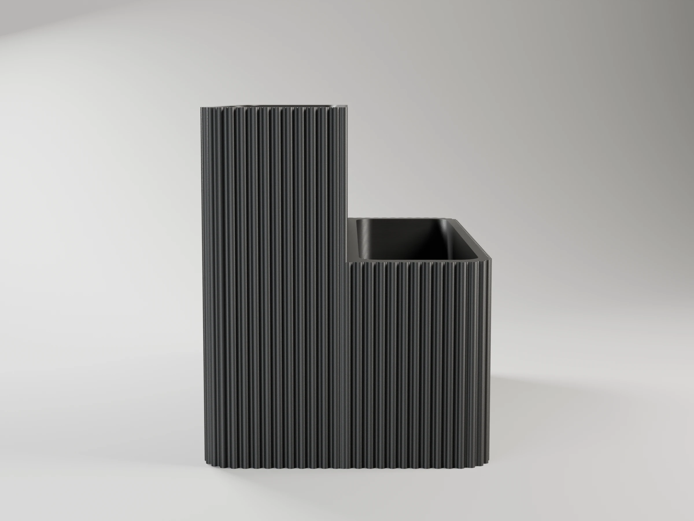
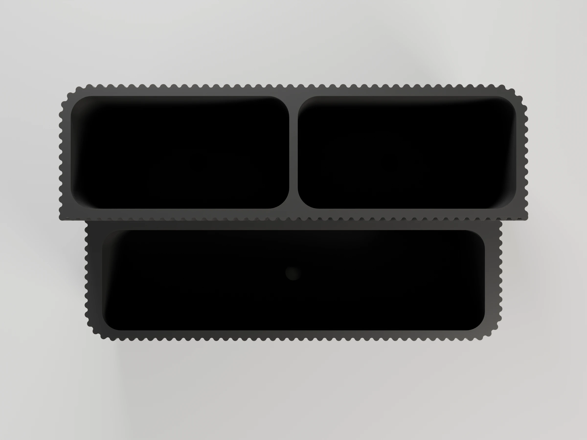
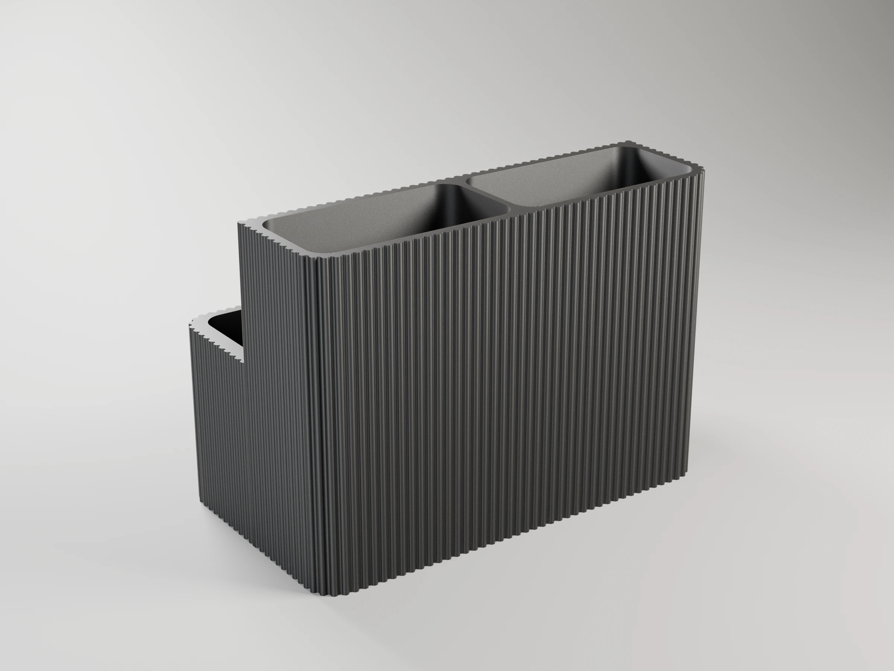
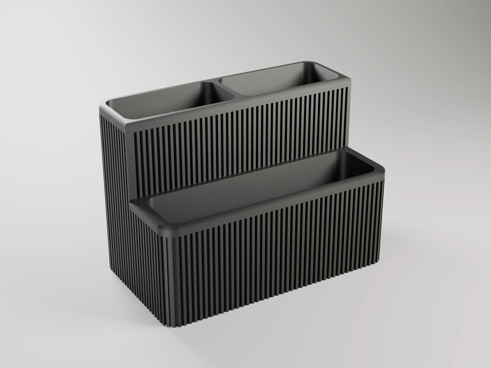
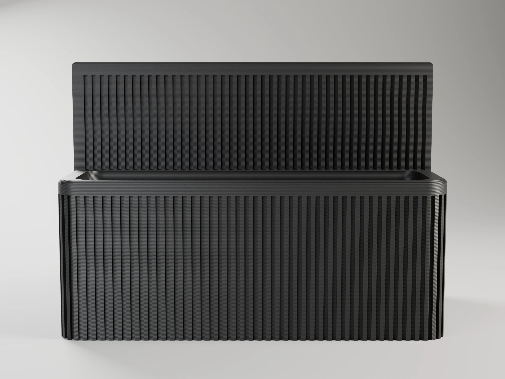
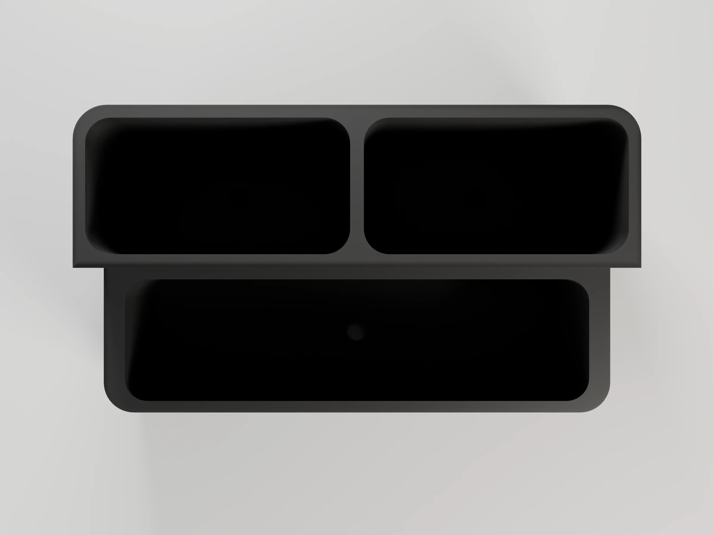
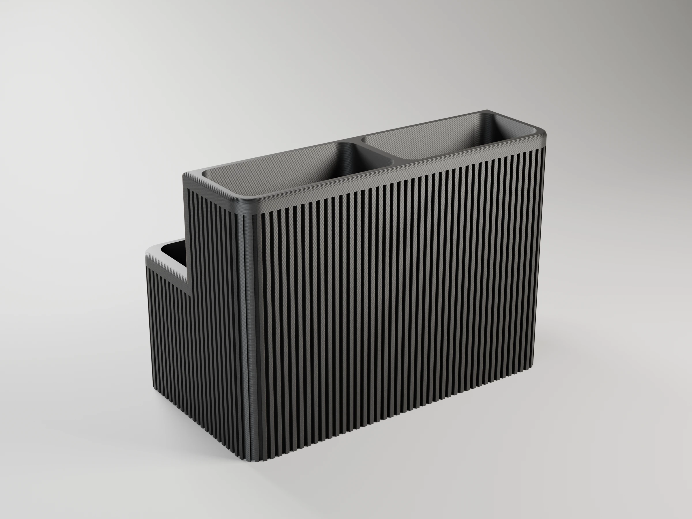

# Remote stand

Two-row stepped box for TV remotes: the front row is lower and the back row
sits on a raised floor, so every remote stays visible. Two finishes of the
same body:



- `remote-stand.scad` (v1): rounded ribs all around the body and the step.
- `remote-stand-v2.scad` (v2): flush walls with narrow channels cut into
  them, under a smooth rounded rim.

```sh
make project                                   # -> remote-stand-p1s.3mf (Bambu Studio, ready to print)
make report                                    # rebuild it, slice it, print time and filament per plate
make                                           # -> remote-stand.stl + remote-stand-v2.stl
make v2 DEFS='-D back_count=3 -D back_remote_w=45'
make preview                                   # -> remote-stand.png + remote-stand-v2.png (OpenSCAD)
make render                                    # -> renders/*.webp, studio views with Blender
make help                                      # every target
```

Set the number of remotes per row and the widest and thickest remote of each
row (`front_*`, `back_*`); `clearance` is added to every pocket. The console
prints the footprint (about 133 x 77 x 95 mm by default). The base has
optional dust holes and recesses for adhesive rubber feet.

## Parameters

All lengths in mm. Both versions share the layout parameters; the finish
parameters differ. Override any of them with `make DEFS='-D name=value'`
(also `make project`, `make report` and `make render`).

| Parameter | v1 | v2 | What it does |
|---|---|---|---|
| **Front row (lower)** | | | |
| `front_count` | 1 | 1 | Number of pockets in the front row (≥ 1) |
| `front_remote_w` | 120 | 120 | Width of the widest item in this row |
| `front_remote_t` | 30 | 30 | Thickness of the thickest item in this row |
| `front_wall_h` | 55 | 55 | Height of the front part of the body |
| **Back row (upper)** | | | |
| `back_count` | 2 | 2 | Number of pockets in the back row (≥ 1) |
| `back_remote_w` | 60 | 60 | Width of the widest item in this row |
| `back_remote_t` | 30 | 30 | Thickness of the thickest item in this row |
| `back_wall_h` | 95 | 95 | Total height (back part of the body) |
| `back_floor_h` | 35 | 35 | Raised floor: back items sit this much higher |
| **Body** | | | |
| `clearance` | 2 | 2 | Added to each pocket's width and thickness |
| `wall` | 2.4 | 3.2 | Outer wall (v1: at the bottom of a valley; v2: channels included) |
| `divider` | 2.4 | 3.2 | Wall between pockets and between rows |
| `step_gap` | 3 | 3 | Flat ledge between the front pockets and the step |
| `floor_t` | 2.4 | 2.4 | Floor thickness |
| `corner_r` | 8 | 8 | Corner radius of the body |
| `slot_r` | 6 | 6 | Pocket corner radius |
| **Ribs (v1)** | | | |
| `rib_r` | 1 | — | Rib roundness |
| `rib_h` | 1 | — | How far each rib stands out |
| `rib_pitch` | 3 | — | Spacing between ribs |
| `valley_r` | -1 | — | Valley fillet: -1 auto (smooth wave), 0 sharp, >0 fixed radius |
| **Channels (v2)** | | | |
| `groove_w` | — | 1.5 | Channel width |
| `groove_depth` | — | 1.2 | Channel depth (must leave ≥ 0.8 mm of wall) |
| `groove_pitch` | — | 3 | Spacing between channels |
| **Rim (v2)** | | | |
| `rim_h` | — | 5 | Smooth band along the top edges, above the channels |
| `rim_round` | — | 1.5 | Radius of its rounded outer edge |
| `rim_steps` | — | 8 | Facets of that rounding |
| **Details** | | | |
| `dust_holes` | true | true | Holes in the floor of every pocket |
| `dust_hole_d` | 6 | 6 | Their diameter |
| `feet_recess` | true | true | Pockets under the base for adhesive rubber feet |
| `foot_d` | 10.5 | 10.5 | Foot pocket diameter |
| `foot_depth` | 1 | 1 | Foot pocket depth |

## Variations

Any two-row organiser where the back items should stand taller than the front
ones. Footprints from the console (v1; v2 is within 1–2 mm), all within the
P1S bed. Use `make v1 DEFS=…`, `make v2 DEFS=…` or `make project DEFS=…`.

| Use | Parameters | Result |
|---|---|---|
| TV + 2 remotes (default) | — | 133 × 77 × 95 mm: one wide pocket in front, two behind |
| Four remotes | `-D front_count=2 -D front_remote_w=55 -D back_count=2 -D back_remote_w=55` | 123 × 77 × 95 mm |
| **Kitchen sink caddy** | `-D front_count=1 -D front_remote_w=100 -D front_remote_t=35 -D front_wall_h=45 -D back_count=2 -D back_remote_w=50 -D back_remote_t=50 -D back_wall_h=90 -D back_floor_h=10` | 113 × 102 × 90 mm: sponge in front, two brushes or a soap bottle behind; the dust holes drain the water. Print in PETG |
| Tea box | `-D front_count=3 -D front_remote_w=72 -D front_remote_t=40 -D front_wall_h=50 -D back_count=3 -D back_remote_w=72 -D back_remote_t=40 -D back_wall_h=80 -D back_floor_h=30` | 234 × 97 × 80 mm: six stacks of tea bags (≈70 mm wide), the back three raised so their labels show |
| Desk organiser | `-D front_count=3 -D front_remote_w=30 -D front_remote_t=30 -D front_wall_h=60 -D back_count=1 -D back_remote_w=80 -D back_remote_t=14 -D back_wall_h=70 -D back_floor_h=20` | 108 × 61 × 70 mm: three pen cups in front and a phone slot behind |

## Printing (Bambu P1S)

`make project` builds `remote-stand-p1s.3mf`, a Bambu Studio project with one
plate per version (print whichever one you want), each standing upright on a
Textured PEI plate: P1S 0.4 nozzle, *0.20mm Standard* with the seam at the
back, Bambu PLA Basic in slot 1. No supports needed. With the default
parameters v1 takes about 4 h 20 min and 156 g, v2 about 5 h 35 min and
169 g. It needs Bambu Studio installed.

## Renders

`make render` builds the project and renders studio views of each stand with
Blender (`../tools/render_studio.py`), in the filament colour and with layer
lines at the project's layer height. 2400 x 1800 WebP, ready for MakerWorld's
model images; add `RENDER_FLAGS="--samples 32 --scale 0.25"` for a quick draft.

| | Hero | Front | Side | Top | Back |
|---|---|---|---|---|---|
| v1 |  |  |  |  |  |
| v2 |  |  |  |  |  |

OpenSCAD previews (`make preview`): [v1](remote-stand.png) · [v2](remote-stand-v2.png).
