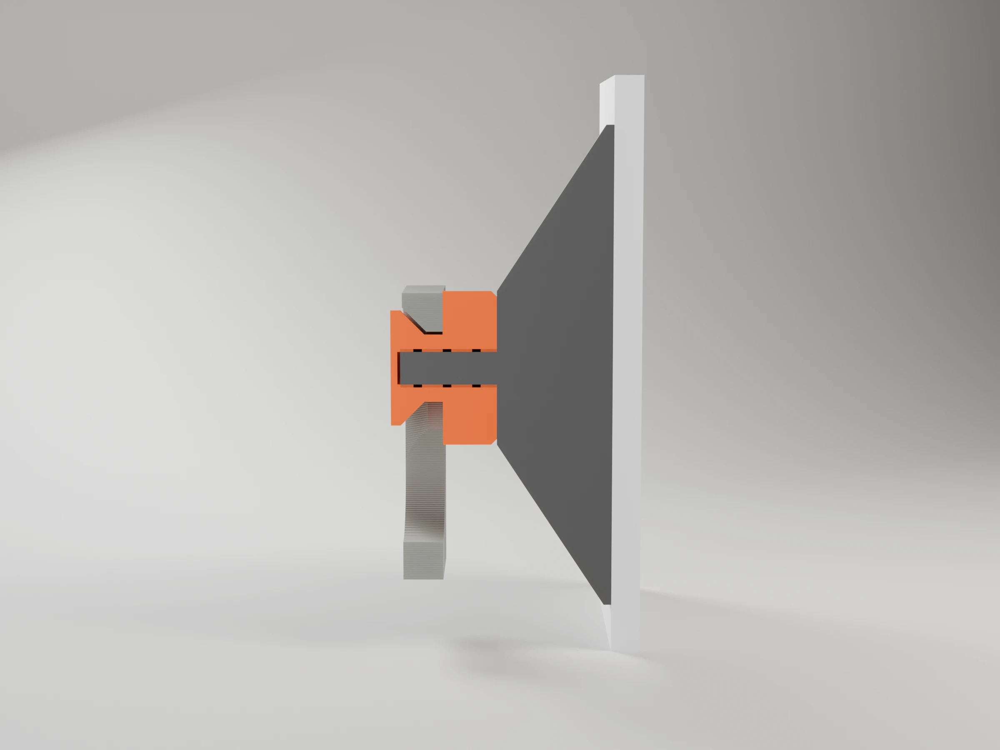
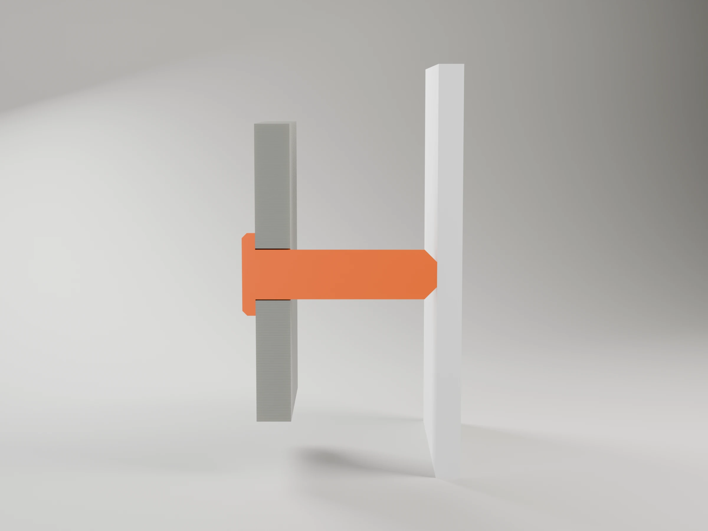
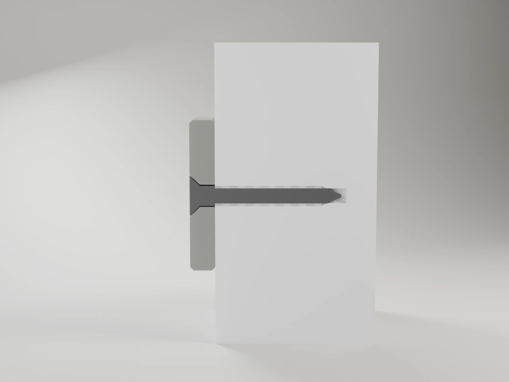
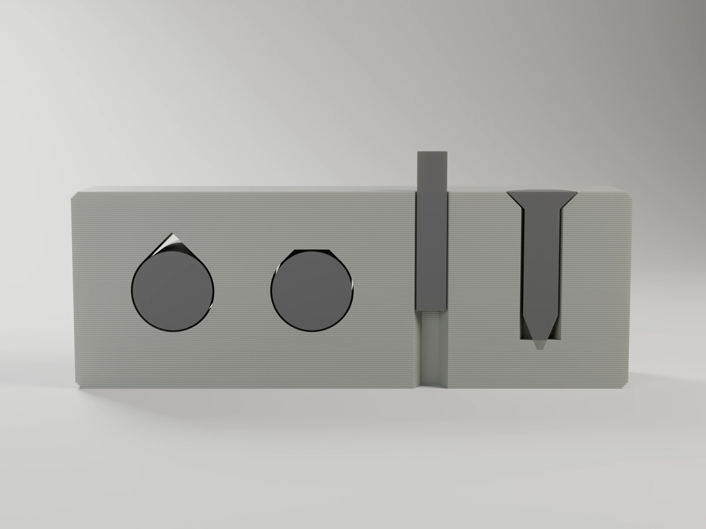
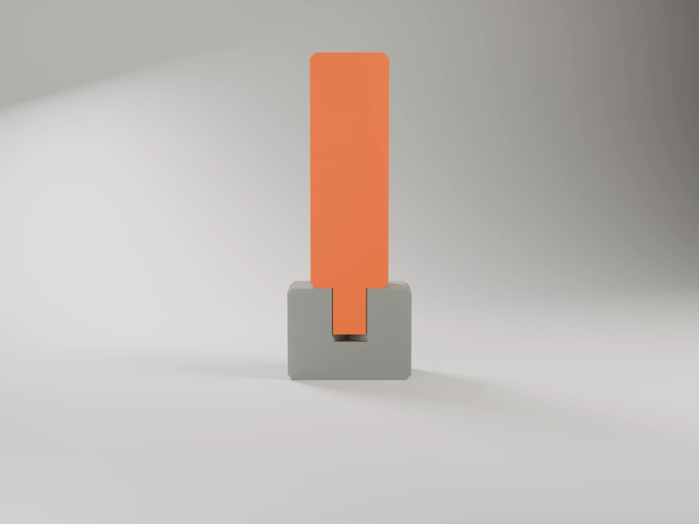
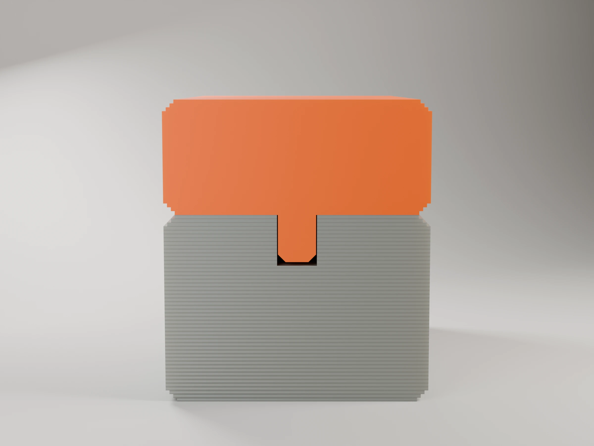
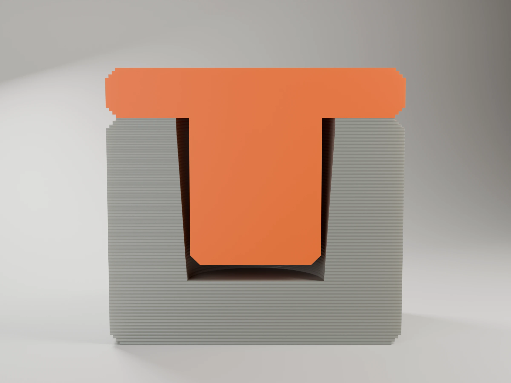
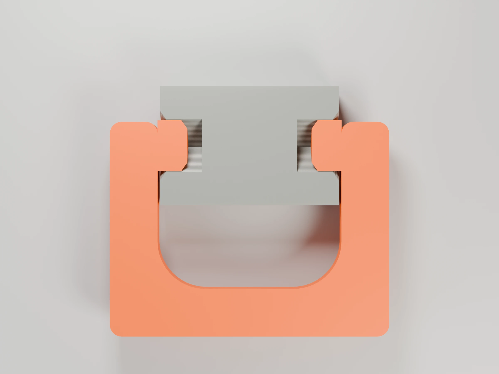
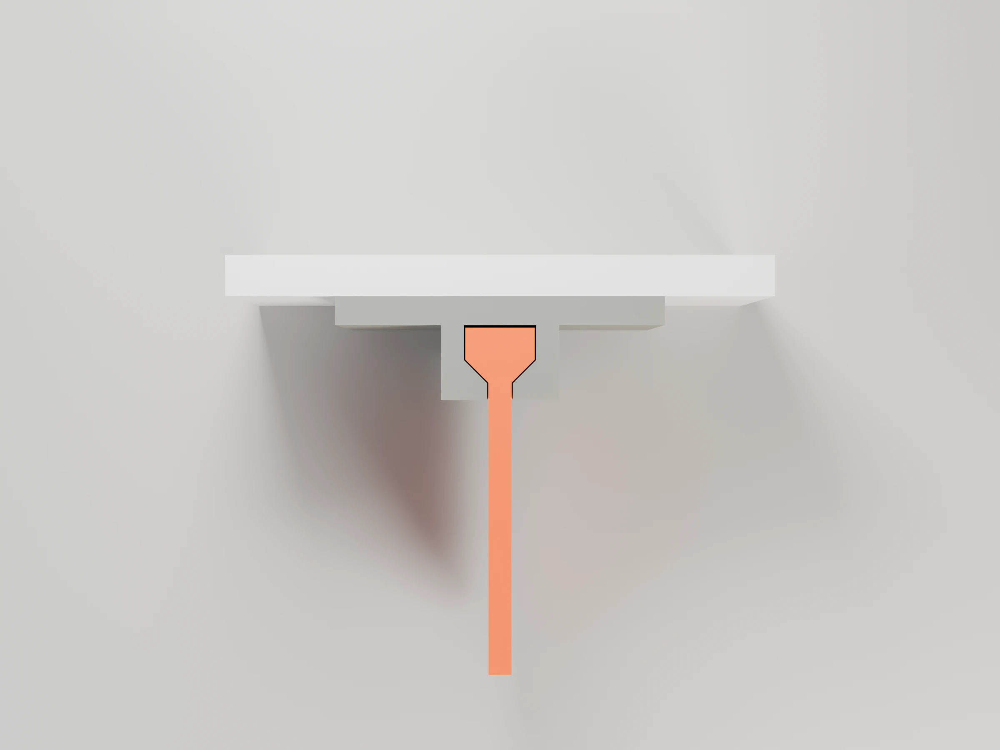
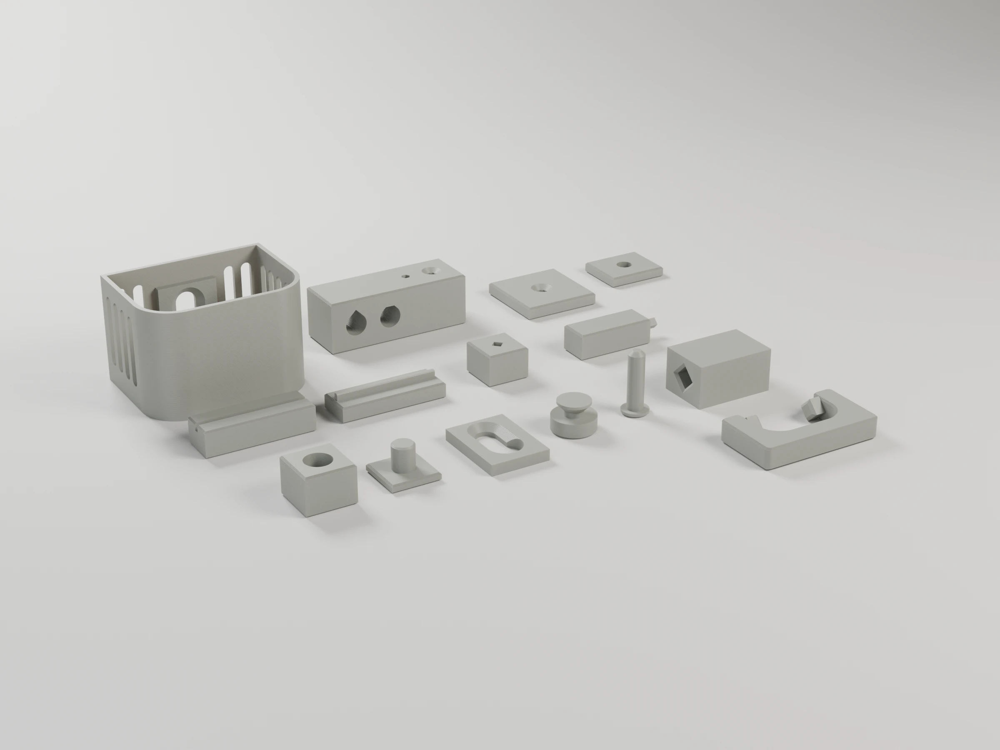

# tools

Shared scripts used by every project's Makefile. With them, a project only needs its `.scad`, a
short `bambu_project.py` and a Makefile; without them, each project would have to be set up by hand
in Bambu Studio (plates, filaments, orientation, settings) and photographed by hand.

| Script | Used by | Does |
|---|---|---|
| [`bambu3mf.py`](bambu3mf.py) | `make project`, `make report` | Builds the ready-to-print Bambu Studio project `<project>-p1s.3mf` from the OpenSCAD model, and slices it to report time and grams |
| [`render_studio.py`](render_studio.py) | `make render` | Photoreal "as printed" studio renders of that project in Blender Cycles |
| [`scad/`](scad/) | the `.scad` models | OpenSCAD library of the mounts, joints, FDM shapes and house style the projects share |

Requirements: Python 3, OpenSCAD, Bambu Studio and Blender (versions and paths in
[CLAUDE.md](../CLAUDE.md#local-environment-verified)).

## `bambu3mf.py`

Bambu Studio cannot turn an OpenSCAD export into a print-ready project on its own: it splits the
colours into parts but does not assign filaments, and it knows nothing about orientation, layout or
per-object settings. This module does that work:

- **Exports from OpenSCAD** (`load_scad`) with `lazy-union` and groups the triangles by colour.
  Each colour becomes one part of the Bambu object, assigned to the filament of the same colour (or
  the one given in `colour_map`).
- **Applies the print orientation** (`rotate=(rx, ry, rz)`) and rests the part on z = 0.
- **Lays out the plates**: refuses objects that leave the bed, overlap each other or touch the
  printer's keep-clear areas (on the P1S the excluded front-left corner `0..18 × 0..28` and the
  front strip `y < 12` where the start G-code draws its load line; on the X2D the left strip the
  right nozzle cannot reach), and places plates on Bambu's grid so multi-plate projects open and
  slice correctly.
- **Fills in the full settings** by running the Bambu Studio CLI with the system presets (merging
  each machine's `template` presets, which hold its real start, end and filament-change G-code;
  without them the CLI falls back to a generic start that heats the nozzle to 205 °C), then sets
  the Textured PEI plate, filament colours, the flush matrix (from the colours' luminance) and the
  prime tower position per plate.
- **Writes per-object settings** (walls, ironing…) to `Metadata/model_settings.config`.

A project's `bambu_project.py` is then a short description:

```python
sys.path.insert(0, os.path.join(HERE, "..", "..", "tools"))
from bambu3mf import PLA_MATTE, Filament, Project, load_scad

proj = Project("Detergent scoop", process="0.20mm Standard @BBL X1C",
               filaments=[Filament(PLA_MATTE, "#A3D8E1")],
               process_overrides={"sparse_infill_pattern": "gyroid"})
scoop = load_scad("detergent-scoop.scad", "scoop", rotate=(180, 0, 0), colour=False)
proj.plate("Detergent scoop").add("Detergent scoop", scoop)
proj.write("detergent-scoop-p1s.3mf")
```

Main pieces:

| | |
|---|---|
| `load_scad(scad, part, defs, rotate, colour=True)` | Mesh grouped by colour. `colour=False` for single-colour models (otherwise uncoloured faces get OpenSCAD's preview colours) |
| `Project(title, process, filaments, process_overrides, colour_map)` | Process preset name, `Filament(preset, "#RRGGBB")` list (slot order) |
| `proj.plate(name, prime_tower=(20, 30))` | New plate |
| `plate.add(name, mesh, x, y, settings={...})` | Object centred at (x, y), default the plate centre; `settings` are per-object overrides |
| `proj.write(path)` | Checks the layout and names and writes the 3MF |
| `Project(..., printer=X2D)`, `PRINTERS` | Target printer: `P1S` (default) or `X2D`. `printer.preset(kind, base)` finds the system preset made for it, e.g. `X2D.preset("filament", "Bambu PLA Matte")` |
| `PLA_BASIC`, `PLA_MATTE`, `PETG_HF`, `PETG_BASIC`, `PETG_MATTE` | Filament preset names for the P1S 0.4 |

Run as a script to slice every plate and print time and grams per plate and slot (the figures in
each README):

```sh
python3 tools/bambu3mf.py report <project>/<project>-p1s.3mf
```

Environment overrides: `OPENSCAD`, `BAMBU_STUDIO`, `BAMBU_PROFILES`.

## `render_studio.py`

Reads the project 3MF, so the renders show exactly what gets printed, with no colour or layer
height picked by hand:

- each part in the **colour and finish** of its filament (Matte, Silk, PETG, Translucent… from the preset name; Translucent renders clear);
- **layer lines** at the project's layer height, along the print Z;
- **exposure and backdrop** that follow the filament brightness, so black and white parts keep
  their detail;
- views hero, front, side, top and back, 2400×1800 WebP, written to `renders/<name>-<view>.webp`.

```sh
blender -b -P tools/render_studio.py -- <project>-p1s.3mf renders/<name> [options]
```

| Option | |
|---|---|
| `--plate N` | Plate to render, 1-based (default 1) |
| `--objects A,B` | Only these objects of the plate |
| `--rotate RX,RY,RZ` | From the print orientation back to the display one (e.g. `180,0,0` for a part printed upside down) |
| `--front -y\|+y\|-x\|+x` | Side that faces the viewer (default `-y`, OpenSCAD's front) |
| `--model FILE --layer-axis y` | Render an OpenSCAD colour export (e.g. an assembly) instead of a plate |
| `--views a,b` | Subset of `hero,front,side,top,back` |
| `--samples N`, `--scale F` | Quality; `--samples 32 --scale 0.25` for a draft in seconds |

The Makefiles call it through `make render`, passing extra options with `RENDER_FLAGS`.
See [CLAUDE.md §3](../CLAUDE.md#3-the-bambu-studio-project-make-project) for the full conventions.

## `scad/`: the OpenSCAD library

Mounts, joints and FDM building blocks that more than one project needs, so a new project starts
from a tested keyhole or fit instead of a copy. Load the files with `use` (not `include`), from
the project folder:

```openscad
use <../../tools/scad/basics.scad>
use <../../tools/scad/mounts.scad>
```

`use` gives the modules and functions without the library's variables, so every size is an
argument with a sensible default, and the project passes its own Customizer parameters. A project
module with the same name as a library one hides it: wrap library calls under a different name
(`sink-organizers` wraps `keyhole_cut` as `keyhole_at(z, x)`).

| File | What | Pieces |
|---|---|---|
| [`basics.scad`](scad/basics.scad) | FDM shapes | `box(a, b)`, `polyhole(d, h)` (vertical holes true to size), `teardrop(d, h, flat)` (horizontal holes without support), `chamfered_cylinder(d, h, c)`, `chamfered_prism(h, c) 2D` (layer-stepped 45° chamfers), `spaced(lo, hi, w, gap)` |
| [`mounts.scad`](scad/mounts.scad) | How a piece hangs | `keyhole_pad`, `keyhole_cut` (entry + slot + 45° countersink) and its male `keyhole_button` (screws onto a suction cup's M4 stud, or any stud); `standoff_peg` (stops a piece nodding forward; goes in from behind, crush ribs) and its `standoff_peg_hole`; `countersunk_screw` (cutter for a `wood_screw`); size functions `keyhole_*` |
| [`joints.scad`](scad/joints.scad) | Part to part, male and female | `diamond_key` / `diamond_socket` (print on their side), `tongue_profile` / `groove_profile`, `lead_in_plug` / `lead_in_socket` (2D children, chamfered tip and mouth), `sprung_handle` / `sprung_handle_socket` (a U snapped onto a part by its diamond pins) and `sprung_handle_strain`, `dovetail_tail` / `dovetail_housing` (a body slid down onto a wall plate, resting on the housing's closed bottom) |
| [`style.scad`](scad/style.scad) | House style for wall pieces | `house_plan(w, d, r)` (straight back, rounded front corners), `house_shell(w, d, t, r)`, `wall_slot(...)`, `slot_positions(lo, hi, w, rib)`, `wall_slots_tilted(at, u0, u1, z0, z1, axis, tilt, w, rib)` (45° slots for walls that print standing with the slots across Z); both take `max_len` to split long slots in a wall that prints standing |
| [`hardware.scad`](scad/hardware.scad) | Bought parts, never printed | `suction_cup`, `wood_screw`, `rod`: stand-ins for assemblies, renders and clearance checks |
| [`catalog.scad`](scad/catalog.scad) | Samples and demos | `part=`: every component and its mate, printable, in print orientation. `demo=`: each one in use, for the renders |

`tools/scad/` follows the project layout: `make project` (`catalog-p1s.3mf`, every sample and
its mate on one plate, 1 h 38 min and 48 g of grey PLA Basic: print it to check the fits on a new
printer or filament) and `make render`, which renders each `demo` assembled and cut through the plane that shows the
joint seated: the component (grey), its printed mate (orange), the hardware it takes (dark grey)
and the wall (white).

| Component | Assembled, in section |
|---|---|
| **Keyhole on a suction cup**: The button screws onto the cup's stud; the keyhole drops over it and its cone head pulls the pad against the flange |  |
| **Stand-off peg**: Pushed into the piece from behind, crush ribs hold it; it rests on the wall |  |
| **Countersunk screw**: The 90° head sinks flush in the plate; the screw bites into the wall through a pilot hole |  |
| **Holes**: Bolts in a teardrop and a flat teardrop (no support), a pin in a polyhole, a screw in a countersink |  |
| **Diamond key**: The key out of a part's side, seated in its socket |  |
| **Tongue and groove**: Press fit along an edge |  |
| **Lead-in plug and socket**: Chamfered tip and mouth find each other; the plug stops short of the bottom |  |
| **Sprung handle**: the arms sprung over the part, the diamond pins seated in their sockets (cut level with the pins, from above) |  |
| **Sliding dovetail**: the body's side wall slid down into the wall plate's housing, its tail resting on the closed bottom (cut across, from above) |  |

Sample plate: 

Where each piece comes from and was printed: keyholes, buttons, pegs and the house style in
`sink-organizers` (soap caddy), the lead-in socket and stepped
chamfers in `desk-hanger-rail`, the sprung handle and the sliding dovetail in `sink-organizers`. Clearances are defaults, not promises: keep the project's fit test
(`test_keyhole`, `test_socket`, `test_anchor_*`) and print it before the real part.

### Tested fits

Values a printed fit test has settled, so the next project can take them as they are. The value in bold is the module's default; the defaults in the `.scad` files follow this table.
Add a row whenever a fit test settles or rules out a value (CLAUDE.md §4.6).

| Component | Parameter | Value | Result | Printed in | Project, date |
|---|---|---|---|---|---|
| `keyhole_cut` | `play` (entry and slot, per side) | 0.3 | Works: the button slides in and up freely | PETG Basic, P1S, 0.20 | sink-organizers, 2026-10 |
| `keyhole_button` | `axial_play` | **0.1** | Works, seated with no play | PETG Basic, P1S, 0.20 | sink-organizers, 2026-10 |
| | | 0.2 | Loose front to back | | |
| `keyhole_button` | `stud_hole` (M4 stud, modelled polyhole) | **3.9** | Works: taps with little effort and holds (prints ≈3.65) | PETG Basic, P1S, 0.20 | sink-organizers, 2026-10 |
| | | 3.8 | Works: harder to turn, looks stronger. For a heavier load | | |
| | | 3.7 | Taps and holds, but hard to turn by hand (prints ≈3.45) | | |
| | | 4.0 | Ruled out | | |
| | | 3.4 (plain cylinder) | Too tight: prints ≈3.15, went on 1 mm | | |
| `standoff_peg` | `rib_d` over the hole | **+0.8** | Works, holds in the hole | PETG Basic, P1S, 0.20 | soap-caddy, 2026-10 |
| | | +0.4 | Fell out | | |
| `diamond_socket` | `play` (per side) | **0.15** | Slip fit | PLA, P1S | |
| | | 0.05 | Press fit | | |
| Sliding part between printed walls | play per side | 0.25 | Slides | PETG Basic, P1S, 0.20 | soap-caddy |
| | | 0.4 | Measured ≈0.5: loose | | |
| `dovetail_housing` | `play` (flanks, per side) / `play_floor`, head `w` 1.68 × `d` 4, 20 mm long | **0.025 / 0** | Works: slides in smoothly, almost no play | PETG Basic, P1S, 0.20 | sink-organizers, 2026-10 |
| | | 0 / 0 | Works: rubs noticeably, no play at all. Too tight for long joints | | |
| | | 0.05 / 0 | Ruled out | | |
| | | 0.05 / 0.2 | Rocks slightly (the floor play lets the tail come off its flanks and tilt) | | |
| | | 0.10, 0.15, 0.20 / 0.2 | Loose | | |
| `dovetail_housing` | the same, head `w` 1.26 × `d` 3 | 0.25 flanks, 0.35 floor | Loose, and the head printed round | PETG Basic, P1S, 0.20 | sink-organizers, 2026-10 |

When a new project invents a mount or joint another project could use, move it here, make its
sizes arguments, give it its mate, add both and a demo to `catalog.scad`, and check that the projects using it export the same
geometry as before (same volume and triangle count per part).
